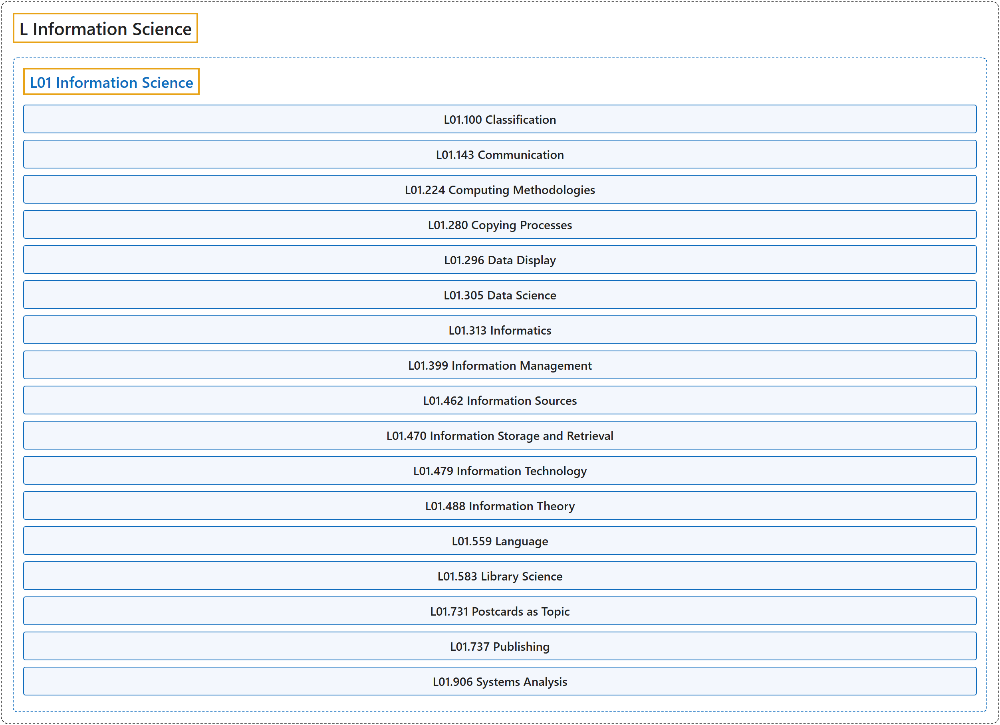

# L Information Science

## Classification

## Glossary

| Term | Definition | 中文翻译 | Source |
|---|---|---|---|
| **L Information Science** 信息科学 | (No definition) | （无定义） | [National Library of Medicine, 2026](https://meshb.nlm.nih.gov/treeView) |
| **[L01 Information Science](l01-information-science.md)** 信息科学 | "The field of knowledge, theory, and technology dealing with the **collection of facts and figures**, and the processes and methods involved in their manipulation, storage, dissemination, publication, and retrieval. It includes the fields of COMMUNICATION; PUBLISHING; LIBRARY SCIENCE; and informatics." | 涉及**事实和数据的收集**，以及对其进行处理、存储、传播、出版和检索的过程与方法的知识、理论和技术领域。包括传播（COMMUNICATION）、出版（PUBLISHING）、图书馆学（LIBRARY SCIENCE）和信息学领域。 | [National Library of Medicine, 2026, "Information Science" scope note](https://meshb.nlm.nih.gov/record/ui?ui=D007254) |

## References

National Library of Medicine. (2026). *MeSH 2026 descriptor records* [Data set]. Retrieved October 28, 2026, from <https://www.nlm.nih.gov/databases/download/mesh.html>
