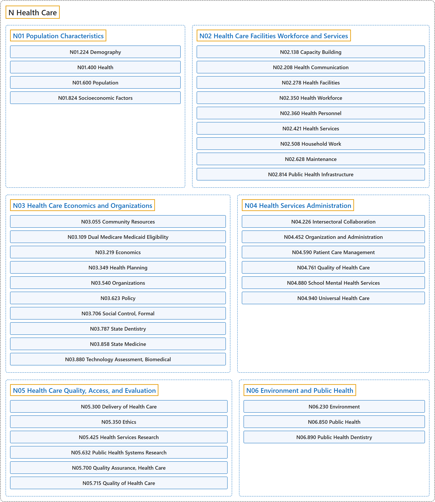

# N Health Care

## Classification

## Glossary

| Term | Definition | 中文翻译 | Source |
|---|---|---|---|
| **N Health Care** 卫生保健 | (No definition) | （无定义） | [National Library of Medicine, 2026](https://meshb.nlm.nih.gov/treeView) |
| **[N01 Population Characteristics](n01-population-characteristics.md)** 人群特征 | "**Qualities and characterization of various types of populations** within a social or geographic group, with emphasis on demography, health status, and socioeconomic factors." | 社会或地理群体中**各类人群的特质和特征描述**，重点在人口统计、健康状况和社会经济因素。 | [National Library of Medicine, 2026, "Population Characteristics" scope note](https://meshb.nlm.nih.gov/record/ui?ui=D011154) |
| **[N02 Health Care Facilities Workforce and Services](n02-health-care-facilities-workforce-and-services.md)** 卫生保健设施、人力和服务 | "The **services provided in the delivery of health care**, associated facilities in health care, and attendant manpower required or available." | **提供卫生保健所提供的服务**、卫生保健中的相关设施，以及所需或可用的配套人力。 | [National Library of Medicine, 2026, "Health Care Facilities Workforce and Services" scope note](https://meshb.nlm.nih.gov/record/ui?ui=D005159) |
| **[N03 Health Care Economics and Organizations](n03-health-care-economics-and-organizations.md)** 卫生保健经济和组织 | "The **economic aspects of health care**, its planning, and delivery. It includes government agencies and organizations in the private sector." | **卫生保健的经济方面**，及其规划和提供。包括政府机构和私营部门组织。 | [National Library of Medicine, 2026, "Health Care Economics and Organizations" scope note](https://meshb.nlm.nih.gov/record/ui?ui=D004472) |
| **[N04 Health Services Administration](n04-health-services-administration.md)** 卫生服务管理 | "The **organization and administration of health services** dedicated to the delivery of health care." | 致力于提供卫生保健的**卫生服务的组织和管理**。 | [National Library of Medicine, 2026, "Health Services Administration" scope note](https://meshb.nlm.nih.gov/record/ui?ui=D006298) |
| **[N05 Health Care Quality, Access, and Evaluation](n05-health-care-quality-access-and-evaluation.md)** 卫生保健质量、可及性和评价 | "The concept concerned with all aspects of the **quality, accessibility, and appraisal of health care** and health care delivery." | 涉及**卫生保健**及其提供的**质量、可及性和评价**各个方面的概念。 | [National Library of Medicine, 2026, "Health Care Quality, Access, and Evaluation" scope note](https://meshb.nlm.nih.gov/record/ui?ui=D017530) |
| **[N06 Environment and Public Health](n06-environment-and-public-health.md)** 环境和公共卫生 | "Natural and man-made environments and their **impact on public health**." | 自然环境和人造环境及其**对公共卫生的影响**。 | [National Library of Medicine, 2026, "Environment and Public Health" scope note](https://meshb.nlm.nih.gov/record/ui?ui=D004778) |

## References

National Library of Medicine. (2026). *MeSH 2026 descriptor records* [Data set]. Retrieved October 28, 2026, from <https://www.nlm.nih.gov/databases/download/mesh.html>
