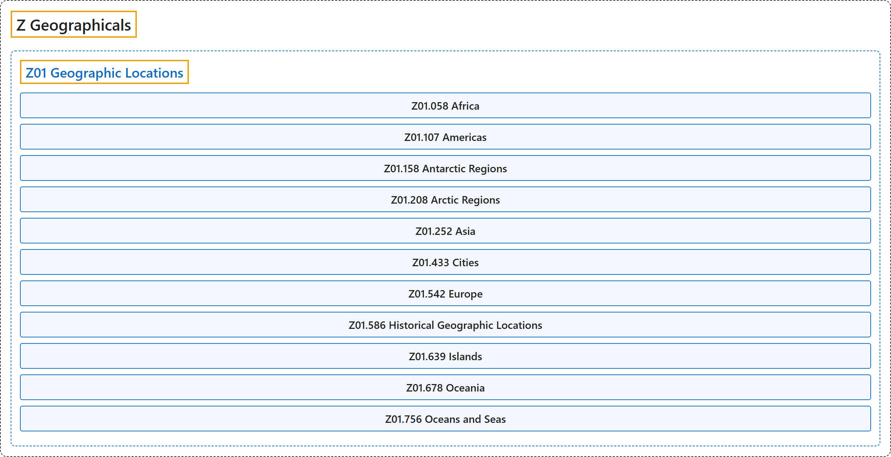

# Z Geographicals

## Classification

## Glossary

| Term | Definition | 中文翻译 | Source |
|---|---|---|---|
| **Z Geographicals** 地理区域 | (No definition) | （无定义） | [National Library of Medicine, 2026](https://meshb.nlm.nih.gov/treeView) |
| **[Z01 Geographic Locations](z01-geographic-locations.md)** 地理位置 | "The **continents and countries** situated on those continents; the UNITED STATES and each of the constituent states arranged by region; CANADA and each of its provinces; AUSTRALIA and each of its states; the major bodies of water and major islands on both hemispheres; and selected major cities." | **各大洲及其上的国家**；按地区排列的美国（UNITED STATES）及其各州；加拿大（CANADA）及其各省；澳大利亚（AUSTRALIA）及其各州；两个半球的主要水域和主要岛屿；以及选定的主要城市。 | [National Library of Medicine, 2026, "Geographic Locations" scope note](https://meshb.nlm.nih.gov/record/ui?ui=D005842) |

## References

National Library of Medicine. (2026). *MeSH 2026 descriptor records* [Data set]. Retrieved October 28, 2026, from <https://www.nlm.nih.gov/databases/download/mesh.html>
