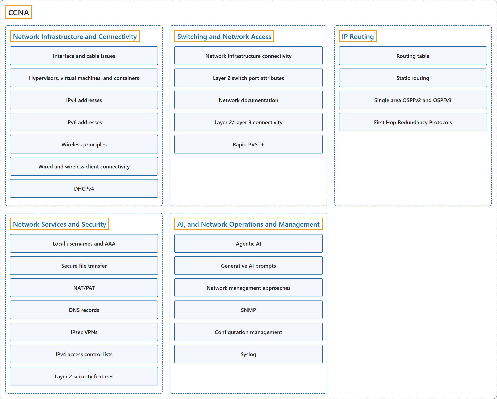

# CCNA

## Classification

## Glossary

| Term | Definition | 中文翻译 | Source |
|---|---|---|---|
| **CCNA** CCNA | "CCNA validates a **broad range of fundamentals for all IT careers** - from **networking technologies, to security, to software development** - proving you have the skills businesses need to meet market demands." | CCNA 验证**适用于所有 IT 职业的广泛基础知识**，从**网络技术到安全，再到软件开发**，证明你具备企业满足市场需求所需的技能。 | [Cisco, n.d.-b, "Validate essential skills in enterprise networking" section, para. 1](https://www.cisco.com/site/us/en/learn/training-certifications/certifications/enterprise/ccna/index.html#:~:text=CCNA%20validates%20a%20broad%20range%20of%20fundamentals) |
| **[Network Infrastructure and Connectivity](network-infrastructure-and-connectivity/index.md)** 网络基础设施与连接 | (context) "Network infrastructure refers to the **hardware and software** that enable **network connectivity and communication** between users, devices, apps, the internet, and more." | （语境）网络基础设施是指**硬件和软件**，它们实现用户、设备、应用、互联网等之间的**网络连接和通信**。 | [Cisco, n.d.-e, para. 1](https://www.cisco.com/site/us/en/learn/topics/networking/what-is-network-infrastructure.html#:~:text=Network%20infrastructure%20refers%20to%20the%20hardware) |
| **[Interface and cable issues](network-infrastructure-and-connectivity/interface-and-cable-issues.md)** 接口和线缆问题 | (context) "**Diagnose interface and cable** (copper and fiber) issues such as **collisions, errors, mismatched duplex, speed, distance, interface, signal levels, pin out, and cable types**" | （语境）**诊断接口和线缆**（铜缆和光纤）问题，例如**冲突、错误、双工不匹配、速率、距离、接口、信号电平、引脚排列和线缆类型**。 | [Cisco, n.d.-a, "1.0 Network Infrastructure and Connectivity" section, 1.1](https://learningnetwork.cisco.com/s/ccna-v2-exam-topics) |
| **[Hypervisors, virtual machines, and containers](network-infrastructure-and-connectivity/hypervisors-virtual-machines-and-containers.md)** 虚拟机管理程序、虚拟机和容器 | (context) "Describe the role and function of **hypervisors, virtual machines, and containers**" | （语境）描述 **hypervisor、虚拟机和容器**的作用和功能。 | [Cisco, n.d.-a, "1.0 Network Infrastructure and Connectivity" section, 1.2](https://learningnetwork.cisco.com/s/ccna-v2-exam-topics) |
| **[IPv4 addresses](network-infrastructure-and-connectivity/ipv4-addresses.md)** IPv4 地址 | (context) "Troubleshoot **IPv4 address configuration, assignment, and subnetting** (public and private)" | （语境）排查 **IPv4 地址的配置、分配和子网划分**（公有和私有）问题。 | [Cisco, n.d.-a, "1.0 Network Infrastructure and Connectivity" section, 1.3](https://learningnetwork.cisco.com/s/ccna-v2-exam-topics) |
| **[IPv6 addresses](network-infrastructure-and-connectivity/ipv6-addresses.md)** IPv6 地址 | (context) "Troubleshoot **IPv6 address configuration, assignment, and prefix sizing** (unicast and modified EUI 64)" | （语境）排查 **IPv6 地址的配置、分配和前缀长度**（单播和修改的 EUI 64）问题。 | [Cisco, n.d.-a, "1.0 Network Infrastructure and Connectivity" section, 1.4](https://learningnetwork.cisco.com/s/ccna-v2-exam-topics) |
| **[Wireless principles](network-infrastructure-and-connectivity/wireless-principles.md)** 无线原理 | (context) "Describe **wireless principles**" | （语境）描述**无线原理**。 | [Cisco, n.d.-a, "1.0 Network Infrastructure and Connectivity" section, 1.5](https://learningnetwork.cisco.com/s/ccna-v2-exam-topics) |
| **[Wired and wireless client connectivity](network-infrastructure-and-connectivity/wired-and-wireless-client-connectivity.md)** 有线和无线客户端连接 | (context) "Troubleshoot **wired and wireless client connectivity** (IP configuration, network reachability, and wireless security parameters on **Windows, MacOS, and Linux**)" | （语境）排查**有线和无线客户端连接**问题（在 **Windows、MacOS 和 Linux** 上的 IP 配置、网络可达性和无线安全参数）。 | [Cisco, n.d.-a, "1.0 Network Infrastructure and Connectivity" section, 1.6](https://learningnetwork.cisco.com/s/ccna-v2-exam-topics) |
| **[DHCPv4](network-infrastructure-and-connectivity/dhcpv4.md)** DHCPv4 | (context) "Troubleshoot **DHCPv4 client, server, and relay** on **IOS devices**" | （语境）排查 **DHCPv4 客户端、服务器和中继**问题，范围是 **IOS 设备**。 | [Cisco, n.d.-a, "1.0 Network Infrastructure and Connectivity" section, 1.7](https://learningnetwork.cisco.com/s/ccna-v2-exam-topics) |
| **[Switching and Network Access](switching-and-network-access/index.md)** 交换与网络接入 | (context) "A network switch is a vital component of a computer network that **connects multiple devices**, like computers, printers, and servers, **within a local area network** (LAN)." | （语境）网络交换机是计算机网络的重要组成部分，它**连接多台设备**（例如计算机、打印机和服务器），范围是**局域网之内**（LAN）。 | [Cisco, n.d.-d, "What is a network switch?" section, para. 1](https://www.cisco.com/site/us/en/learn/topics/small-business/what-are-the-different-types-of-network-switches.html#:~:text=A%20network%20switch%20is%20a%20vital%20component) |
| **[Network infrastructure connectivity](switching-and-network-access/network-infrastructure-connectivity.md)** 网络基础设施连接 | (context) "Configure **network infrastructure connectivity** (**switch-to-switch and switch-to-router**)" | （语境）配置**网络基础设施连接**（**交换机到交换机、交换机到路由器**）。 | [Cisco, n.d.-a, "2.0 Switching and Network Access" section, 2.1](https://learningnetwork.cisco.com/s/ccna-v2-exam-topics) |
| **[Layer 2 switch port attributes](switching-and-network-access/layer-2-switch-port-attributes.md)** 二层交换机端口属性 | (context) "Configure **Layer 2 switch port attributes** for **edge-host connectivity** (VLAN, PoE, port channel, and LACP)" | （语境）配置**二层交换机端口属性**，用于**边缘主机连接**（VLAN、PoE、端口通道和 LACP）。 | [Cisco, n.d.-a, "2.0 Switching and Network Access" section, 2.2](https://learningnetwork.cisco.com/s/ccna-v2-exam-topics) |
| **[Network documentation](switching-and-network-access/network-documentation.md)** 网络文档 | (context) "**Validate the accuracy of network documentation** using **CDP and LLDP**" | （语境）**验证网络文档的准确性**，使用 **CDP 和 LLDP**。 | [Cisco, n.d.-a, "2.0 Switching and Network Access" section, 2.3](https://learningnetwork.cisco.com/s/ccna-v2-exam-topics) |
| **[Layer 2/Layer 3 connectivity](switching-and-network-access/layer-2-layer-3-connectivity.md)** 二层/三层连接 | (context) "Troubleshoot **basic Layer 2/Layer 3 connectivity and device operations** using show commands (including show logs), **ping, extended ping, trace route, and packet capture output**" | （语境）排查**基本的二层/三层连接和设备运行**问题，使用 show 命令（包括 show logs）、**ping、扩展 ping、trace route 和抓包输出**。 | [Cisco, n.d.-a, "2.0 Switching and Network Access" section, 2.4](https://learningnetwork.cisco.com/s/ccna-v2-exam-topics) |
| **[Rapid PVST+](switching-and-network-access/rapid-pvst.md)** Rapid PVST+ | (context) "Configure **operations of the Rapid Per VLAN Spanning Tree Protocol** (Rapid PVST+)" | （语境）配置**快速每 VLAN 生成树协议的运行**（Rapid PVST+）。 | [Cisco, n.d.-a, "2.0 Switching and Network Access" section, 2.5](https://learningnetwork.cisco.com/s/ccna-v2-exam-topics) |
| **[IP Routing](ip-routing/index.md)** IP 路由 | "Routing is the process of **selecting and defining paths for IP-packet traffic** within or between networks as well as the process of **managing network traffic overall**." | 路由是**为 IP 数据包流量选择和定义路径**的过程（在网络内或网络之间），也是**整体管理网络流量**的过程。 | [Cisco, n.d.-h, para. 1](https://www.cisco.com/site/us/en/learn/topics/networking/what-is-routing.html#:~:text=Routing%20is%20the%20process%20of%20selecting) |
| **[Routing table](ip-routing/routing-table.md)** 路由表 | (context) "**Interpret a routing table** to **identify the next hop for a packet** (routing protocol, prefix/mask, administrative distance, metric, and default route)" | （语境）**解读路由表**，以**确定数据包的下一跳**（路由协议、前缀/掩码、管理距离、度量值和默认路由）。 | [Cisco, n.d.-a, "3.0 IP Routing" section, 3.1](https://learningnetwork.cisco.com/s/ccna-v2-exam-topics) |
| **[Static routing](ip-routing/static-routing.md)** 静态路由 | (context) "Troubleshoot **IPv4 and IPv6 static routing**" | （语境）排查 **IPv4 和 IPv6 静态路由**问题。 | [Cisco, n.d.-a, "3.0 IP Routing" section, 3.2](https://learningnetwork.cisco.com/s/ccna-v2-exam-topics) |
| **[Single area OSPFv2 and OSPFv3](ip-routing/single-area-ospfv2-and-ospfv3.md)** 单区域 OSPFv2 和 OSPFv3 | (context) "Configure **single area OSPFv2 for IPv4** and **OSPFv3 for IPv6**" | （语境）配置**用于 IPv4 的单区域 OSPFv2** 和**用于 IPv6 的 OSPFv3**。 | [Cisco, n.d.-a, "3.0 IP Routing" section, 3.3](https://learningnetwork.cisco.com/s/ccna-v2-exam-topics) |
| **[First Hop Redundancy Protocols](ip-routing/first-hop-redundancy-protocols.md)** 第一跳冗余协议 | (context) "**Interpret the operational status** of **First Hop Redundancy Protocols** (HSRP and VRRP)" | （语境）**解读运行状态**，对象是**第一跳冗余协议**（HSRP 和 VRRP）。 | [Cisco, n.d.-a, "3.0 IP Routing" section, 3.4](https://learningnetwork.cisco.com/s/ccna-v2-exam-topics) |
| **[Network Services and Security](network-services-and-security/index.md)** 网络服务与安全 | (context) "Network services are **applications at the network application layer** that connect users working in offices, branches, or remote locations to applications and data in a network." "Network security **combines policies and technologies** to protect systems and digital assets from unauthorized access, misuse, and disruption." | （语境）网络服务是**网络应用层上的应用**，把在办公室、分支机构或远程位置工作的用户连接到网络中的应用和数据。 网络安全**结合策略和技术**，保护系统和数字资产免遭未授权访问、滥用和中断。 | [Cisco, n.d.-c, para. 1](https://www.cisco.com/site/us/en/learn/topics/networking/what-are-network-services.html#:~:text=Network%20services%20are%20applications) [Cisco, n.d.-g, para. 1](https://www.cisco.com/site/us/en/learn/topics/security/what-is-network-security.html#:~:text=Network%20security%20combines%20policies) |
| **[Local usernames and AAA](network-services-and-security/local-usernames-and-aaa.md)** 本地用户名和 AAA | (context) "Configure network devices with **local usernames** and as an **AAA client** (TACACS+ and RADIUS) for management" | （语境）为网络设备配置**本地用户名**，并将其配置为 **AAA 客户端**（TACACS+ 和 RADIUS），用于管理。 | [Cisco, n.d.-a, "4.0 Network Services and Security" section, 4.1](https://learningnetwork.cisco.com/s/ccna-v2-exam-topics) |
| **[Secure file transfer](network-services-and-security/secure-file-transfer.md)** 安全文件传输 | (context) "Manage **device configuration and software files** using **secure file transfer operations with SFTP/SCP**" | （语境）管理**设备配置和软件文件**，使用**基于 SFTP/SCP 的安全文件传输操作**。 | [Cisco, n.d.-a, "4.0 Network Services and Security" section, 4.2](https://learningnetwork.cisco.com/s/ccna-v2-exam-topics) |
| **[NAT/PAT](network-services-and-security/nat-and-pat.md)** NAT/PAT | (context) "Configure **NAT/PAT** on **IOS XE routers**" | （语境）配置 **NAT/PAT**，范围是 **IOS XE 路由器**。 | [Cisco, n.d.-a, "4.0 Network Services and Security" section, 4.3](https://learningnetwork.cisco.com/s/ccna-v2-exam-topics) |
| **[DNS records](network-services-and-security/dns-records.md)** DNS 记录 | (context) "**Diagnose issues with DNS records** (A, AAAA, CNAME, MX, NS, and PTR) to support **host, web application, and mail server access by name**" | （语境）**诊断 DNS 记录的问题**（A、AAAA、CNAME、MX、NS 和 PTR），以支持**按名称访问主机、Web 应用和邮件服务器**。 | [Cisco, n.d.-a, "4.0 Network Services and Security" section, 4.4](https://learningnetwork.cisco.com/s/ccna-v2-exam-topics) |
| **[IPsec VPNs](network-services-and-security/ipsec-vpns.md)** IPsec VPN | (context) "Describe **IPsec remote access and site-to-site VPNs** (protocols and transport modes)" | （语境）描述 **IPsec 远程访问 VPN 和站点到站点 VPN**（协议和传输模式）。 | [Cisco, n.d.-a, "4.0 Network Services and Security" section, 4.5](https://learningnetwork.cisco.com/s/ccna-v2-exam-topics) |
| **[IPv4 access control lists](network-services-and-security/ipv4-access-control-lists.md)** IPv4 访问控制列表 | (context) "Configure **IPv4 access control lists** (standard, extended, numbered, and named ACLs)" | （语境）配置 **IPv4 访问控制列表**（标准、扩展、编号和命名 ACL）。 | [Cisco, n.d.-a, "4.0 Network Services and Security" section, 4.6](https://learningnetwork.cisco.com/s/ccna-v2-exam-topics) |
| **[Layer 2 security features](network-services-and-security/layer-2-security-features.md)** 二层安全功能 | (context) "Configure **Layer 2 security features**" | （语境）配置**二层安全功能**。 | [Cisco, n.d.-a, "4.0 Network Services and Security" section, 4.7](https://learningnetwork.cisco.com/s/ccna-v2-exam-topics) |
| **[AI, and Network Operations and Management](ai-and-network-operations-and-management/index.md)** AI 与网络运维和管理 | (context) "Network management encompasses both the **essential processes and the specialized platforms** used by IT and NetOps teams to **configure, monitor, and optimize network performance**." | （语境）网络管理涵盖**基本流程和专用平台**，IT 和 NetOps 团队用它们来**配置、监控和优化网络性能**。 | [Cisco, n.d.-f, para. 1](https://www.cisco.com/site/us/en/learn/topics/networking/what-is-network-management.html#:~:text=Network%20management%20encompasses%20both) |
| **[Agentic AI](ai-and-network-operations-and-management/agentic-ai.md)** 智能体 AI | (context) "Describe the **role of agentic AI** in **network operations**" | （语境）描述**智能体 AI** 在**网络运维**中的作用。 | [Cisco, n.d.-a, "5.0 AI, and Network Operations and Management" section, 5.1](https://learningnetwork.cisco.com/s/ccna-v2-exam-topics) |
| **[Generative AI prompts](ai-and-network-operations-and-management/generative-ai-prompts.md)** 生成式 AI 提示词 | (context) "**Select a prompt** to send to a generative AI system to **support network operations** considering prompt components such as data classification, output format, persona, and instructions" | （语境）**选择提示词**发送给生成式 AI 系统，以**支持网络运维**，并考虑数据分类、输出格式、角色设定和指令等提示词组成部分。 | [Cisco, n.d.-a, "5.0 AI, and Network Operations and Management" section, 5.2](https://learningnetwork.cisco.com/s/ccna-v2-exam-topics) |
| **[Network management approaches](ai-and-network-operations-and-management/network-management-approaches.md)** 网络管理方法 | (context) "Describe **network management approaches** (**device-based, cloud-based, controller-based, automation-based, and infrastructure as code**)" | （语境）描述**网络管理方法**（**基于设备、基于云、基于控制器、基于自动化，以及基础设施即代码**）。 | [Cisco, n.d.-a, "5.0 AI, and Network Operations and Management" section, 5.3](https://learningnetwork.cisco.com/s/ccna-v2-exam-topics) |
| **[SNMP](ai-and-network-operations-and-management/snmp.md)** SNMP | (context) "Describe the **function of SNMP** in **network operations**" | （语境）描述 **SNMP 的功能**在**网络运维**中的体现。 | [Cisco, n.d.-a, "5.0 AI, and Network Operations and Management" section, 5.4](https://learningnetwork.cisco.com/s/ccna-v2-exam-topics) |
| **[Configuration management](ai-and-network-operations-and-management/configuration-management.md)** 配置管理 | (context) "Use **configuration management mechanisms** such as **Ansible** to execute commands" | （语境）使用**配置管理机制**（例如 **Ansible**）执行命令。 | [Cisco, n.d.-a, "5.0 AI, and Network Operations and Management" section, 5.5](https://learningnetwork.cisco.com/s/ccna-v2-exam-topics) |
| **[Syslog](ai-and-network-operations-and-management/syslog.md)** Syslog | (context) "**Interpret syslog message content**, **severity levels, and facilities**" | （语境）**解读 syslog 消息内容**、**严重级别和设施**。 | [Cisco, n.d.-a, "5.0 AI, and Network Operations and Management" section, 5.6](https://learningnetwork.cisco.com/s/ccna-v2-exam-topics) |

## Coverage

| Certification | Skill area |
|---|---|
| 200-301 CCNA v2.0 | [1. Network Infrastructure and Connectivity (25%)](https://learningnetwork.cisco.com/s/ccna-v2-exam-topics) [2. Switching and Network Access (25%)](https://learningnetwork.cisco.com/s/ccna-v2-exam-topics) [3. IP Routing (20%)](https://learningnetwork.cisco.com/s/ccna-v2-exam-topics) [4. Network Services and Security (20%)](https://learningnetwork.cisco.com/s/ccna-v2-exam-topics) [5. AI, and Network Operations and Management (10%)](https://learningnetwork.cisco.com/s/ccna-v2-exam-topics) |

## References

- Cisco. (n.d.-a). *200-301 CCNA exam topics and study guide* (Version 2.0). Cisco Learning Network. Retrieved October 25, 2026, from <https://learningnetwork.cisco.com/s/ccna-v2-exam-topics>
- Cisco. (n.d.-b). *CCNA*. Retrieved October 24, 2026, from <https://www.cisco.com/site/us/en/learn/training-certifications/certifications/enterprise/ccna/index.html>
- Cisco. (n.d.-c). *What are network services?* Retrieved October 27, 2026, from <https://www.cisco.com/site/us/en/learn/topics/networking/what-are-network-services.html>
- Cisco. (n.d.-d). *What are the different types of network switches?* Retrieved October 27, 2026, from <https://www.cisco.com/site/us/en/learn/topics/small-business/what-are-the-different-types-of-network-switches.html>
- Cisco. (n.d.-e). *What is network infrastructure?* Retrieved October 27, 2026, from <https://www.cisco.com/site/us/en/learn/topics/networking/what-is-network-infrastructure.html>
- Cisco. (n.d.-f). *What is network management?* Retrieved October 27, 2026, from <https://www.cisco.com/site/us/en/learn/topics/networking/what-is-network-management.html>
- Cisco. (n.d.-g). *What is network security?* Retrieved October 27, 2026, from <https://www.cisco.com/site/us/en/learn/topics/security/what-is-network-security.html>
- Cisco. (n.d.-h). *What is routing?* Retrieved October 27, 2026, from <https://www.cisco.com/site/us/en/learn/topics/networking/what-is-routing.html>
