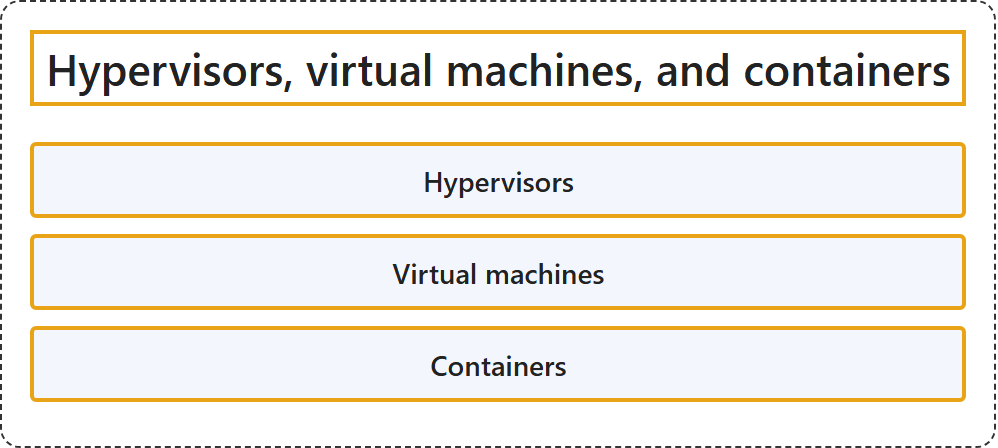

# 1.2 Hypervisors, Virtual Machines, and Containers

Exam objective: Describe the role and function of hypervisors, virtual machines, and containers.

## Classification

## Glossary

| Term | Definition | 中文翻译 | Source |
|---|---|---|---|
| **Hypervisors** 虚拟机管理程序 | "A hypervisor **provides management for virtualized services**. It **enables connections between virtual services and external interfaces**." | hypervisor **为虚拟化服务提供管理**。它**让虚拟服务能够连接外部接口**。 | [Cisco, n.d.-d, "Virtualization software" section, para. 1](https://www.cisco.com/site/us/en/learn/topics/networking/what-is-virtualization.html#:~:text=A%20hypervisor%20provides%20management) |
| **Virtual machines** 虚拟机 | "A virtual machine (VM) is a **software-defined, hypervisor-managed, portable computing environment** that **resides on and uses the resources of a host computer**." | 虚拟机（VM）是一种**软件定义、由 hypervisor 管理、可移植的计算环境**，它**驻留在主机上并使用主机的资源**。 | [Cisco, n.d.-c, para. 1](https://www.cisco.com/site/us/en/learn/topics/computing/what-is-a-virtual-machine.html#:~:text=is%20a%20software%2Ddefined%2C%20hypervisor%2Dmanaged) |
| **Containers** 容器 | "A container is a **unit of lightweight, executable software** that **packages application code and its dependencies** in a standardized way." | 容器是一种**轻量的可执行软件单元**，以标准化的方式**打包应用代码及其依赖**。 | [Cisco, n.d.-b, para. 1](https://www.cisco.com/site/us/en/learn/topics/computing/what-are-containers.html#:~:text=A%20container%20is%20a%20unit%20of%20lightweight) |

## References

- Cisco. (n.d.-a). *200-301 CCNA exam topics and study guide* (Version 2.0). Cisco Learning Network. Retrieved October 25, 2026, from <https://learningnetwork.cisco.com/s/ccna-v2-exam-topics>
- Cisco. (n.d.-b). *What are containers?* Retrieved October 27, 2026, from <https://www.cisco.com/site/us/en/learn/topics/computing/what-are-containers.html>
- Cisco. (n.d.-c). *What is a virtual machine?* Retrieved October 27, 2026, from <https://www.cisco.com/site/us/en/learn/topics/computing/what-is-a-virtual-machine.html>
- Cisco. (n.d.-d). *What is virtualization?* Retrieved October 27, 2026, from <https://www.cisco.com/site/us/en/learn/topics/networking/what-is-virtualization.html>
