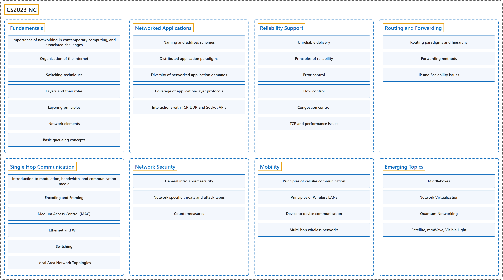

# CS2023 NC

## Classification

## Glossary

| Term | Definition | 中文翻译 | Source |
|---|---|---|---|
| **CS2023 NC** CS2023 NC | "This knowledge area deals with **key concepts in networking and communication**, as well as their **representative instantiations in the internet and other computer networks**." | 本知识领域讨论**网络与通信中的关键概念**，以及它们**在互联网和其他计算机网络中的典型实现**。 | [Joint Task Force on Computing Curricula, 2024, NC "Preamble" section, para. 2](https://csed.acm.org/wp-content/uploads/2024/04/3.1-Body-of-Knowledge-1.pdf#page=135) |
| **[Fundamentals](fundamentals/index.md)** 基础 | (context) "Articulate the **organization of the internet**." | （语境）清楚说明**互联网的组织结构**。 | [Joint Task Force on Computing Curricula, 2024, NC-Fundamentals "Illustrative Learning Outcomes", 1](https://csed.acm.org/wp-content/uploads/2024/04/3.1-Body-of-Knowledge-1.pdf#page=136) |
| **[Networked Applications](networked-applications/index.md)** 网络应用 | (context) "Define the **principles of naming, addressing, resource location**." | （语境）定义**命名、寻址和资源定位的原理**。 | [Joint Task Force on Computing Curricula, 2024, NC-Applications "Illustrative Learning Outcomes", 1](https://csed.acm.org/wp-content/uploads/2024/04/3.1-Body-of-Knowledge-1.pdf#page=137) |
| **[Reliability Support](reliability-support/index.md)** 可靠性支持 | (context) "Describe the **operation of reliable delivery protocols**." | （语境）描述**可靠传输协议的运作方式**。 | [Joint Task Force on Computing Curricula, 2024, NC-Reliability "Illustrative Learning Outcomes", 1](https://csed.acm.org/wp-content/uploads/2024/04/3.1-Body-of-Knowledge-1.pdf#page=137) |
| **[Routing and Forwarding](routing-and-forwarding/index.md)** 路由与转发 | (context) "Describe various **routing paradigms and hierarchies**." | （语境）描述各种**路由范式和层次结构**。 | [Joint Task Force on Computing Curricula, 2024, NC-Routing "Illustrative Learning Outcomes", 1](https://csed.acm.org/wp-content/uploads/2024/04/3.1-Body-of-Knowledge-1.pdf#page=138) |
| **[Single Hop Communication](single-hop-communication/index.md)** 单跳通信 | (context) "Describe some basic aspects of **modulation, bandwidth, and communication media**." | （语境）描述**调制、带宽和通信介质**的一些基本方面。 | [Joint Task Force on Computing Curricula, 2024, NC-SingleHop "Illustrative Learning Outcomes", 1](https://csed.acm.org/wp-content/uploads/2024/04/3.1-Body-of-Knowledge-1.pdf#page=138) |
| **[Network Security](network-security/index.md)** 网络安全 | (context) "Describe some of the **threat models of network security**." | （语境）描述**网络安全的一些威胁模型**。 | [Joint Task Force on Computing Curricula, 2024, NC-Security "Illustrative Learning Outcomes", 1](https://csed.acm.org/wp-content/uploads/2024/04/3.1-Body-of-Knowledge-1.pdf#page=138) |
| **[Mobility](mobility/index.md)** 移动性 | (context) "Describe some aspects of **cellular communication** such as registration" | （语境）描述**蜂窝通信**的某些方面，例如注册 | [Joint Task Force on Computing Curricula, 2024, NC-Mobility "Illustrative Learning Outcomes", 1](https://csed.acm.org/wp-content/uploads/2024/04/3.1-Body-of-Knowledge-1.pdf#page=139) |
| **[Emerging Topics](emerging-topics/index.md)** 新兴主题 | (context) "Describe the value of **advances in middleboxes** in networks." | （语境）描述网络中**中间盒的进展**所带来的价值。 | [Joint Task Force on Computing Curricula, 2024, NC-Emerging "Illustrative Learning Outcomes", 1](https://csed.acm.org/wp-content/uploads/2024/04/3.1-Body-of-Knowledge-1.pdf#page=139) |

## References

Joint Task Force on Computing Curricula. (2024). *Computer science curricula 2023*. Association for Computing Machinery. <https://doi.org/10.1145/3664191>
