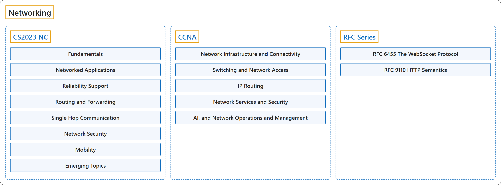

# Networking

## Classification

## Glossary

| Term | Definition | 中文翻译 | Source |
|---|---|---|---|
| **Networking** 网络 | "Networking and communication play a **central role** in **interconnected computer systems** that are **transforming the daily lives** of billions of people." | 网络与通信发挥着**核心作用**，体现在**互联的计算机系统**中，这些系统正在**改变数十亿人的日常生活**。 | [Joint Task Force on Computing Curricula, 2024, NC "Preamble" section, para. 1](https://csed.acm.org/wp-content/uploads/2024/04/3.1-Body-of-Knowledge-1.pdf#page=135) |
| **[CS2023 NC](cs2023/index.md)** CS2023 NC | "This knowledge area deals with **key concepts in networking and communication**, as well as their **representative instantiations** in the **internet and other computer networks**." | 这个知识领域涉及**网络与通信的关键概念**，以及它们的**代表性实现**，即在**互联网和其他计算机网络**中的实现。 | [Joint Task Force on Computing Curricula, 2024, NC "Preamble" section, para. 2](https://csed.acm.org/wp-content/uploads/2024/04/3.1-Body-of-Knowledge-1.pdf#page=135) |
| **[CCNA](ccna/index.md)** CCNA | "CCNA **validates a broad range of fundamentals** for **all IT careers** - from networking technologies, to security, to software development - proving you have the **skills businesses need** to meet market demands." | CCNA **验证广泛的基础知识**，适用于**所有 IT 职业**，从网络技术、安全到软件开发，证明你具备**企业所需的技能**，能满足市场需求。 | [Cisco, n.d.-b, "CCNA" page, para. 2](https://www.cisco.com/site/us/en/learn/training-certifications/certifications/enterprise/ccna/index.html#:~:text=CCNA%20validates%20a%20broad%20range%20of%20fundamentals) |
| **[RFC Series](rfc-series/index.md)** RFC 系列 | "RFCs outline **computer networking and Internet foundations**, including **Internet Standards** and **historical or informative content**." | RFC 阐述**计算机网络和互联网的基础**，包括**互联网标准**以及**历史性或参考性内容**。 | [RFC Editor, n.d., home page, para. 1](https://www.rfc-editor.org/#:~:text=RFCs%20outline%20computer%20networking%20and%20Internet%20foundations) |

## References

Cisco. (n.d.-a). *200-301 CCNA exam topics and study guide* (Version 2.0). Cisco Learning Network. Retrieved October 25, 2026, from <https://learningnetwork.cisco.com/s/ccna-v2-exam-topics>

Cisco. (n.d.-b). *CCNA*. Retrieved October 24, 2026, from <https://www.cisco.com/site/us/en/learn/training-certifications/certifications/enterprise/ccna/index.html>

Fette, I., & Melnikov, A. (2011). *The WebSocket protocol* (RFC 6455). RFC Editor. <https://doi.org/10.17487/RFC6455>

Fielding, R., Nottingham, M., & Reschke, J. (Eds.). (2022). *HTTP semantics* (RFC 9110). RFC Editor. <https://doi.org/10.17487/RFC9110>

Joint Task Force on Computing Curricula. (2024). *Computer science curricula 2023*. Association for Computing Machinery. <https://doi.org/10.1145/3664191>

RFC Editor. (n.d.). *The RFC Series*. Retrieved October 25, 2026, from <https://www.rfc-editor.org/>
