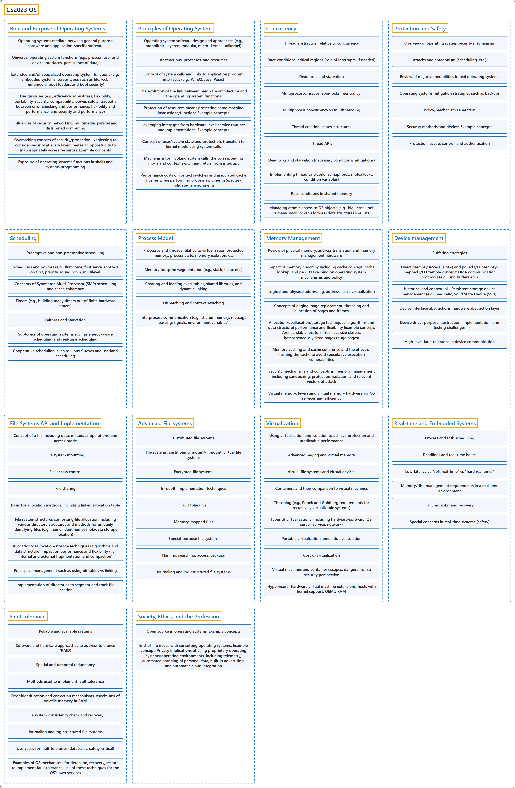

# CS2023 OS

## Classification

## Glossary

| Term | Definition | 中文翻译 | Source |
|---|---|---|---|
| **CS2023 OS** CS2023 OS | "Core topics focus on the **mechanisms and policies** needed to **virtualize computation, memory, and Input/Output (I/O)**." | 核心主题侧重于**机制与策略**，用以**虚拟化计算、内存和输入/输出（I/O）**。 | [Joint Task Force on Computing Curricula, 2024, OS "Preamble" section, para. 1](https://csed.acm.org/wp-content/uploads/2024/04/3.1-Body-of-Knowledge-1.pdf#page=143) |
| **[Role and Purpose of Operating Systems](role-and-purpose-of-operating-systems/index.md)** 操作系统的作用和目的 | (context) "Understand the **objectives and functions of modern operating systems**." | （语境）理解**现代操作系统的目标和功能**。 | [Joint Task Force on Computing Curricula, 2024, OS-Purpose "Illustrative Learning Outcomes", 1](https://csed.acm.org/wp-content/uploads/2024/04/3.1-Body-of-Knowledge-1.pdf#page=145) |
| **[Principles of Operating System](principles-of-operating-system/index.md)** 操作系统原理 | (context) "Understand how the application of **software design approaches** to operating systems design/implementation (e.g., layered, modular, etc.) affects the **robustness and maintainability** of an operating system." | （语境）理解把**软件设计方法**应用于操作系统设计/实现（例如分层、模块化等）如何影响操作系统的**健壮性和可维护性**。 | [Joint Task Force on Computing Curricula, 2024, OS-Principles "Illustrative Learning Outcomes", 1](https://csed.acm.org/wp-content/uploads/2024/04/3.1-Body-of-Knowledge-1.pdf#page=145) |
| **[Concurrency](concurrency/index.md)** 并发 | (context) "Understand the **advantages and disadvantages of concurrency** as inseparable functions within the operating system framework." | （语境）理解**并发的优点和缺点**，它们是操作系统框架中不可分割的功能。 | [Joint Task Force on Computing Curricula, 2024, OS-Concurrency "Illustrative Learning Outcomes", 1](https://csed.acm.org/wp-content/uploads/2024/04/3.1-Body-of-Knowledge-1.pdf#page=146) |
| **[Protection and Safety](protection-and-safety/index.md)** 保护与安全 | (context) "Understand the requirement for **protection and security mechanisms** in operating systems." | （语境）理解操作系统中对**保护和安全机制**的需求。 | [Joint Task Force on Computing Curricula, 2024, OS-Protection "Illustrative Learning Outcomes", 1](https://csed.acm.org/wp-content/uploads/2024/04/3.1-Body-of-Knowledge-1.pdf#page=147) |
| **[Scheduling](scheduling/index.md)** 调度 | (context) "Compare and contrast the common algorithms used for both **preemptive and non-preemptive scheduling** of tasks in operating systems, such as priority, performance comparison, and fair-share schemes." | （语境）比较操作系统中用于任务**抢占式和非抢占式调度**的常见算法，例如优先级、性能比较和公平共享方案。 | [Joint Task Force on Computing Curricula, 2024, OS-Scheduling "Illustrative Learning Outcomes", 1](https://csed.acm.org/wp-content/uploads/2024/04/3.1-Body-of-Knowledge-1.pdf#page=147) |
| **[Process Model](process-model/index.md)** 进程模型 | (context) "Understand how **processes and threads** use concurrency features to **virtualize control**." | （语境）理解**进程和线程**如何使用并发特性来**虚拟化控制**。 | [Joint Task Force on Computing Curricula, 2024, OS-Process "Illustrative Learning Outcomes", 1](https://csed.acm.org/wp-content/uploads/2024/04/3.1-Body-of-Knowledge-1.pdf#page=148) |
| **[Memory Management](memory-management/index.md)** 内存管理 | (context) "Explain **memory hierarchy** and **cost-performance tradeoffs**." | （语境）解释**存储层次结构**和**成本与性能的权衡**。 | [Joint Task Force on Computing Curricula, 2024, OS-Memory "Illustrative Learning Outcomes", 1](https://csed.acm.org/wp-content/uploads/2024/04/3.1-Body-of-Knowledge-1.pdf#page=149) |
| **[Device management](device-management/index.md)** 设备管理 | (context) "Explain **architecture level device control implementation** and link relevant operating system mechanisms and policy (e.g., buffering strategies, direct memory access)." | （语境）解释**体系结构层面的设备控制实现**，并联系相关的操作系统机制和策略（例如缓冲策略、直接内存访问）。 | [Joint Task Force on Computing Curricula, 2024, OS-Devices "Illustrative Learning Outcomes", 1](https://csed.acm.org/wp-content/uploads/2024/04/3.1-Body-of-Knowledge-1.pdf#page=149) |
| **[File Systems API and Implementation](file-systems-api-and-implementation/index.md)** 文件系统 API 与实现 | (context) "Explain the choices to be made in **designing file systems**." | （语境）解释**设计文件系统**时要做的选择。 | [Joint Task Force on Computing Curricula, 2024, OS-Files "Illustrative Learning Outcomes", 1](https://csed.acm.org/wp-content/uploads/2024/04/3.1-Body-of-Knowledge-1.pdf#page=150) |
| **[Advanced File systems](advanced-file-systems/index.md)** 高级文件系统 | (context) "Explain how **hardware developments** have led to changes in the priorities for the **design and the management of file systems**." | （语境）解释**硬件的发展**如何改变了**文件系统设计和管理**的优先事项。 | [Joint Task Force on Computing Curricula, 2024, OS-Advanced-Files "Illustrative Learning Outcomes", 1](https://csed.acm.org/wp-content/uploads/2024/04/3.1-Body-of-Knowledge-1.pdf#page=151) |
| **[Virtualization](virtualization/index.md)** 虚拟化 | (context) "Explain how **hardware architecture** provides support and efficiencies for **virtualization**." | （语境）解释**硬件体系结构**如何为**虚拟化**提供支持和效率。 | [Joint Task Force on Computing Curricula, 2024, OS-Virtualization "Illustrative Learning Outcomes", 1](https://csed.acm.org/wp-content/uploads/2024/04/3.1-Body-of-Knowledge-1.pdf#page=151) |
| **[Real-time and Embedded Systems](real-time-and-embedded-systems/index.md)** 实时与嵌入式系统 | (context) "Explain what makes a system a **real-time system**." | （语境）解释什么使一个系统成为**实时系统**。 | [Joint Task Force on Computing Curricula, 2024, OS-Real-time "Illustrative Learning Outcomes", 1](https://csed.acm.org/wp-content/uploads/2024/04/3.1-Body-of-Knowledge-1.pdf#page=152) |
| **[Fault tolerance](fault-tolerance/index.md)** 容错 | (context) "Explain how operating systems can facilitate **fault tolerance, reliability, and availability**." | （语境）解释操作系统如何促进**容错、可靠性和可用性**。 | [Joint Task Force on Computing Curricula, 2024, OS-Faults "Illustrative Learning Outcomes", 1](https://csed.acm.org/wp-content/uploads/2024/04/3.1-Body-of-Knowledge-1.pdf#page=152) |
| **[Society, Ethics, and the Profession](society-ethics-and-the-profession/index.md)** 社会、伦理与职业 | (context) "Explain advantages and disadvantages of **finding and addressing bugs in open-source kernels**." | （语境）解释**在开源内核中发现并修复缺陷**的优点和缺点。 | [Joint Task Force on Computing Curricula, 2024, OS-SEP "Illustrative Learning Outcomes", 1](https://csed.acm.org/wp-content/uploads/2024/04/3.1-Body-of-Knowledge-1.pdf#page=153) |

## References

Joint Task Force on Computing Curricula. (2024). *Computer science curricula 2023*. Association for Computing Machinery. <https://doi.org/10.1145/3664191>
