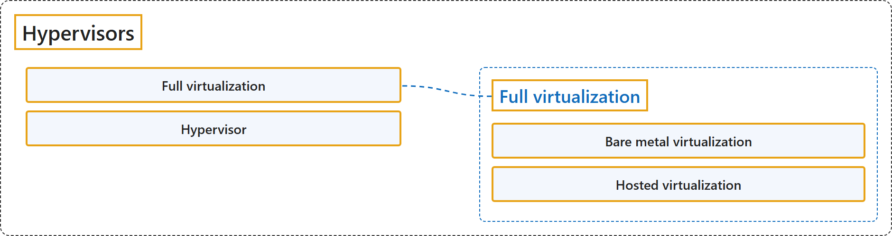

# 11.10 Hypervisors- Hardware Virtual Machine Extensions, Hosts with Kernel Support, QEMU KVM

Sources: [CS2023 Body of Knowledge, OS-Virtualization, topic 10, p. 151](https://csed.acm.org/wp-content/uploads/2024/04/3.1-Body-of-Knowledge-1.pdf#page=151); [NIST SP 800-125, Guide to Security for Full Virtualization Technologies](https://doi.org/10.6028/NIST.SP.800-125).

## Classification

## Glossary

| Term | Definition | 中文翻译 | Source |
|---|---|---|---|
| **Full virtualization** 完全虚拟化 | "In full virtualization, **one or more OSs and the applications they contain** are run on top of **virtual hardware**." | 在完全虚拟化中，**一个或多个 OS 及其包含的应用程序**运行在**虚拟硬件**之上。 | [Scarfone et al., 2011, section 2.1, p. 2-1](https://nvlpubs.nist.gov/nistpubs/legacy/sp/nistspecialpublication800-125.pdf#page=10) |
| **Hypervisor** 虚拟机管理程序 | "The guest OSs on a host are managed by the **hypervisor, also called the virtual machine monitor** (VMM), which **controls the flow of instructions between the guest OSs and the physical hardware**, such as CPU, disk storage, memory, and network interface cards." | 主机上的客户 OS 由 **hypervisor 管理，hypervisor 也称为虚拟机监视器**（VMM），它**控制客户 OS 与物理硬件之间的指令流**，物理硬件例如 CPU、磁盘存储、内存和网卡。 | [Scarfone et al., 2011, section 2.1, p. 2-1](https://nvlpubs.nist.gov/nistpubs/legacy/sp/nistspecialpublication800-125.pdf#page=10) |
| **Bare metal virtualization** 裸机虚拟化 | "In bare metal virtualization, also known as **native virtualization**, the hypervisor **runs directly on the underlying hardware, without a host OS**; the hypervisor can even be built into the computer's firmware." | 在裸机虚拟化（也称为**原生虚拟化**）中，hypervisor **直接运行在底层硬件上，没有主机 OS**；hypervisor 甚至可以内置在计算机固件中。 | [Scarfone et al., 2011, section 2.2, p. 2-2](https://nvlpubs.nist.gov/nistpubs/legacy/sp/nistspecialpublication800-125.pdf#page=11) |
| **Hosted virtualization** 宿主虚拟化 | "In the other form of full virtualization, known as **hosted virtualization**, the hypervisor **runs on top of the host OS**; the host OS can be almost any common operating system such as Windows, Linux, or MacOS." | 另一种完全虚拟化形式称为**宿主虚拟化**，其中 hypervisor **运行在主机 OS 之上**；主机 OS 几乎可以是任何常见操作系统，例如 Windows、Linux 或 MacOS。 | [Scarfone et al., 2011, section 2.2, p. 2-2](https://nvlpubs.nist.gov/nistpubs/legacy/sp/nistspecialpublication800-125.pdf#page=11) |

## References

- Joint Task Force on Computing Curricula. (2024). *Computer science curricula 2023*. Association for Computing Machinery. <https://doi.org/10.1145/3664191>
- Scarfone, K., Souppaya, M., & Hoffman, P. (2011). *Guide to security for full virtualization technologies* (NIST Special Publication 800-125). National Institute of Standards and Technology. <https://doi.org/10.6028/NIST.SP.800-125>
