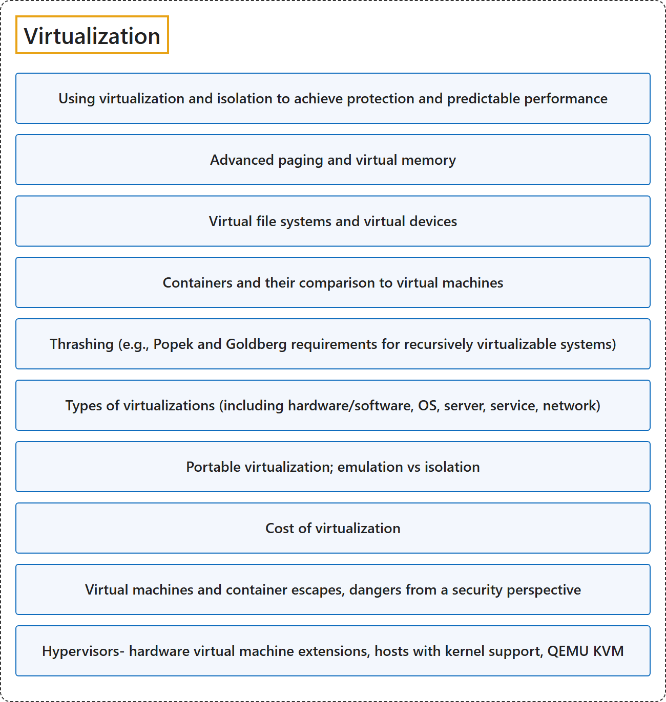

# 11. Virtualization

## Classification

## Glossary

| Term | Definition | 中文翻译 | Source |
|---|---|---|---|
| **Virtualization** 虚拟化 | "Virtualization is the **simulation of the software and/or hardware** upon which **other software runs**." | 虚拟化是对**软件和/或硬件的模拟**，**其他软件**运行在这些软件或硬件之上。 | [Scarfone et al., 2011, p. ES-1](https://nvlpubs.nist.gov/nistpubs/legacy/sp/nistspecialpublication800-125.pdf#page=6) |
| **[Using virtualization and isolation to achieve protection and predictable performance](using-virtualization-and-isolation-to-achieve-protection-and-predictable-perform.md)** 用虚拟化和隔离实现保护和可预测的性能 | (context) "The hypervisor can **partition the system's resources** and **isolate the guest OSs** so that each has access to only its own resources, as well as possible access to shared resources such as files on the host OS." | （语境）hypervisor 可以**划分系统资源**并**隔离各个客户 OS**，使每个客户 OS 只能访问自己的资源，以及可能访问主机 OS 上文件等共享资源。 | [Scarfone et al., 2011, p. ES-1](https://nvlpubs.nist.gov/nistpubs/legacy/sp/nistspecialpublication800-125.pdf#page=6) |
| **[Advanced paging and virtual memory](advanced-paging-and-virtual-memory.md)** 高级分页和虚拟内存 | (context) "The virtual memory **abstracts the details of physical memory** from the application software, allows to keep only needed information in the physical memory (**demand paging**) and provides a mechanism for the protection and controlled sharing of data between processes." | （语境）虚拟内存为应用软件**抽象掉物理内存的细节**，只把需要的信息保留在物理内存中（**按需分页**），并提供在进程之间保护和受控共享数据的机制。 | [The kernel development community, n.d.-a, "Virtual Memory Primer" section, para. 3](https://docs.kernel.org/admin-guide/mm/concepts.html#:~:text=The%20virtual%20memory%20abstracts%20the%20details) |
| **[Virtual file systems and virtual devices](virtual-file-systems-and-virtual-devices.md)** 虚拟文件系统和虚拟设备 | (context) "Ensure that **virtual devices for the guest OS** are associated only with the **appropriate physical devices on the host system**, such as the mappings between virtual and physical NICs." | （语境）确保**客户 OS 的虚拟设备**只与**主机系统上相应的物理设备**相关联，例如虚拟网卡和物理网卡之间的映射。 | [Scarfone et al., 2011, p. 4-4](https://nvlpubs.nist.gov/nistpubs/legacy/sp/nistspecialpublication800-125.pdf#page=25) |
| **[Containers and their comparison to virtual machines](containers-and-their-comparison-to-virtual-machines.md)** 容器及其与虚拟机的比较 | (context) "Another form of virtualization, known as **operating system virtualization**, provides a **virtual implementation of the OS interface** that can be used to run applications written for the same OS as the host, with each application in a separate VM container." | （语境）另一种虚拟化形式称为**操作系统虚拟化**，它提供 **OS 接口的虚拟实现**，可用于运行为与主机相同的 OS 编写的应用程序，每个应用程序在单独的 VM 容器中运行。 | [Scarfone et al., 2011, p. 2-1](https://nvlpubs.nist.gov/nistpubs/legacy/sp/nistspecialpublication800-125.pdf#page=10) |
| **[Thrashing (e.g., Popek and Goldberg requirements for recursively virtualizable systems)](thrashing.md)** 抖动（例如 Popek 和 Goldberg 关于可递归虚拟化系统的要求） | (context) "The 'full' line indicates the share of time in which all non-idle tasks are stalled on a given resource simultaneously. In this state actual **CPU cycles are going to waste**, and a workload that spends extended time in this state is considered to be **thrashing**." | （语境）"full" 一行表示所有非空闲任务同时在某个资源上停滞的时间占比。在这种状态下，实际的 **CPU 周期被浪费**，长时间处于这种状态的工作负载被认为在**抖动**（thrashing）。 | [The kernel development community, n.d.-b, "Pressure interface" section](https://docs.kernel.org/accounting/psi.html#:~:text=is%20considered%20to%20be%20thrashing) |
| **[Types of virtualizations (including hardware/software, OS, server, service, network)](types-of-virtualizations.md)** 虚拟化的类型（包括硬件/软件、OS、服务器、服务、网络） | (context) "There are **many forms of virtualization**, distinguished primarily by **computing architecture layer**." | （语境）虚拟化有**多种形式**，主要按**计算体系结构的层次**来区分。 | [Scarfone et al., 2011, p. ES-1](https://nvlpubs.nist.gov/nistpubs/legacy/sp/nistspecialpublication800-125.pdf#page=6) |
| **[Portable virtualization; emulation vs isolation](portable-virtualization-emulation-vs-isolation.md)** 可移植虚拟化；仿真与隔离 | (context) "Also, each guest OS can be **completely encapsulated**, making it **portable**." | （语境）此外，每个客户 OS 都可以被**完全封装**，从而**可移植**。 | [Scarfone et al., 2011, p. ES-1](https://nvlpubs.nist.gov/nistpubs/legacy/sp/nistspecialpublication800-125.pdf#page=6) |
| **[Cost of virtualization](cost-of-virtualization.md)** 虚拟化的成本 | (context) "In particular, due to the **overhead required for virtualization**, load testing in a virtual environment **may not provide the same results** as load testing in a physical environment." | （语境）特别是，由于**虚拟化所需的开销**，在虚拟环境中做负载测试**可能得不到与物理环境相同的结果**。 | [Scarfone et al., 2011, p. 3-4](https://nvlpubs.nist.gov/nistpubs/legacy/sp/nistspecialpublication800-125.pdf#page=21) |
| **[Virtual machines and container escapes, dangers from a security perspective](virtual-machines-and-container-escapes-dangers-from-a-security-perspective.md)** 虚拟机和容器逃逸：安全角度的危险 | (context) "**Breaking out of a guest OS** is also known as **escape**. If an attacker can successfully escape a guest OS and gain access to the hypervisor, the attacker might be able to compromise the hypervisor and gain control over all of its guest OSs." | （语境）**突破客户 OS** 也称为**逃逸**。如果攻击者能成功从客户 OS 逃逸并访问 hypervisor，就可能攻破 hypervisor，并控制它的所有客户 OS。 | [Scarfone et al., 2011, p. 3-2](https://nvlpubs.nist.gov/nistpubs/legacy/sp/nistspecialpublication800-125.pdf#page=19) |
| **[Hypervisors- hardware virtual machine extensions, hosts with kernel support, QEMU KVM](hypervisors-hardware-virtual-machine-extensions-hosts-with-kernel-support-qemu-k.md)** 虚拟机管理程序：硬件虚拟机扩展、带内核支持的主机、QEMU KVM | (context) "The guest OSs on a host are managed by the **hypervisor**, also called the virtual machine monitor (VMM), which **controls the flow of instructions** between the guest OSs and the physical hardware, such as CPU, disk storage, memory, and network interface cards." | （语境）主机上的客户 OS 由 **hypervisor** 管理，它也称为虚拟机监视器（VMM），负责**控制指令流**，指令在客户 OS 与 CPU、磁盘存储、内存和网卡等物理硬件之间流动。 | [Scarfone et al., 2011, p. 2-1](https://nvlpubs.nist.gov/nistpubs/legacy/sp/nistspecialpublication800-125.pdf#page=10) |

## References

- Joint Task Force on Computing Curricula. (2024). *Computer science curricula 2023*. Association for Computing Machinery. <https://doi.org/10.1145/3664191>
- Scarfone, K., Souppaya, M., & Hoffman, P. (2011). *Guide to security for full virtualization technologies* (NIST Special Publication 800-125). National Institute of Standards and Technology. <https://doi.org/10.6028/NIST.SP.800-125>
- The kernel development community. (n.d.-a). *Concepts overview*. The Linux Kernel documentation. Retrieved October 27, 2026, from <https://docs.kernel.org/admin-guide/mm/concepts.html>
- The kernel development community. (n.d.-b). *PSI - Pressure stall information*. The Linux Kernel documentation. Retrieved October 27, 2026, from <https://docs.kernel.org/accounting/psi.html>
