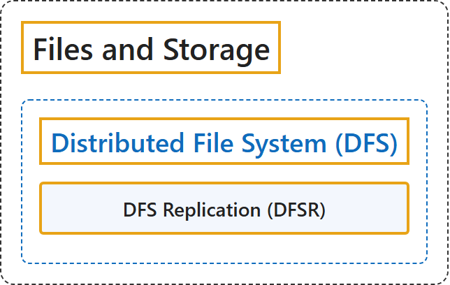

# 5.3 Files and Storage

Sources: [Windows Server documentation, Key areas, Files and Storage](https://learn.microsoft.com/en-us/windows-server/); [DFS Namespaces overview](https://learn.microsoft.com/en-us/windows-server/storage/dfs-namespaces/dfs-overview); [Distributed File System (DFS) Replication overview](https://learn.microsoft.com/en-us/windows-server/storage/dfs-replication/dfsr-overview).

## Classification

## Glossary

| Term | Definition | 中文解释 | Source |
|---|---|---|---|
| **Distributed File System (DFS)** 分布式文件系统（DFS） | (context) "**DFS (Distributed File System) Namespaces** is a role service in Windows Server that enables you to **group shared folders located on different servers** into one or more **logically structured namespaces**." | （语境）**DFS（分布式文件系统）命名空间**是 Windows Server 中的一种角色服务，让你把**位于不同服务器上的共享文件夹**组合成一个或多个**逻辑结构的命名空间**。 | [Microsoft, 2025a, para. 1](https://learn.microsoft.com/en-us/windows-server/storage/dfs-namespaces/dfs-overview#:~:text=DFS%20%28Distributed%20File%20System%29%20Namespaces%20is%20a%20role) |
| **DFS Replication (DFSR)** DFS 复制（DFSR） | "**Distributed File System (DFS) Replication** is a Windows Server role service that lets you **efficiently synchronize folders across multiple servers and sites**." | **分布式文件系统（DFS）复制**是一种 Windows Server 角色服务，让你**在多个服务器和站点之间高效同步文件夹**。 | [Microsoft, 2025b, para. 1](https://learn.microsoft.com/en-us/windows-server/storage/dfs-replication/dfsr-overview#:~:text=Distributed%20File%20System%20%28DFS%29%20Replication%20is%20a%20Windows) |

## References

- Microsoft. (2025a, May 21). *DFS Namespaces overview*. Microsoft Learn. https://learn.microsoft.com/en-us/windows-server/storage/dfs-namespaces/dfs-overview
- Microsoft. (2025b, May 28). *Distributed File System (DFS) Replication overview*. Microsoft Learn. https://learn.microsoft.com/en-us/windows-server/storage/dfs-replication/dfsr-overview
