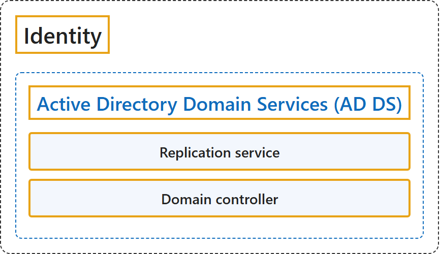

# 5.2 Identity

## Classification

## Glossary

| Term | Definition | 中文解释 | Source |
|---|---|---|---|
| **Active Directory Domain Services (AD DS)** Active Directory 域服务（AD DS） | "A *directory service*, such as **Active Directory Domain Services (AD DS)**, provides the methods for **storing directory data** and **making this data available to network users and administrators**." | 目录服务（例如 **Active Directory 域服务（AD DS）**）提供**存储目录数据**、并**把这些数据提供给网络用户和管理员**的方法。 | [Microsoft, 2025, para. 1](https://learn.microsoft.com/en-us/windows-server/identity/ad-ds/get-started/virtual-dc/active-directory-domain-services-overview#:~:text=A%20directory%20service%2C%20such%20as%20Active%20Directory%20Domain) |
| **Replication service** 复制服务 | "A **replication service** that **distributes directory data across a network**." | 一种**复制服务**，**在网络中分发目录数据**。 | [Microsoft, 2025, "AD DS also includes" list, item 4](https://learn.microsoft.com/en-us/windows-server/identity/ad-ds/get-started/virtual-dc/active-directory-domain-services-overview#:~:text=A%20replication%20service%20that%20distributes%20directory%20data%20across) |
| **Domain controller** 域控制器 | (context) "All **domain controllers** in a domain participate in replication and **contain a complete copy of all directory information for their domain**." | （语境）一个域中的所有**域控制器**都参与复制，并**保存本域全部目录信息的完整副本**。 | [Microsoft, 2025, "AD DS also includes" list, item 4](https://learn.microsoft.com/en-us/windows-server/identity/ad-ds/get-started/virtual-dc/active-directory-domain-services-overview#:~:text=All%20domain%20controllers%20in%20a%20domain%20participate%20in) |

## References

- Microsoft. (2025, March 10). *Active Directory Domain Services overview*. Microsoft Learn. https://learn.microsoft.com/en-us/windows-server/identity/ad-ds/get-started/virtual-dc/active-directory-domain-services-overview
