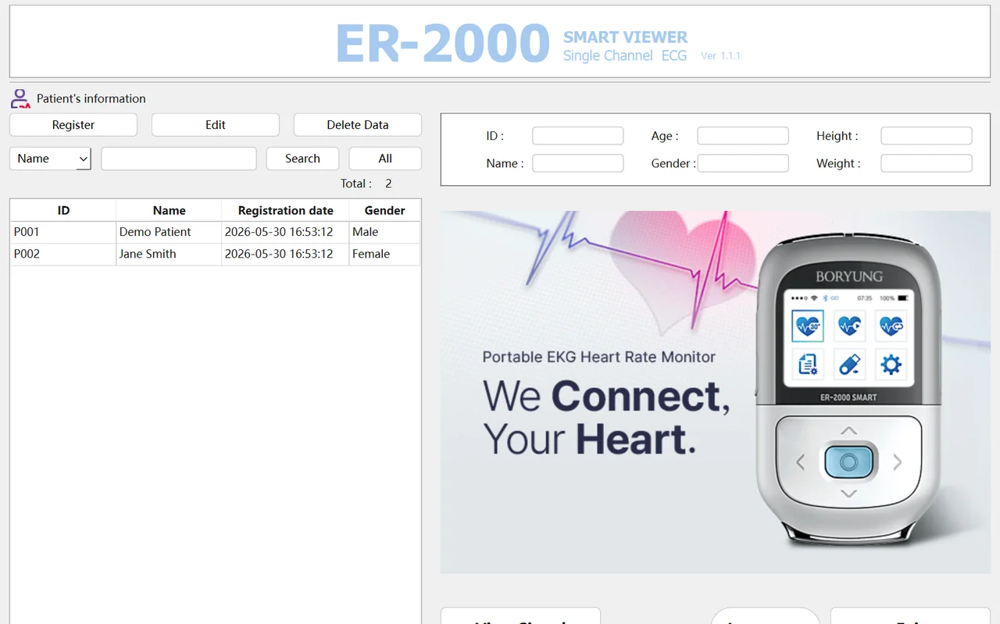
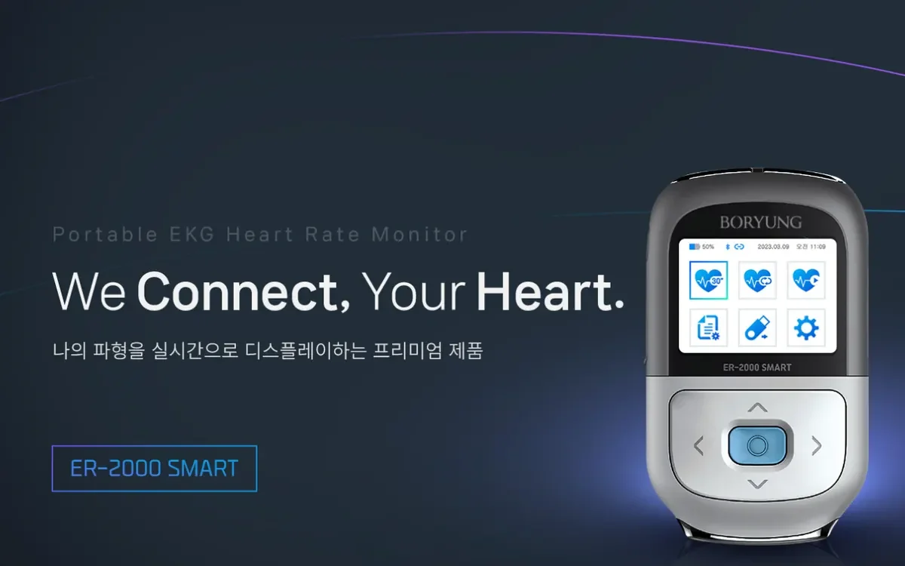

# ECG Viewer Modernization

Rebuilt a legacy ECG desktop viewer with no source code available on a tight timeline, then added real-time ECG over Bluetooth LE.

- **Role:** Lead Architect & Developer (team)
- **Organization:** Healthcare client, Korea
- **Dates:** May 2026 – Jun 2026
- **Stack:** Python, PySide6, Bluetooth LE

## What it does

A Windows desktop viewer for a single-channel ECG recorder, rebuilt from scratch because the original source code was not available.

- Password login; patient records in SQLite with search and edit
- Signal view: 10 or 5 mm/mV gain, 30 or 60 seconds per page, paging and side-by-side comparison
- Print preview and printing with page ranges
- Decoded the legacy recording format (verified on 200 of 200 sample files)
- Added real-time ECG from the device over Bluetooth LE (100 Hz), with a live waveform, BPM and recording

*Main window: patient records and the entry to real-time ECG (test patients only)*

*The portable single-channel ECG recorder the viewer connects to*

## How it's built

- Python + PySide6; Bluetooth LE with bleak
- Packaged as Windows installers with PyInstaller and NSIS
- 46 UI checks and 37 end-to-end tests

Source code is private (client project).
