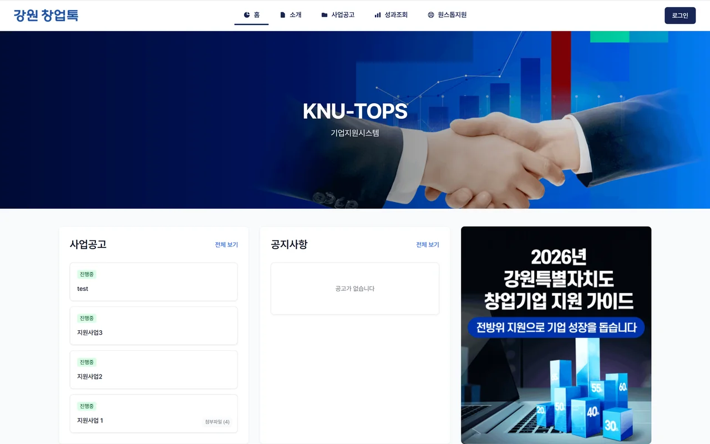

# Gangwon State Business Portal

A B2B performance-management portal where startups submit performance data and apply for government support programs.

- **Role:** Lead Architect & Developer (team)
- **Organization:** Gangwon State, Korea
- **Dates:** Dec 2025 – Apr 2026
- **Stack:** FastAPI, SQLAlchemy, Supabase, React, Vite, Tailwind, Zustand
- **Source code:** <https://github.com/zhizhunbao/gangwon-business-portal>

## What it does

A one-stop portal for startups in Gangwon State. Companies register, submit quarterly and annual performance data and apply for government support programs; administrators review and approve them in their own dashboard. It also handles notices, news, banners, in-site messages and statistics reports, in Korean and Chinese.

*KNU-TOPS home page: program notices, announcements and the support guide*

## How it's built

- FastAPI with async SQLAlchemy 2, Alembic migrations, JWT auth and role-based access
- Supabase PostgreSQL and Storage
- Two React single-page apps (company portal and admin dashboard) with Vite, Tailwind, Zustand and React Query
- Deployed on Render (static front end + Python API); CI on GitHub Actions
