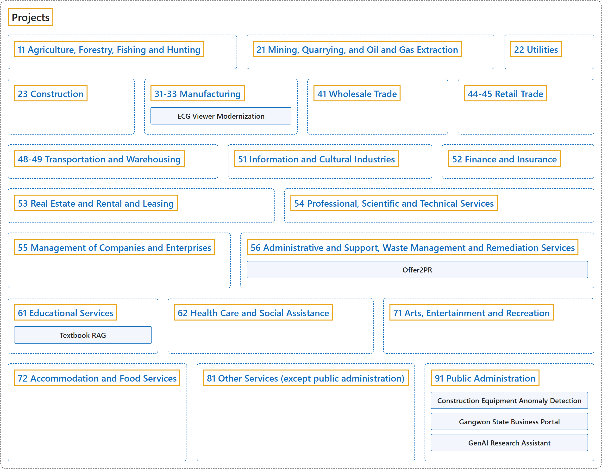

# Projects

## Classification

## Glossary

| Term | Definition | 中文翻译 | Source |
|---|---|---|---|
| **NAICS Canada 2022 Version 1.0** 北美产业分类体系（加拿大 2022 年 1.0 版） | "The North American Industry Classification System (NAICS) is an **industry classification system** developed by the **statistical agencies of Canada, Mexico and the United States**." | 北美产业分类体系（NAICS）是由**加拿大、墨西哥和美国的统计机构**共同制定的**产业分类体系**。 | [Statistics Canada, 2022a, "Introduction" section, para. 1](https://www.statcan.gc.ca/en/subjects/standard/naics/2022/v1/introduction#:~:text=The%20North%20American%20Industry%20Classification%20System%20%28NAICS%29%20is) |
| **[11 Agriculture, Forestry, Fishing and Hunting](11-agriculture-forestry-fishing-and-hunting/index.md)** 农业、林业、渔业和狩猎 | "This sector comprises establishments primarily engaged in **growing crops, raising animals, harvesting timber, harvesting fish and other animals** from their natural habitats and providing related support activities." | 本部门由主要从事**种植作物、饲养动物、采伐木材、从自然栖息地捕捞鱼类和其他动物**以及提供相关支持活动的机构组成。 | [Statistics Canada, 2022b, sector 11](https://www23.statcan.gc.ca/imdb/p3VD.pl?Function=getVD&TVD=1369825#:~:text=This%20sector%20comprises%20establishments%20primarily%20engaged%20in%20growing) |
| **[21 Mining, Quarrying, and Oil and Gas Extraction](21-mining-quarrying-and-oil-and-gas-extraction/index.md)** 采矿、采石和油气开采 | "This sector comprises establishments primarily engaged in **extracting naturally occurring minerals**." | 本部门由主要从事**开采天然矿物**的机构组成。 | [Statistics Canada, 2022b, sector 21](https://www23.statcan.gc.ca/imdb/p3VD.pl?Function=getVD&TVD=1369825#:~:text=This%20sector%20comprises%20establishments%20primarily%20engaged%20in%20extracting) |
| **[22 Utilities](22-utilities/index.md)** 公用事业 | "This sector comprises establishments primarily engaged in **operating electric, gas and water utilities**." | 本部门由主要从事**运营电力、燃气和供水公用事业**的机构组成。 | [Statistics Canada, 2022b, sector 22](https://www23.statcan.gc.ca/imdb/p3VD.pl?Function=getVD&TVD=1369825#:~:text=This%20sector%20comprises%20establishments%20primarily%20engaged%20in%20operating) |
| **[23 Construction](23-construction/index.md)** 建筑业 | "This sector comprises establishments primarily engaged in **constructing, repairing and renovating buildings and engineering works**, and in subdividing and developing land." | 本部门由主要从事**建造、修缮和翻新建筑物与工程设施**以及土地分割和开发的机构组成。 | [Statistics Canada, 2022b, sector 23](https://www23.statcan.gc.ca/imdb/p3VD.pl?Function=getVD&TVD=1369825#:~:text=This%20sector%20comprises%20establishments%20primarily%20engaged%20in%20constructing%2C) |
| **[31-33 Manufacturing](31-33-manufacturing/index.md)** 制造业 | "This sector comprises establishments primarily engaged in the **chemical, mechanical or physical transformation of materials or substances into new products**." | 本部门由主要从事**通过化学、机械或物理方法把材料或物质转化为新产品**的机构组成。 | [Statistics Canada, 2022b, sector 31-33](https://www23.statcan.gc.ca/imdb/p3VD.pl?Function=getVD&TVD=1369825#:~:text=This%20sector%20comprises%20establishments%20primarily%20engaged%20in%20the) |
| **[41 Wholesale Trade](41-wholesale-trade/index.md)** 批发贸易 | "This sector comprises establishments primarily engaged in **wholesaling merchandise**, generally without transformation, and rendering services incidental to the sale of merchandise." | 本部门由主要从事**批发商品**（通常不经加工）并提供商品销售附带服务的机构组成。 | [Statistics Canada, 2022b, sector 41](https://www23.statcan.gc.ca/imdb/p3VD.pl?Function=getVD&TVD=1369825#:~:text=This%20sector%20comprises%20establishments%20primarily%20engaged%20in%20wholesaling) |
| **[44-45 Retail Trade](44-45-retail-trade/index.md)** 零售贸易 | "This sector comprises establishments primarily engaged in **retailing merchandise**, generally without transformation, and rendering services incidental to the sale of merchandise." | 本部门由主要从事**零售商品**（通常不经加工）并提供商品销售附带服务的机构组成。 | [Statistics Canada, 2022b, sector 44-45](https://www23.statcan.gc.ca/imdb/p3VD.pl?Function=getVD&TVD=1369825#:~:text=This%20sector%20comprises%20establishments%20primarily%20engaged%20in%20retailing) |
| **[48-49 Transportation and Warehousing](48-49-transportation-and-warehousing/index.md)** 运输和仓储 | "This sector comprises establishments primarily engaged in **transporting passengers and goods, warehousing and storing goods**, and providing services to these establishments." | 本部门由主要从事**运输旅客和货物、仓储和储存货物**以及为这些机构提供服务的机构组成。 | [Statistics Canada, 2022b, sector 48-49](https://www23.statcan.gc.ca/imdb/p3VD.pl?Function=getVD&TVD=1369825#:~:text=This%20sector%20comprises%20establishments%20primarily%20engaged%20in%20transporting) |
| **[51 Information and Cultural Industries](51-information-and-cultural-industries/index.md)** 信息和文化产业 | "This sector comprises establishments primarily engaged in **producing and distributing** (except by wholesale and retail methods) **information and cultural products**." | 本部门由主要从事**生产和发行**（批发和零售方式除外）**信息和文化产品**的机构组成。 | [Statistics Canada, 2022b, sector 51](https://www23.statcan.gc.ca/imdb/p3VD.pl?Function=getVD&TVD=1369825#:~:text=This%20sector%20comprises%20establishments%20primarily%20engaged%20in%20producing) |
| **[52 Finance and Insurance](52-finance-and-insurance/index.md)** 金融和保险 | "This sector comprises establishments primarily engaged in **financial transactions** (that is, transactions involving the creation, liquidation, or change in ownership of financial assets) or in **facilitating financial transactions**." | 本部门由主要从事**金融交易**（即涉及金融资产的创设、清算或所有权变更的交易）或**促成金融交易**的机构组成。 | [Statistics Canada, 2022b, sector 52](https://www23.statcan.gc.ca/imdb/p3VD.pl?Function=getVD&TVD=1369825#:~:text=This%20sector%20comprises%20establishments%20primarily%20engaged%20in%20financial) |
| **[53 Real Estate and Rental and Leasing](53-real-estate-and-rental-and-leasing/index.md)** 房地产及租赁 | "This sector comprises establishments primarily engaged in **renting, leasing or otherwise allowing the use of tangible or intangible assets**." | 本部门由主要从事**出租、租赁或以其他方式允许使用有形或无形资产**的机构组成。 | [Statistics Canada, 2022b, sector 53](https://www23.statcan.gc.ca/imdb/p3VD.pl?Function=getVD&TVD=1369825#:~:text=This%20sector%20comprises%20establishments%20primarily%20engaged%20in%20renting%2C) |
| **[54 Professional, Scientific and Technical Services](54-professional-scientific-and-technical-services/index.md)** 专业、科学和技术服务 | "This sector comprises establishments primarily engaged in activities in which **human capital is the major input**." | 本部门由主要从事以**人力资本为主要投入**的活动的机构组成。 | [Statistics Canada, 2022b, sector 54](https://www23.statcan.gc.ca/imdb/p3VD.pl?Function=getVD&TVD=1369825#:~:text=This%20sector%20comprises%20establishments%20primarily%20engaged%20in%20activities) |
| **[55 Management of Companies and Enterprises](55-management-of-companies-and-enterprises/index.md)** 公司和企业管理 | "This sector comprises (1), comprises legal entities engaged only in **holding the securities of subsidiaries and affiliates** for the purpose of owning a controlling interest or influencing the management decisions of these businesses, or (2), establishments primarily engaged in **administering, overseeing, and managing other establishments** of the company or enterprise and which may also hold the securities of their subsidiaries and affiliates." | 本部门包括：（1）只从事**持有子公司和关联公司证券**、以取得控股权或影响这些企业管理决策的法律实体；或（2）主要从事**管理、监督和经营本公司或本企业其他机构**、并可能同时持有其子公司和关联公司证券的机构。 | [Statistics Canada, 2022b, sector 55](https://www23.statcan.gc.ca/imdb/p3VD.pl?Function=getVD&TVD=1369825#:~:text=This%20sector%20comprises%20%281%29%2C%20comprises%20legal%20entities%20engaged) |
| **[56 Administrative and Support, Waste Management and Remediation Services](56-administrative-and-support-waste-management-and-remediation-services/index.md)** 行政和支持、废物管理和修复服务 | "This sector comprises establishments of two different types: those primarily engaged in activities that **support the day-to-day operations of other organizations**; and those primarily engaged in **waste management activities**." | 本部门由两类机构组成：一类主要从事**支持其他组织日常运营**的活动；另一类主要从事**废物管理活动**。 | [Statistics Canada, 2022b, sector 56](https://www23.statcan.gc.ca/imdb/p3VD.pl?Function=getVD&TVD=1369825#:~:text=This%20sector%20comprises%20establishments%20of%20two%20different%20types%3A) |
| **[61 Educational Services](61-educational-services/index.md)** 教育服务 | "This sector comprises establishments primarily engaged in **providing instruction and training** in a wide variety of subjects." | 本部门由主要从事**提供**多种学科的**教学和培训**的机构组成。 | [Statistics Canada, 2022b, sector 61](https://www23.statcan.gc.ca/imdb/p3VD.pl?Function=getVD&TVD=1369825#:~:text=This%20sector%20comprises%20establishments%20primarily%20engaged%20in%20providing) |
| **[62 Health Care and Social Assistance](62-health-care-and-social-assistance/index.md)** 医疗保健和社会救助 | "This sector comprises establishments primarily engaged in **providing health care by diagnosis and treatment**, providing residential care for medical and social reasons, and **providing social assistance**, such as counselling, welfare, child protection, community housing and food services, vocational rehabilitation and child care, to those requiring such assistance." | 本部门由主要从事以下活动的机构组成：**通过诊断和治疗提供医疗保健**，出于医疗和社会原因提供住宿式照护，以及向需要者**提供社会救助**，如咨询、福利、儿童保护、社区住房和食品服务、职业康复和儿童照护。 | [Statistics Canada, 2022b, sector 62](https://www23.statcan.gc.ca/imdb/p3VD.pl?Function=getVD&TVD=1369825#:~:text=This%20sector%20comprises%20establishments%20primarily%20engaged%20in%20providing) |
| **[71 Arts, Entertainment and Recreation](71-arts-entertainment-and-recreation/index.md)** 艺术、娱乐和休闲 | "This sector comprises establishments primarily engaged in operating facilities or providing services to meet the **cultural, entertainment and recreational interests** of their patrons." | 本部门由主要从事运营设施或提供服务、以满足顾客的**文化、娱乐和休闲需求**的机构组成。 | [Statistics Canada, 2022b, sector 71](https://www23.statcan.gc.ca/imdb/p3VD.pl?Function=getVD&TVD=1369825#:~:text=This%20sector%20comprises%20establishments%20primarily%20engaged%20in%20operating) |
| **[72 Accommodation and Food Services](72-accommodation-and-food-services/index.md)** 住宿和餐饮服务 | "This sector comprises establishments primarily engaged in **providing short-term lodging** and complementary services to travellers, vacationers and others, in facilities such as hotels, motor hotels, resorts, motels, casino hotels, bed and breakfast accommodations, housekeeping cottages and cabins, recreational vehicle parks and campgrounds, hunting and fishing camps, and various types of recreational and adventure camps." | 本部门由主要在酒店、汽车旅馆、度假村、汽车旅店、赌场酒店、民宿、自炊小屋和木屋、房车营地和露营地、狩猎和钓鱼营地以及各类休闲和探险营地等设施中，向旅客、度假者和其他人**提供短期住宿**及配套服务的机构组成。 | [Statistics Canada, 2022b, sector 72](https://www23.statcan.gc.ca/imdb/p3VD.pl?Function=getVD&TVD=1369825#:~:text=This%20sector%20comprises%20establishments%20primarily%20engaged%20in%20providing) |
| **[81 Other Services (except public administration)](81-other-services-except-public-administration/index.md)** 其他服务（公共管理除外） | "This sector comprises establishments, **not classified to any other sector**, primarily engaged in **repairing, or performing general or routine maintenance**, on motor vehicles, machinery, equipment and other products to ensure that they work efficiently; **providing personal care services**, funeral services, laundry services and other services to individuals, such as pet care services and photo finishing services; organizing and promoting religious activities; supporting various causes through grant-making, advocating (promoting) various social and political causes, and promoting and defending the interests of their members." | 本部门由**未归入其他任何部门**的机构组成，它们主要从事：对机动车、机械、设备和其他产品进行**修理或一般、日常维护**以保证其高效运行；**提供个人护理服务**、殡葬服务、洗衣服务以及宠物护理、照片冲印等其他面向个人的服务；组织和推广宗教活动；通过资助支持各类事业、倡导（推动）各类社会和政治事业，以及促进和维护会员利益。 | [Statistics Canada, 2022b, sector 81](https://www23.statcan.gc.ca/imdb/p3VD.pl?Function=getVD&TVD=1369825#:~:text=This%20sector%20comprises%20establishments%2C%20not%20classified%20to%20any) |
| **[91 Public Administration](91-public-administration/index.md)** 公共管理 | "This sector comprises establishments primarily engaged in **activities of a governmental nature**, that is, the enactment and judicial interpretation of laws and their pursuant regulations, and the administration of programs based on them." | 本部门由主要从事**政府性质活动**的机构组成，即制定法律及其配套法规、对其作出司法解释，以及管理以其为依据的各项计划。 | [Statistics Canada, 2022b, sector 91](https://www23.statcan.gc.ca/imdb/p3VD.pl?Function=getVD&TVD=1369825#:~:text=This%20sector%20comprises%20establishments%20primarily%20engaged%20in%20activities) |

## Projects

Newest first.

| Project | What it is | Role | Organization | Dates |
|---|---|---|---|---|
| [Offer2PR](offer2pr.md) | A daily-updated Canadian job board with 24,000+ live postings from 30 sources across all 10 provinces, tagged with immigration signals; in English, Chinese and Korean. | Founder: AI Agent Development & Operations | offer2pr.com, Ottawa, ON | Jun 2026 – Present |
| [Construction Equipment Anomaly Detection](molit.md) | Detects construction-equipment anomalies from thermal, vibration and acoustic sensors and grades equipment health in four levels. | Lead Architect & Developer (team) | Korea Ministry of Land, Infrastructure and Transport (MOLIT) | Jun 2026 – Aug 2026 |
| [ECG Viewer Modernization](ecg-viewer.md) | Rebuilt a legacy ECG desktop viewer with no source code available on a tight timeline, then added real-time ECG over Bluetooth LE. | Lead Architect & Developer (team) | Healthcare client, Korea | May 2026 – Jun 2026 |
| [Textbook RAG](textbook-rag.md) | Retrieval-augmented question answering over course textbooks with hybrid retrieval (BM25 plus vector search). | Architect & Developer (Capstone, solo) | Algonquin College | Mar 2026 – Jun 2026 |
| [Gangwon State Business Portal](gangwon-portal.md) | A B2B performance-management portal where startups submit performance data and apply for government support programs. | Lead Architect & Developer (team) | Gangwon State, Korea | Dec 2025 – Apr 2026 |
| [GenAI Research Assistant](ottawa-genai.md) | Designed and built a proof-of-concept generative AI research assistant for the City of Ottawa's Economic Development team, then continued it with City-side collaborators. | Architect & Developer (PoC) | City of Ottawa | Sep 2025 – Apr 2026 |

## References

Statistics Canada. (2022a). *Introduction to the North American Industry Classification System (NAICS) Canada 2022 Version 1.0*. Retrieved October 28, 2026, from <https://www.statcan.gc.ca/en/subjects/standard/naics/2022/v1/introduction>

Statistics Canada. (2022b). *North American Industry Classification System (NAICS) Canada 2022 Version 1.0*. Retrieved October 28, 2026, from <https://www23.statcan.gc.ca/imdb/p3VD.pl?Function=getVD&TVD=1369825>
