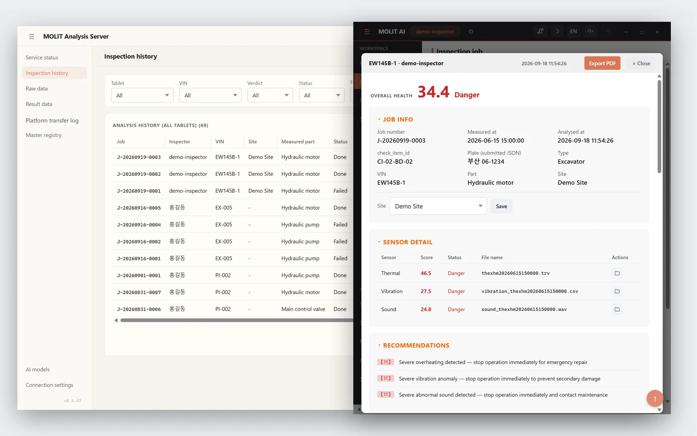
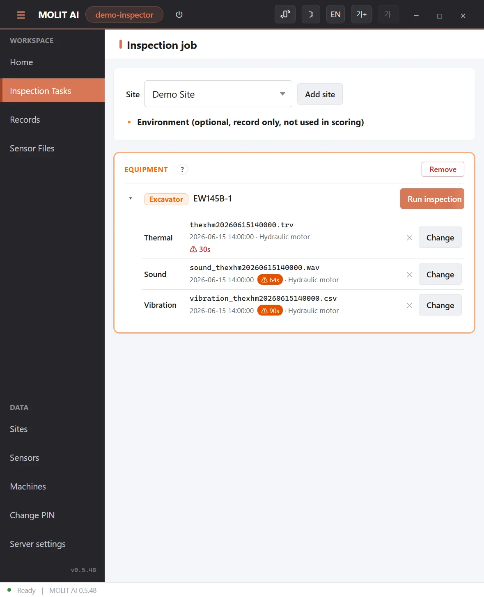
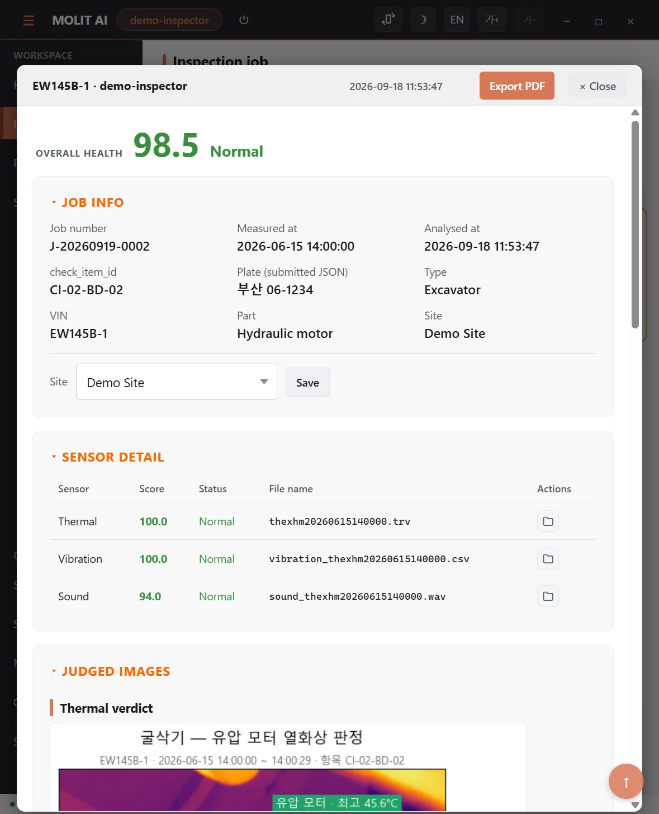
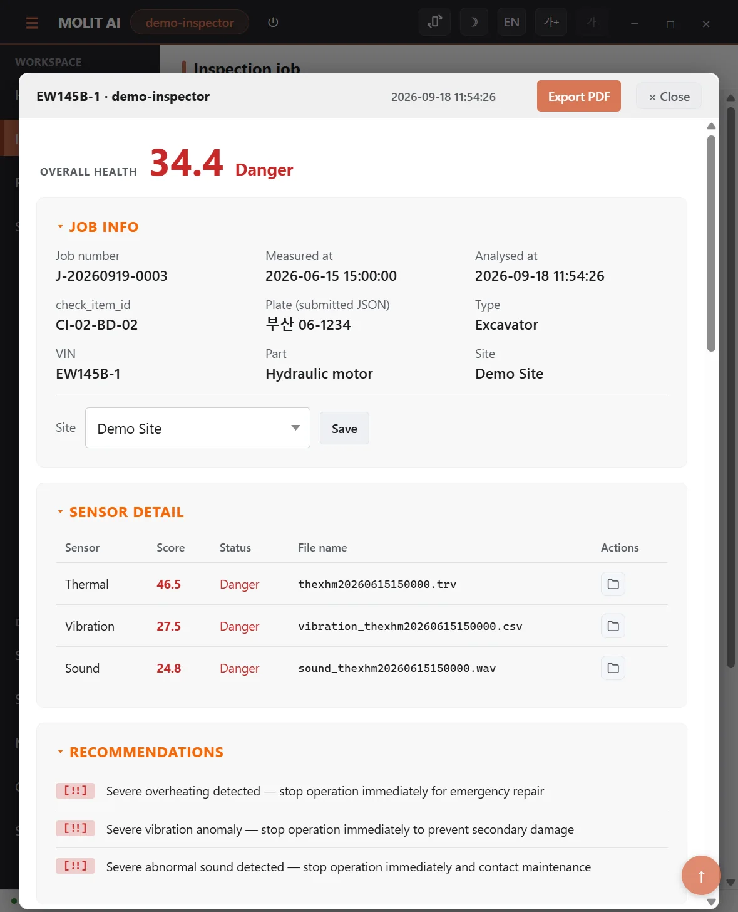
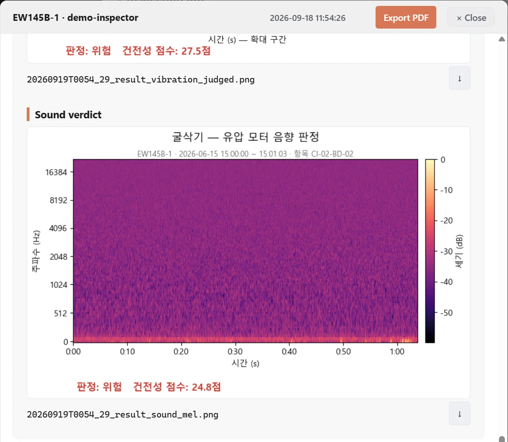
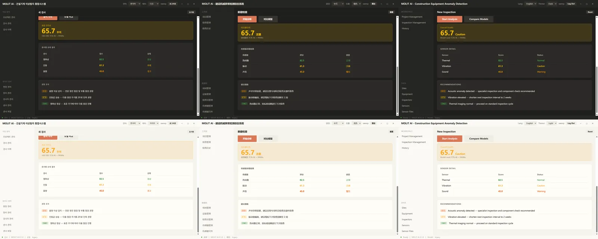
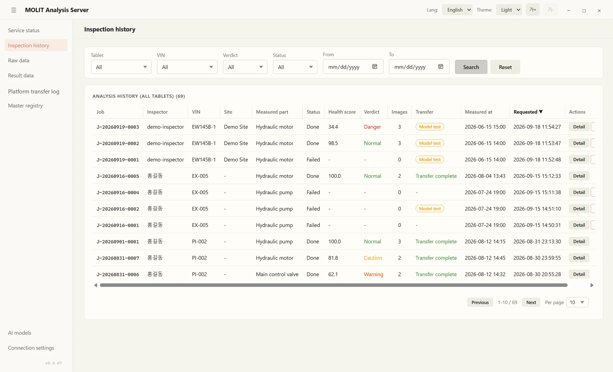
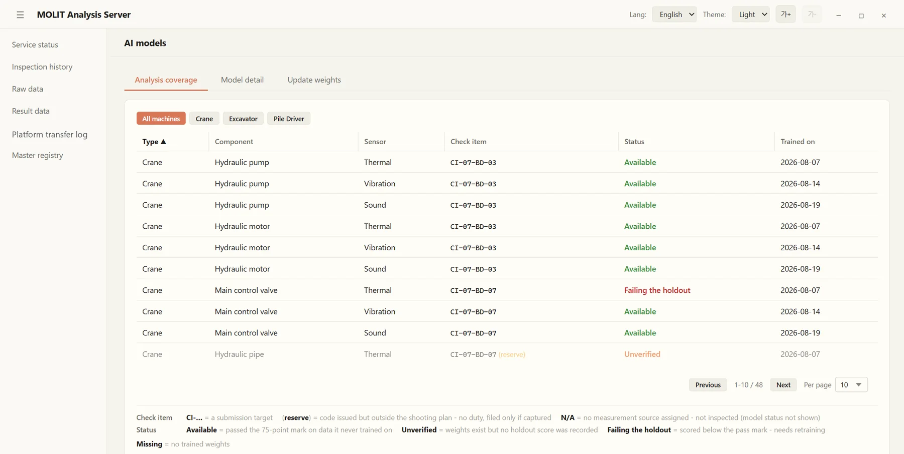

# Construction Equipment Anomaly Detection

Detects construction-equipment anomalies from thermal, vibration and acoustic sensors and grades equipment health in four levels.

- **Role:** Lead Architect & Developer (team)
- **Organization:** Korea Ministry of Land, Infrastructure and Transport (MOLIT)
- **Dates:** Jun 2026 – Aug 2026
- **Stack:** Python, PyTorch, PySide6, Payload CMS, Supabase
- **Recognition:** Top grade in data quality certification for the high-risk construction equipment thermal-imaging dataset.

## What it does

Inspects construction equipment such as excavators and cranes with three sensors (thermal camera, vibration and acoustic) and gives each machine a 0–100 health score in four levels:

- **Normal** 80–100
- **Caution** 60–79
- **Warning** 40–59
- **Danger** 0–39

Two Windows programs work as a pair: a tablet inspection app for the inspector and an analysis server that runs the models. Only results and an auto-generated PDF report leave the site.

*Analysis server (left) and tablet inspection app (right) running together on a fault-injected set: 34.4, Danger*

## Models

- Thermal and vibration: TCN autoencoders (same architecture, separate weights)
- Acoustic: PANNs CNN14 embeddings + Mahalanobis distance
- Overall score weights: thermal 40%, vibration 35%, acoustic 25%
- Thermal model: AUROC 0.81, F1 0.84 (evaluation of 2 Jun 2026)

## Inspection app

*An inspection job: one thermal, sound and vibration capture for an excavator hydraulic motor*

*Normal set: thermal 100, vibration 100, sound 94, overall 98.5 Normal*

*Fault-injected set: 46.5, 27.5 and 24.8, overall 34.4 Danger, with a recommendation per sensor*

*Evidence image: mel spectrogram of the sound with the verdict and score overlaid*

*The same screen in Korean, Chinese and English, dark and light themes*

## Analysis server

*Inspection history from every tablet, with job detail: files, scores and recommendations*

*AI model coverage per machine, component and sensor, with hold-out status*

## Recognition

The project's thermal-imaging dataset for high-risk construction equipment received the top grade in data quality certification.

Source code is private (client project). Screenshots from the team's demo run.
