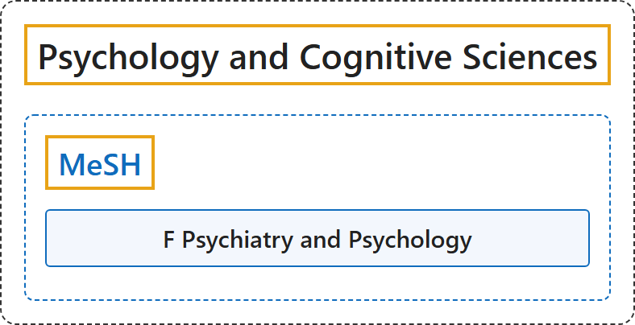

# Psychology and Cognitive Sciences

## Classification

## Glossary

| Term | Definition | 中文翻译 | Source |
|---|---|---|---|
| **Psychology and Cognitive Sciences** 医学主题词表（MeSH） | (context) "the **scientific study of the way the human mind works** and **how it influences behaviour**, or the influence of a particular person's character on their behaviour" | （语境）对**人类心智如何运作**及**它如何影响行为**的科学研究，或指某个人的性格对其行为的影响 | [Cambridge University Press & Assessment, n.d., "psychology" noun](https://dictionary.cambridge.org/dictionary/english/psychology) |
| **[MeSH](mesh/index.md)** 医学主题词表（MeSH） | "The Medical Subject Headings (MeSH) thesaurus is a **controlled and hierarchically-organized vocabulary** produced by the National Library of Medicine. It is used for **indexing, cataloging, and searching** of biomedical and health-related information." | 医学主题词表（MeSH）叙词表是美国国家医学图书馆编制的一套**受控且分层组织的词表**。它用于对生物医学和健康相关信息进行**标引、编目和检索**。 | [National Library of Medicine, n.d., para. 1](https://www.nlm.nih.gov/mesh/meshhome.html#:~:text=The%20Medical%20Subject%20Headings%20%28MeSH%29%20thesaurus%20is%20a%20controlled) |

## References

Cambridge University Press & Assessment. (n.d.). Psychology. In *Cambridge Dictionary*. Retrieved October 27, 2026, from <https://dictionary.cambridge.org/dictionary/english/psychology>

National Library of Medicine. (n.d.). *Welcome to Medical Subject Headings*. Retrieved October 27, 2026, from <https://www.nlm.nih.gov/mesh/meshhome.html>
