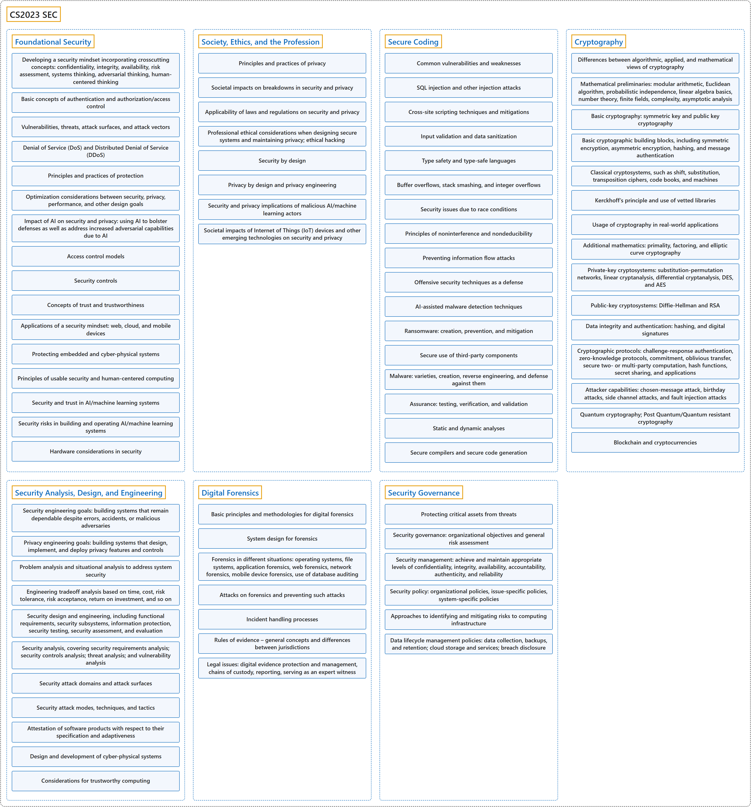

# CS2023 SEC

## Classification

## Glossary

| Term | Definition | 中文翻译 | Source |
|---|---|---|---|
| **CS2023 SEC** CS2023 SEC | "The Security (SEC) knowledge area focuses on **developing a security mindset** into the overall ethos of computer science graduates so that **security is embedded in all their work products**." | 安全（SEC）知识领域着重于把**安全思维的培养**融入计算机科学毕业生的整体精神，使**安全贯穿于他们所有的工作成果**。 | [Joint Task Force on Computing Curricula, 2024, SEC "Preamble" section, para. 2](https://csed.acm.org/wp-content/uploads/2024/04/3.1-Body-of-Knowledge-1.pdf#page=193) |
| **[Foundational Security](foundational-security/index.md)** 安全基础 | (context) "Evaluate a system for **possible attacks that can be launched by an adversary**." | （语境）评估一个系统可能遭受的、**对手能够发起的攻击**。 | [Joint Task Force on Computing Curricula, 2024, SEC-Foundations "Illustrative Learning Outcomes", 1](https://csed.acm.org/wp-content/uploads/2024/04/3.1-Body-of-Knowledge-1.pdf#page=196) |
| **[Society, Ethics, and the Profession](society-ethics-and-the-profession/index.md)** 社会、伦理与职业 | (context) "Calculate the **impact of a breakdown in security** of a given system." | （语境）计算给定系统**安全失效所造成的影响**。 | [Joint Task Force on Computing Curricula, 2024, SEC-SEP "Illustrative Learning Outcomes", 1](https://csed.acm.org/wp-content/uploads/2024/04/3.1-Body-of-Knowledge-1.pdf#page=197) |
| **[Secure Coding](secure-coding/index.md)** 安全编码 | (context) "Identify underlying problems in given examples of an **enumeration of common weaknesses** and explain how they can be circumvented." | （语境）在给出的**常见弱点枚举**示例中找出根本问题，并解释如何规避它们。 | [Joint Task Force on Computing Curricula, 2024, SEC-Coding "Illustrative Learning Outcomes", 1](https://csed.acm.org/wp-content/uploads/2024/04/3.1-Body-of-Knowledge-1.pdf#page=198) |
| **[Cryptography](cryptography/index.md)** 密码学 | (context) "Explain the **role of cryptography in supporting security and privacy**." | （语境）解释**密码学在支持安全和隐私方面的作用**。 | [Joint Task Force on Computing Curricula, 2024, SEC-Crypto "Illustrative Learning Outcomes", 1](https://csed.acm.org/wp-content/uploads/2024/04/3.1-Body-of-Knowledge-1.pdf#page=199) |
| **[Security Analysis, Design, and Engineering](security-analysis-design-and-engineering/index.md)** 安全分析、设计与工程 | (context) "Create a **threat model** for a system or system design." | （语境）为一个系统或系统设计建立**威胁模型**。 | [Joint Task Force on Computing Curricula, 2024, SEC-Engineering "Illustrative Learning Outcomes", 1](https://csed.acm.org/wp-content/uploads/2024/04/3.1-Body-of-Knowledge-1.pdf#page=200) |
| **[Digital Forensics](digital-forensics/index.md)** 数字取证 | (context) "Explain what a **digital investigation** is and how it can be implemented" | （语境）解释什么是**数字调查**以及如何实施 | [Joint Task Force on Computing Curricula, 2024, SEC-Forensics "Illustrative Learning Outcomes", 1](https://csed.acm.org/wp-content/uploads/2024/04/3.1-Body-of-Knowledge-1.pdf#page=201) |
| **[Security Governance](security-governance/index.md)** 安全治理 | (context) "Describe **critical assets** and how they can be protected." | （语境）描述**关键资产**以及如何保护它们。 | [Joint Task Force on Computing Curricula, 2024, SEC-Governance "Illustrative Learning Outcomes", 1](https://csed.acm.org/wp-content/uploads/2024/04/3.1-Body-of-Knowledge-1.pdf#page=201) |

## References

Joint Task Force on Computing Curricula. (2024). *Computer science curricula 2023*. Association for Computing Machinery. <https://doi.org/10.1145/3664191>
