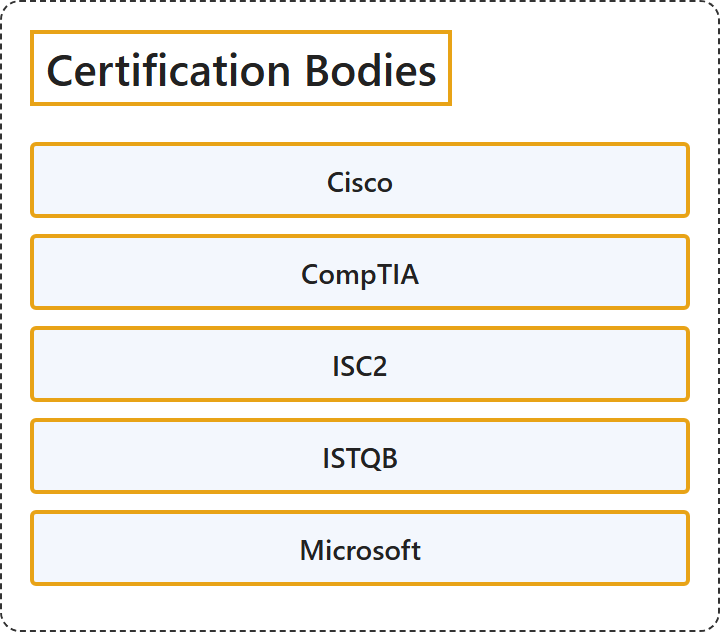

# 7. Certification Bodies

## Classification

## Glossary

| Term | Definition | 中文翻译 | Source |
|---|---|---|---|
| **Certification Bodies** 认证机构 | (context) "the process of **giving official or legal approval** to a person, company, product, etc. that has **reached a particular standard**" | （语境）对**达到特定标准**的个人、公司、产品等**给予正式或法定认可**的过程 | [Cambridge University Press & Assessment, n.d., "certification" noun](https://dictionary.cambridge.org/dictionary/english/certification) |
| **[Cisco](cisco.md)** Cisco 认证 | (context) "CCNA validates **a broad range of fundamentals for all IT careers** ..." | （语境）CCNA 验证**适用于所有 IT 职业的广泛基础知识**…… | [Cisco Systems, Inc., n.d., 'Validate essential skills in enterprise networking' section, para. 1](https://www.cisco.com/site/us/en/learn/training-certifications/certifications/enterprise/ccna/index.html#:~:text=CCNA%20validates%20a%20broad%20range%20of%20fundamentals%20for%20all) |
| **[CompTIA](comptia.md)** CompTIA（美国计算机行业协会） | "CompTIA plays a critical role in the global technology ecosystem. We are **the largest vendor-neutral credentialing organization** for **technology workers** ..." | CompTIA 在全球技术生态系统中发挥着关键作用。我们是面向**技术从业者**的**最大的厂商中立认证机构**…… | [Computing Technology Industry Association, n.d., 'What is CompTIA’s mission?' section, para. 1](https://www.comptia.org/en-us/about-us/#:~:text=CompTIA%20plays%20a%20critical%20role%20in%20the%20global%20technology) |
| **[ISC2](isc2.md)** ISC2（国际信息系统安全认证联盟） | "ISC2 is **the world’s leading member association** for **cybersecurity professionals**." | ISC2 是**全球领先的会员协会**，服务于**网络安全专业人员**。 | [ISC2, n.d., 'Our Vision' section, para. 2](https://www.isc2.org/about#:~:text=ISC2%20is%20the%20world%E2%80%99s%20leading%20member%20association%20for%20cybersecurity) |
| **[ISTQB](istqb.md)** 国际软件测试资质认证委员会（ISTQB） | "ISTQB® is **the leading global certification scheme** in the field of **software testing**." | ISTQB® 是**软件测试**领域**领先的全球认证体系**。 | [International Software Testing Qualifications Board, n.d., heading](https://istqb.org/#:~:text=ISTQB%C2%AE%20is%20the%20leading%20global%20certification%20scheme%20in%20the) |
| **[Microsoft](microsoft.md)** Microsoft 凭据（Microsoft Credentials） | "From role-based Certifications to scenario-based Applied Skills, now available for technical and business professionals, **Microsoft-verified credentials** help you **grow your AI career** ..." | 从基于角色的认证到基于场景的 Applied Skills，现已面向技术和业务专业人员提供，**经 Microsoft 验证的凭据**帮助你**发展 AI 职业**…… | [Microsoft, n.d., para. 2](https://learn.microsoft.com/en-us/credentials/#:~:text=From%20role%2Dbased%20Certifications%20to%20scenario%2Dbased%20Applied%20Skills%2C%20now) |

## References

Cambridge University Press & Assessment. (n.d.). Certification. In *Cambridge Dictionary*. Retrieved October 27, 2026, from <https://dictionary.cambridge.org/dictionary/english/certification>

Cisco Systems, Inc.. (n.d.). *CCNA*. Retrieved October 27, 2026, from <https://www.cisco.com/site/us/en/learn/training-certifications/certifications/enterprise/ccna/index.html>

Computing Technology Industry Association. (n.d.). *About us*. Retrieved October 27, 2026, from <https://www.comptia.org/en-us/about-us/>

International Software Testing Qualifications Board. (n.d.). *ISTQB®: Official software testing certifications*. Retrieved October 27, 2026, from <https://istqb.org/>

ISC2. (n.d.). *Our association and mission*. Retrieved October 27, 2026, from <https://www.isc2.org/about>

Microsoft. (n.d.). *Microsoft Credentials*. Retrieved October 27, 2026, from <https://learn.microsoft.com/en-us/credentials/>
