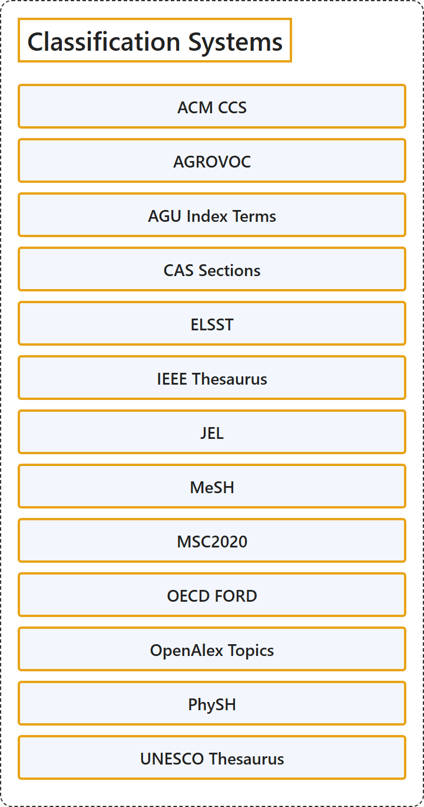

# 4. Classification Systems

## Classification

## Glossary

| Term | Definition | 中文翻译 | Source |
|---|---|---|---|
| **Classification Systems** 分类体系 | (context) "a **system for naming and organizing things**, especially plants and animals, **into groups that share similar qualities**" | （语境）一种**给事物命名并加以组织的体系**，尤其用于植物和动物，**把它们分成具有相似特性的组** | [Cambridge University Press & Assessment, n.d., "taxonomy" noun](https://dictionary.cambridge.org/dictionary/english/taxonomy) |
| **[ACM CCS](acm-ccs.md)** ACM 计算分类系统 | "The 2012 ACM Computing Classification System has been developed as a **poly-hierarchical ontology** that can be utilized in semantic web applications. It replaces the traditional 1998 version of the ACM Computing Classification System (CCS), which has served as **the de facto standard classification system for the computing field**." | 2012 ACM 计算分类系统被开发成一个**多层级的本体**，可以用于语义网应用。它取代了传统的 1998 版 ACM 计算分类系统（CCS），后者一直是**计算领域事实上的标准分类系统**。 | [Association for Computing Machinery, 2012, para. 1](https://www.acm.org/publications/class-2012#:~:text=The%202012%20ACM%20Computing%20Classification%20System%20has%20been%20developed) |
| **[AGROVOC](agrovoc.md)** AGROVOC（联合国粮农组织农业叙词表） | "AGROVOC is a relevant **Linked Open Data set about agriculture** available for public use and facilitates access and visibility of data **across domains and languages**." | AGROVOC 是一个可供公众使用的**关于农业的关联开放数据集**，有助于数据**跨领域、跨语言**的访问和可见性。 | [Food and Agriculture Organization of the United Nations, n.d., para. 1](https://www.fao.org/agrovoc/#:~:text=AGROVOC%20is%20a%20relevant%20Linked%20Open%20Data%20set) |
| **[AGU Index Terms](agu-index-terms.md)** AGU 索引词 | (context) "Choose the **most appropriate index terms** for **your paper**." | （语境）选择**最合适的索引词**，用于**你的论文**。 | [American Geophysical Union, n.d., para. 1](https://www.agu.org/publications/authors/journals/index-terms#:~:text=Choose%20the%20most%20appropriate%20index%20terms) |
| **[CAS Sections](cas-sections.md)** CA 类目（《化学文摘》分类） | "You will find that CAS information is divided into **80 different sections**. Each CA section covers only **one broad area of scientific inquiry**." | 你会发现，CAS 信息被划分为 **80 个不同的类目**。每个 CA 类目只涵盖**一个宽泛的科学研究领域**。 | [Chemical Abstracts Service, n.d., 1 and list item 1](https://www.cas.org/training/documentation/references/ca-sections#:~:text=You%20will%20find%20that%20CAS%20information%20is%20divided%20into) |
| **[ELSST](elsst.md)** ELSST（欧洲语言社会科学叙词表） | "The European Language Social Science Thesaurus (ELSST) is a **broad-based, multilingual thesaurus** for **the social sciences**." | 欧洲语言社会科学叙词表（ELSST）是一套面向**社会科学**的**覆盖面广的多语种叙词表**。 | [Consortium of European Social Science Data Archives, n.d., para. 1](https://elsst.cessda.eu/about/#:~:text=The%20European%20Language%20Social%20Science%20Thesaurus%20%28ELSST%29%20is) |
| **[IEEE Thesaurus](ieee-thesaurus.md)** IEEE 叙词表 | "The IEEE Thesaurus is a **controlled vocabulary** of about 12,770 **descriptive engineering, technical, and scientific terms** as well as IEEE-specific society terms." | IEEE 叙词表是一套**受控词表**，收录约 12,770 个**描述性的工程、技术和科学术语**，以及 IEEE 各学会特有的术语。 | [Institute of Electrical and Electronics Engineers, n.d., "General information on the IEEE Thesaurus" section, para. 1](https://www.ieee.org/publications/services/thesaurus#:~:text=The%20IEEE%20Thesaurus%20is%20a%20controlled%20vocabulary) |
| **[JEL](jel.md)** JEL 分类体系 | "The JEL classification system was developed for use in the Journal of Economic Literature (JEL), and is **a standard method of classifying scholarly literature** in the **field of economics**." | JEL 分类体系是为《经济文献杂志》（JEL）而开发的，是在**经济学领域**中**对学术文献进行分类的一种标准方法**。 | [American Economic Association, n.d., para. 1](https://www.aeaweb.org/econlit/jelCodes.php#:~:text=The%20JEL%20classification%20system%20was%20developed%20for%20use) |
| **[MeSH](mesh.md)** 医学主题词表（MeSH） | "The Medical Subject Headings (MeSH) thesaurus is a **controlled and hierarchically-organized vocabulary** produced by the National Library of Medicine. It is used for **indexing, cataloging, and searching** of biomedical and health-related information." | 医学主题词表（MeSH）叙词表是美国国家医学图书馆编制的一套**受控且分层组织的词表**。它用于对生物医学和健康相关信息进行**标引、编目和检索**。 | [National Library of Medicine, n.d., para. 1](https://www.nlm.nih.gov/mesh/meshhome.html#:~:text=The%20Medical%20Subject%20Headings%20%28MeSH%29%20thesaurus%20is%20a%20controlled) |
| **[MSC2020](msc2020.md)** MSC2020（数学学科分类 2020） | "Mathematical Reviews (MR) and zbMATH collaborate on maintaining the Mathematics Subject Classification, which is used by these reviewing services, publishers, funding agencies, and others to **categorize items in the mathematical sciences literature**. It is **a taxonomy created by and for mathematical researchers**." | Mathematical Reviews（MR）和 zbMATH 共同维护数学学科分类，这些评论服务、出版社、资助机构等用它来**给数学科学文献分类**。它是**由数学研究者创建、为数学研究者服务的分类体系**。 | [Associate Editors of Mathematical Reviews and zbMATH, 2020, para. 2](https://msc2020.org/#:~:text=Mathematical%20Reviews%20%28MR%29%20and%20zbMATH%20collaborate%20on%20maintaining) |
| **[OECD FORD](oecd-ford.md)** OECD 研究与发展领域分类（FORD） | "This manual proposes the use of the OECD Fields of Research and Development (FORD) classification for such purposes. This classification, developed for **R&D measurement purposes**, follows primarily **a content approach**." | 本手册建议为此类目的使用 OECD 研究与发展领域（FORD）分类。这一分类为 **R&D 测度目的**而制定，主要遵循**内容方法**。 | [Organisation for Economic Co-operation and Development, 2015, p. 57](https://doi.org/10.1787/9789264239012-en) |
| **[OpenAlex Topics](openalex-topics.md)** OpenAlex 主题 | "Topics are the **bottom, most granular level** of OpenAlex’s **classification hierarchy**: 4 domains → 26 fields → 252 subfields → 4,516 topics." | 主题是 OpenAlex **分类层级**中**最底层、最细粒度的一级**：4 个领域 → 26 个学科 → 252 个子学科 → 4,516 个主题。 | [OpenAlex, n.d., para. 1](https://docs.openalex.org/api-entities/topics#:~:text=Topics%20are%20the%20bottom%2C%20most%20granular%20level%20of%20OpenAlex%E2%80%99s) |
| **[PhySH](physh.md)** PhySH（物理学主题词表） | "PhySH (Physics Subject Headings) is a **physics classification scheme** developed by the American Physical Society (APS) to **organize journal, meeting, and other content by topic**." | PhySH（物理学主题词表）是美国物理学会（APS）开发的一种**物理学分类方案**，用于**按主题组织期刊、会议及其他内容**。 | [American Physical Society, n.d., para. 1](https://physh.org/about#:~:text=PhySH%20%28Physics%20Subject%20Headings%29%20is%20a%20physics%20classification%20scheme) |
| **[UNESCO Thesaurus](unesco-thesaurus.md)** UNESCO 叙词表 | "The UNESCO Thesaurus is a **controlled and structured list of concepts** used in **subject analysis and retrieval** of documents and publications in the fields of education, culture, natural sciences, social and human sciences, communication and information." | UNESCO 叙词表是一份**受控的、结构化的概念列表**，用于教育、文化、自然科学、社会与人文科学、传播与信息等领域文献和出版物的**主题分析与检索**。 | [UNESCO, n.d., para. 1](https://vocabularies.unesco.org/en/about#:~:text=The%20UNESCO%20Thesaurus%20is%20a%20controlled) |

## References

American Economic Association. (n.d.). *JEL classification system / EconLit subject descriptors*. Retrieved October 27, 2026, from <https://www.aeaweb.org/econlit/jelCodes.php>

American Geophysical Union. (n.d.). *Index terms*. Retrieved October 27, 2026, from <https://www.agu.org/publications/authors/journals/index-terms>

American Physical Society. (n.d.). *About PhySH*. Retrieved October 27, 2026, from <https://physh.org/about>

Associate Editors of Mathematical Reviews and zbMATH. (2020). *Mathematics Subject Classification 2020 (MSC2020)*. Retrieved October 27, 2026, from <https://msc2020.org/>

Association for Computing Machinery. (2012). *The 2012 ACM Computing Classification System*. Retrieved October 27, 2026, from <https://www.acm.org/publications/class-2012>

Cambridge University Press & Assessment. (n.d.). Taxonomy. In *Cambridge Dictionary*. Retrieved October 27, 2026, from <https://dictionary.cambridge.org/dictionary/english/taxonomy>

Chemical Abstracts Service. (n.d.). *The sections of CA*. Retrieved October 27, 2026, from <https://www.cas.org/training/documentation/references/ca-sections>

Consortium of European Social Science Data Archives. (n.d.). *About ELSST*. Retrieved October 27, 2026, from <https://elsst.cessda.eu/about/>

Food and Agriculture Organization of the United Nations. (n.d.). *AGROVOC*. Retrieved October 27, 2026, from <https://www.fao.org/agrovoc/>

Institute of Electrical and Electronics Engineers. (n.d.). *IEEE Thesaurus*. Retrieved October 27, 2026, from <https://www.ieee.org/publications/services/thesaurus>

National Library of Medicine. (n.d.). *Welcome to Medical Subject Headings*. Retrieved October 27, 2026, from <https://www.nlm.nih.gov/mesh/meshhome.html>

OpenAlex. (n.d.). *Topics*. Retrieved October 27, 2026, from <https://docs.openalex.org/api-entities/topics>

Organisation for Economic Co-operation and Development. (2015). *Frascati Manual 2015: Guidelines for collecting and reporting data on research and experimental development*. <https://doi.org/10.1787/9789264239012-en>

UNESCO. (n.d.). *About the UNESCO Thesaurus*. Retrieved October 27, 2026, from <https://vocabularies.unesco.org/en/about>
