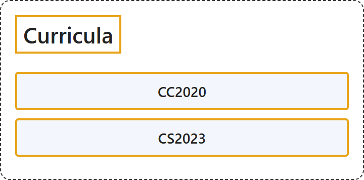

# 5. Curricula

## Classification

## Glossary

| Term | Definition | 中文翻译 | Source |
|---|---|---|---|
| **Curricula** 课程标准 | "the **subjects studied** in a school, college, etc. and **what each subject includes**" | 学校、学院等**所学的科目**以及**每个科目包括的内容** | [Cambridge University Press & Assessment, n.d., "curriculum" noun](https://dictionary.cambridge.org/dictionary/english/curriculum) |
| **[CC2020](cc2020.md)** CC2020（计算课程体系 2020） | "The purpose of the CC2020 project, as a modern extension of the CC2005 report, is to provide **global guidance** in an evolving computing environment as it affects **baccalaureate degree programs in computing** worldwide." | CC2020 项目作为 CC2005 报告的现代延伸，其目的是在不断演变的计算环境中提供**全球性指导**，因为这一环境影响着世界各地的**计算类学士学位项目**。 | [CC2020 Task Force, 2020, p. 14](https://www.acm.org/binaries/content/assets/education/curricula-recommendations/cc2020.pdf#page=15) |
| **[CS2023](cs2023.md)** CS2023 | "CS2023 is the **latest version of computer science curricular guidelines**, produced by **a joint task force of the ACM, IEEE Computer Society, and AAAI**." | CS2023 是**最新版的计算机科学课程指南**，由 **ACM、IEEE 计算机学会和 AAAI 的联合工作组**制定。 | [Joint Task Force on Computing Curricula, 2024, p. 1](https://csed.acm.org/wp-content/uploads/2024/04/1.1-Executive-Summary.pdf#page=1) |

## References

Cambridge University Press & Assessment. (n.d.). Curriculum. In *Cambridge Dictionary*. Retrieved October 27, 2026, from <https://dictionary.cambridge.org/dictionary/english/curriculum>

CC2020 Task Force. (2020). *Computing curricula 2020: Paradigms for global computing education*. <https://www.acm.org/binaries/content/assets/education/curricula-recommendations/cc2020.pdf>

Joint Task Force on Computing Curricula. (2024). *Executive summary*. <https://csed.acm.org/wp-content/uploads/2024/04/1.1-Executive-Summary.pdf>
