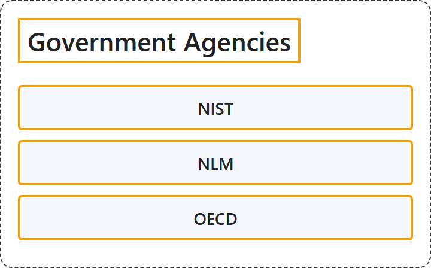

# 2. Government Agencies

## Classification

## Glossary

| Term | Definition | 中文翻译 | Source |
|---|---|---|---|
| **Government Agencies** 政府机构 | "a **government organization**" | **政府组织** | [Cambridge University Press & Assessment, n.d., "agency" noun (ORGANIZATION)](https://dictionary.cambridge.org/dictionary/english/agency) |
| **[NIST](nist.md)** 美国国家标准与技术研究院 | "The National Institute of Standards and Technology (NIST) was founded in 1901 and is now part of the **U.S. Department of Commerce**. NIST is one of the nation's **oldest physical science laboratories**." | 美国国家标准与技术研究院（NIST）成立于 1901 年，现隶属于**美国商务部**。NIST 是美国**历史最悠久的物理科学实验室**之一。 | [National Institute of Standards and Technology, n.d., para. 1](https://www.nist.gov/about-nist#:~:text=The%20National%20Institute%20of%20Standards%20and%20Technology%20%28NIST%29%20was%20founded) |
| **[NLM](nlm.md)** 美国国家医学图书馆 | "The world’s **largest biomedical library**, NLM maintains and makes available a **vast print collection** and produces **electronic information resources** on a wide range of topics ..." | 作为世界上**最大的生物医学图书馆**，NLM 维护并提供**大量印刷馆藏**，并制作涵盖广泛主题的**电子信息资源**…… | [National Library of Medicine, n.d., para. 1](https://www.nlm.nih.gov/about/index.html#:~:text=The%20world%E2%80%99s%20largest%20biomedical%20library%2C%20NLM%20maintains%20and%20makes) |
| **[OECD](oecd.md)** 经济合作与发展组织 | "The OECD is a **unique forum where governments work together** to address the **economic, social and environmental challenges of globalisation**." | 经合组织是一个**各国政府共同合作的独特论坛**，致力于应对**全球化带来的经济、社会和环境挑战**。 | [Organisation for Economic Co-operation and Development, 2015, back matter, para. 1](https://doi.org/10.1787/9789264239012-en) |

## References

Cambridge University Press & Assessment. (n.d.). Agency. In *Cambridge Dictionary*. Retrieved October 27, 2026, from <https://dictionary.cambridge.org/dictionary/english/agency>

National Institute of Standards and Technology. (n.d.). *About NIST*. Retrieved October 27, 2026, from <https://www.nist.gov/about-nist>

National Library of Medicine. (n.d.). *About the National Library of Medicine*. Retrieved October 27, 2026, from <https://www.nlm.nih.gov/about/index.html>

Organisation for Economic Co-operation and Development. (2015). *Frascati Manual 2015: Guidelines for collecting and reporting data on research and experimental development*. <https://doi.org/10.1787/9789264239012-en>
