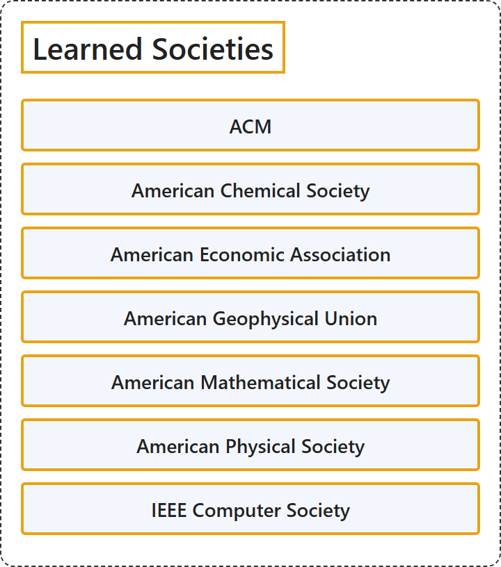

# 3. Learned Societies

## Classification

## Glossary

| Term | Definition | 中文翻译 | Source |
|---|---|---|---|
| **Learned Societies** 学会 | (context) "an **organization** to which **people who share similar interests** can belong" | （语境）一个**有共同兴趣的人**可以加入的**组织** | [Cambridge University Press & Assessment, n.d., "society" noun (ORGANIZATION)](https://dictionary.cambridge.org/dictionary/english/society) |
| **[ACM](acm.md)** 美国计算机协会 | "ACM, the world's **largest educational and scientific computing society**, delivers resources that advance **computing as a science and a profession**." | ACM 是世界上**最大的教育和科学计算学会**，提供推动**计算作为一门科学和一种职业**发展的资源。 | [Association for Computing Machinery, 2018](https://www.acm.org/code-of-ethics#:~:text=ACM%2C%20the%20world%27s%20largest%20educational%20and%20scientific%20computing%20society) |
| **[American Chemical Society](american-chemical-society.md)** 美国化学会 | (Definition pending: the site blocks automated reading, so no page is cached yet.) | （定义待补：该网站阻止自动读取，尚未缓存页面。） | Pending |
| **[American Economic Association](american-economic-association.md)** 美国经济学会 | "The American Economic Association (AEA) is a **nonprofit, nonpartisan, scholarly association** with more than 17,000 members from academia, government, and business who are committed to the **advancement of economics** and its enduring contributions to society." | 美国经济学会（AEA）是一个**非营利无党派学术协会**，拥有超过 17,000 名来自学术界、政府和商界的会员，他们致力于**推动经济学的发展**及其对社会的持久贡献。 | [American Economic Association, n.d., para. 1](https://www.aeaweb.org/about-aea#:~:text=The%20American%20Economic%20Association%20%28AEA%29%20is%20a%20nonprofit%2C%20nonpartisan) |
| **[American Geophysical Union](american-geophysical-union.md)** 美国地球物理联合会 | "AGU is a **global community** supporting more than half a million advocates and professionals in **Earth and space sciences**." | AGU 是一个**全球性社群**，支持着超过五十万名**地球与空间科学**领域的倡导者和专业人士。 | [American Geophysical Union, n.d.](https://news.agu.org/#:~:text=AGU%20is%20a%20global%20community%20supporting%20more%20than%20half%20a) |
| **[American Mathematical Society](american-mathematical-society.md)** 美国数学学会 | (Definition pending: the site blocks automated reading, so no page is cached yet.) | （定义待补：该网站阻止自动读取，尚未缓存页面。） | Pending |
| **[American Physical Society](american-physical-society.md)** 美国物理学会 | "The American Physical Society is a **nonprofit membership organization** working to **advance physics** by fostering a vibrant, inclusive, and global community dedicated to science and society." | 美国物理学会是一个**非营利会员组织**，致力于**推动物理学发展**，方式是培育一个充满活力、包容、全球化并致力于科学与社会的社群。 | [American Physical Society, n.d., para. 2](https://www.aps.org/about#:~:text=The%20American%20Physical%20Society%20is%20a%20nonprofit%20membership%20organization%20working) |
| **[IEEE Computer Society](ieee-computer-society.md)** IEEE 计算机学会 | "IEEE CS is the **trusted organization** dedicated to engaging the engineers, scientists, academia, and industry professionals from across the globe driving **continued advancements in computer science and technology**." | IEEE CS 是一个**值得信赖的组织**，致力于联系来自全球的工程师、科学家、学术界和行业专业人士，正是他们推动着**计算机科学与技术的持续进步**。 | [IEEE Computer Society, n.d., para. 2](https://www.computer.org/about#:~:text=IEEE%20CS%20is%20the%20trusted%20organization%20dedicated%20to%20engaging%20the) |

## References

American Economic Association. (n.d.). *About the AEA*. Retrieved October 27, 2026, from <https://www.aeaweb.org/about-aea>

American Geophysical Union. (n.d.). *AGU Newsroom*. Retrieved October 27, 2026, from <https://news.agu.org/>

American Physical Society. (n.d.). *About*. Retrieved October 27, 2026, from <https://www.aps.org/about>

Association for Computing Machinery. (2018). *ACM Code of Ethics and Professional Conduct*. Retrieved October 27, 2026, from <https://www.acm.org/code-of-ethics>

Cambridge University Press & Assessment. (n.d.). Society. In *Cambridge Dictionary*. Retrieved October 27, 2026, from <https://dictionary.cambridge.org/dictionary/english/society>

IEEE Computer Society. (n.d.). *About the IEEE Computer Society*. Retrieved October 27, 2026, from <https://www.computer.org/about>
