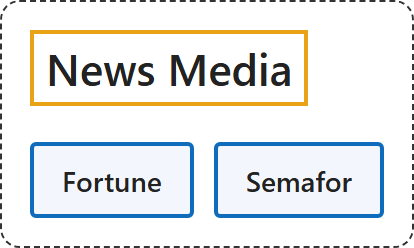

# 11. News Media

## Classification

## Glossary

| Term | Definition | 中文翻译 | Source |
|---|---|---|---|
| **News Media** 新闻媒体 | "forms of communication, including the internet, newspapers, magazines, television, etc., that **collect and give information about current events**, considered as a group" | 互联网、报纸、杂志、电视等**收集并提供时事信息**的传播形式的总称 | [Cambridge University Press & Assessment, n.d., "news media" noun](https://dictionary.cambridge.org/dictionary/english/news-media) |
| **[Fortune](fortune.md)** 《财富》 | "We achieve that by providing **trusted information**, telling great stories, and building world-class communities." | 我们通过提供**可信的信息**、讲述精彩的故事和建设世界级社群来实现这一点。 | [Fortune, n.d., "Our mission" section, para. 1](https://fortune.com/about-us/#:~:text=We%20achieve%20that%20by%20providing%20trusted%20information%2C%20telling) |
| **[Semafor](semafor.md)** Semafor | "Enter Semafor. The **world's first news platform** designed to meet the moment we are in." | Semafor 登场：为应对我们所处的时刻而设计的**全球首个新闻平台**。 | [Semafor, n.d., "About Semafor" section, para. 2](https://www.semafor.com/about#:~:text=Enter%20Semafor.%20The%20world%27s%20first%20news%20platform%20designed) |

## References

Cambridge University Press & Assessment. (n.d.). News media. In *Cambridge Dictionary*. Retrieved November 3, 2026, from <https://dictionary.cambridge.org/dictionary/english/news-media>

Fortune. (n.d.). *About us*. Retrieved November 3, 2026, from <https://fortune.com/about-us/>

Semafor. (n.d.). *About*. Retrieved November 3, 2026, from <https://www.semafor.com/about>
