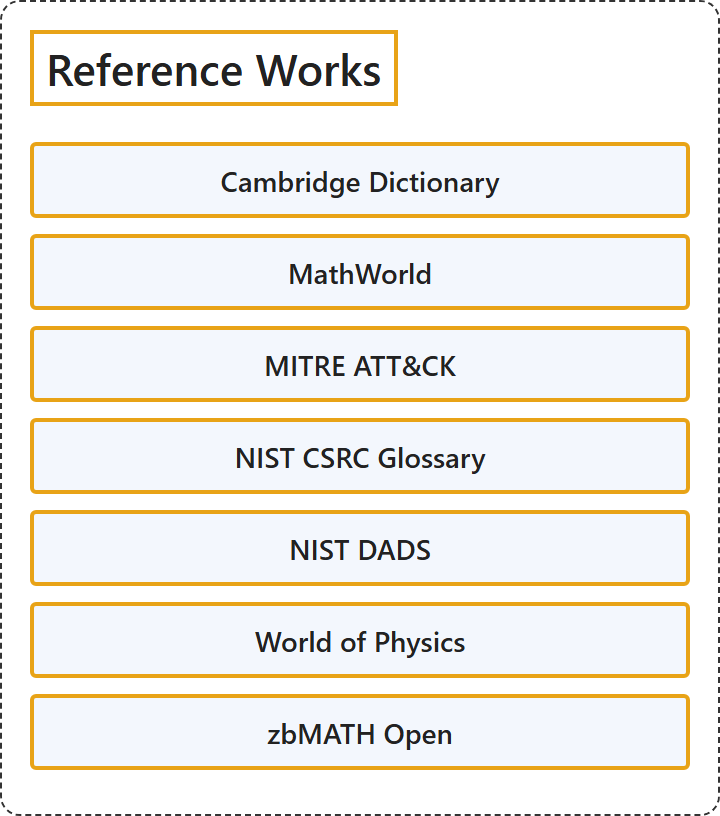

# 6. Reference Works

## Classification

## Glossary

| Term | Definition | 中文翻译 | Source |
|---|---|---|---|
| **Reference Works** 参考工具 | (context) "a **book of facts**, such as a dictionary or an encyclopedia, that you look at to **discover particular information**" | （语境）一种**汇集事实的书**，如词典或百科全书，供人查阅以**找到特定信息** | [Cambridge University Press & Assessment, n.d., "reference book" noun](https://dictionary.cambridge.org/dictionary/english/reference-book) |
| **[Cambridge Dictionary](cambridge-dictionary.md)** 剑桥词典 | "Cambridge University Press has been **publishing dictionaries for learners of English** since 1995. Cambridge Dictionaries Online began offering these dictionaries **completely free of charge** in 1999 — and today, Cambridge Dictionary is still growing." | 剑桥大学出版社自 1995 年起一直在**出版面向英语学习者的词典**。剑桥在线词典于 1999 年开始**完全免费**提供这些词典，而如今，剑桥词典仍在不断发展。 | [Cambridge University Press & Assessment, n.d., para. 1](https://dictionary.cambridge.org/about.html#:~:text=Cambridge%20University%20Press%20has%20been%20publishing%20dictionaries%20for%20learners) |
| **[MathWorld](mathworld.md)** MathWorld | "MathWorld is **the web's most extensive mathematical resource**, provided as **a free service** to the world's mathematics and internet communities ..." | MathWorld 是**网络上最全面的数学资源**，作为一项**免费服务**提供给全世界的数学界和互联网社区…… | [Wolfram Research, n.d., para. 1](https://mathworld.wolfram.com/about/#:~:text=MathWorld%20is%20the%20web%27s%20most%20extensive%20mathematical%20resource) |
| **[MITRE ATT&CK](mitre-att-ck.md)** MITRE ATT&CK | "MITRE ATT&CK® is a **globally-accessible knowledge base** of **adversary tactics and techniques** based on **real-world observations**." | MITRE ATT&CK® 是一个**全球可访问的知识库**，收录基于**真实世界观察**的**对手战术与技术**。 | [The MITRE Corporation, n.d., para. 1](https://attack.mitre.org/#:~:text=MITRE%20ATT%26CK%C2%AE%20is%20a%20globally%2Daccessible%20knowledge%20base%20of%20adversary) |
| **[NIST CSRC Glossary](nist-csrc-glossary.md)** NIST CSRC 术语表 | "This Glossary is **an aggregation of terms and definitions** specified in **NIST's cybersecurity and privacy standards, guidelines, and other technical publications**, and in CNSSI 4009-2022." | 本术语表**汇集了术语和定义**，它们出自 **NIST 的网络安全与隐私标准、指南及其他技术出版物**，以及 CNSSI 4009-2022。 | [National Institute of Standards and Technology, n.d., para. 2](https://csrc.nist.gov/glossary#:~:text=This%20Glossary%20is%20an%20aggregation%20of%20terms%20and%20definitions) |
| **[NIST DADS](nist-dads.md)** 算法与数据结构词典（DADS） | "This is a dictionary of **algorithms**, algorithmic techniques, **data structures**, **archetypal problems**, and related definitions." | 这是一部词典，收录**算法**、算法技术、**数据结构**、**典型问题**以及相关定义。 | [Black, P. E., 2024, para. 2](https://xlinux.nist.gov/dads/#:~:text=This%20is%20a%20dictionary%20of%20algorithms%2C%20algorithmic%20techniques%2C%20data) |
| **[World of Physics](world-of-physics.md)** 物理学世界（Eric Weisstein's World of Physics） | (context) "Eric Weisstein's World of Science contains **budding encyclopedias** of astronomy, scientific biography, chemistry, and **physics**." | （语境）Eric Weisstein 的科学世界（World of Science）包含若干**正在成长的百科全书**，涵盖天文学、科学传记、化学和**物理学**。 | [Weisstein, E. W., n.d., para. 1](https://scienceworld.wolfram.com/info/#:~:text=Eric%20Weisstein%27s%20World%20of%20Science%20contains%20budding%20encyclopedias%20of) |
| **[zbMATH Open](zbmath-open.md)** zbMATH Open | (Definition pending: the site blocks automated reading, so no page is cached yet.) | （定义待补：该网站阻止自动读取，尚未缓存页面。） | Pending |

## References

Black, P. E.. (2024). *Dictionary of Algorithms and Data Structures*. Retrieved October 27, 2026, from <https://xlinux.nist.gov/dads/>

Cambridge University Press & Assessment. (n.d.). *About Cambridge Dictionary*. Retrieved October 27, 2026, from <https://dictionary.cambridge.org/about.html>

Cambridge University Press & Assessment. (n.d.). Reference book. In *Cambridge Dictionary*. Retrieved October 27, 2026, from <https://dictionary.cambridge.org/dictionary/english/reference-book>

National Institute of Standards and Technology. (n.d.). *Glossary*. Retrieved October 27, 2026, from <https://csrc.nist.gov/glossary>

The MITRE Corporation. (n.d.). *MITRE ATT&CK®*. Retrieved October 27, 2026, from <https://attack.mitre.org/>

Weisstein, E. W.. (n.d.). *About Eric Weisstein's World of Science*. Retrieved October 27, 2026, from <https://scienceworld.wolfram.com/info/>

Wolfram Research. (n.d.). *About MathWorld*. Retrieved October 27, 2026, from <https://mathworld.wolfram.com/about/>
