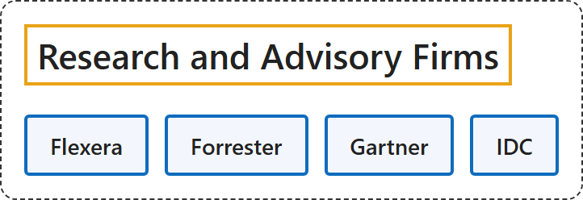

# 10. Research and Advisory Firms

## Classification

## Glossary

| Term | Definition | 中文翻译 | Source |
|---|---|---|---|
| **Research and Advisory Firms** 研究咨询公司 | (context) "**detailed study of a subject**, especially in order to **discover new information** about something or reach a new understanding of it" | （语境）对某一主题的**详细研究**，尤其是为了**发现新信息**或获得新的理解 | [Cambridge University Press & Assessment, n.d., "research" noun, definition 1](https://dictionary.cambridge.org/dictionary/english/research) |
| **[Flexera](flexera.md)** Flexera | "We are the **industry leader in hybrid IT asset management (ITAM) and FinOps**, with the numbers to back it up." | 我们是**混合 IT 资产管理（ITAM）和 FinOps 领域的行业领导者**，并有数据作证。 | [Flexera, n.d., "The intelligence to make better decisions, the data to bring teams together" section, para. 1](https://www.flexera.com/about-us#:~:text=We%20are%20the%20industry%20leader%20in%20hybrid%20IT) |
| **[Forrester](forrester.md)** Forrester | "Forrester helps **business and technology leaders** use **customer obsession** to **accelerate growth**." | Forrester 帮助**商业与技术领导者**运用**客户至上**理念**加速增长**。 | [Forrester, n.d., "About Us" section, para. 1](https://www.forrester.com/about-us/#:~:text=Forrester%20helps%20business%20and%20technology%20leaders%20use%20customer) |
| **[Gartner](gartner.md)** 高德纳 | "We deliver **actionable, objective business and technology insights**." | 我们提供**可付诸行动、客观的商业与技术洞察**。 | [Gartner, n.d., opening heading](https://www.gartner.com/en/about#:~:text=We%20deliver%20actionable%2C%20objective%20business%20and%20technology%20insights) |
| **[IDC](idc.md)** 国际数据公司 | "Building a world where the **most trusted technology intelligence** makes **everyone better at what they do**." | 建设一个让**最值得信赖的技术情报**使**每个人都更擅长自己工作**的世界。 | [IDC, n.d., "We are the tech intelligence layer of the AI economy" section, para. 1](https://www.idc.com/about/#:~:text=Building%20a%20world%20where%20the%20most%20trusted%20technology) |

## References

Cambridge University Press & Assessment. (n.d.). Research. In *Cambridge Dictionary*. Retrieved November 3, 2026, from <https://dictionary.cambridge.org/dictionary/english/research>

Flexera. (n.d.). *About us*. Retrieved November 3, 2026, from <https://www.flexera.com/about-us>

Forrester. (n.d.). *About us*. Retrieved November 3, 2026, from <https://www.forrester.com/about-us/>

Gartner. (n.d.). *About Gartner: Company information & leadership*. Retrieved November 3, 2026, from <https://www.gartner.com/en/about>

IDC. (n.d.). *About IDC*. Retrieved November 3, 2026, from <https://www.idc.com/about/>
