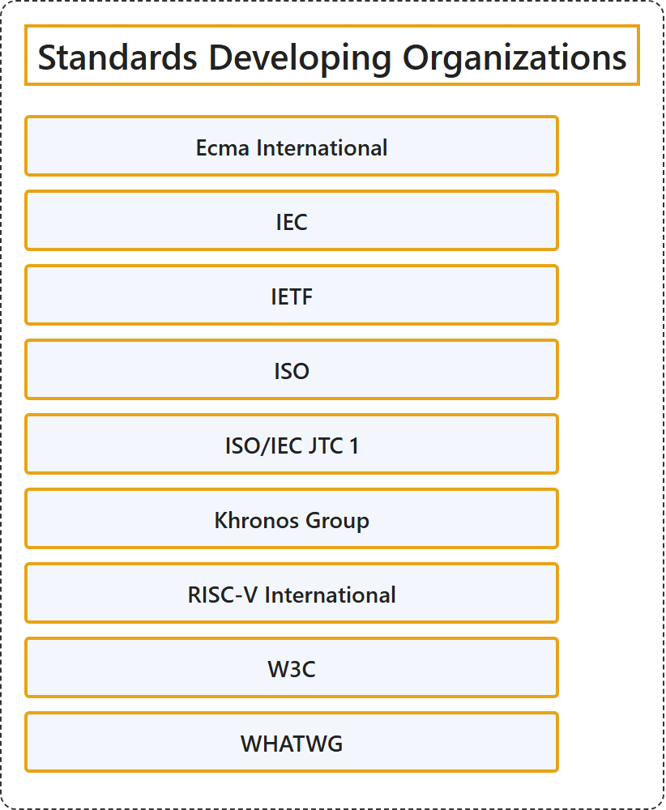

# 1. Standards Developing Organizations

## Classification

## Glossary

| Term | Definition | 中文翻译 | Source |
|---|---|---|---|
| **Standards Developing Organizations** 标准制定组织 | "any organization that **develops and approves standards** using various methods to **establish consensus among its participants**." | 任何以各种方法在参与者之间**达成共识**、以此**制定并批准标准**的组织。 | [National Institute of Standards and Technology, n.d., "standards developing organization" entry, definition 1](https://csrc.nist.gov/glossary/term/standards_developing_organization#:~:text=any%20organization%20that%20develops%20and%20approves%20standards) |
| **[Ecma International](ecma-international.md)** Ecma 国际 | "Ecma International is an **industry association** dedicated to the **standardization of information and communication systems**" | Ecma 国际是一个**行业协会**，致力于**信息与通信系统的标准化**。 | [Ecma International, n.d., para. 1](https://ecma-international.org/#:~:text=Ecma%20International%20is%20an%20industry%20association%20dedicated%20to%20the) |
| **[IEC](iec.md)** 国际电工委员会 | "Founded in 1906, the IEC (International Electrotechnical Commission) is the **world’s leading organization** for the preparation and publication of **international standards for all electrical, electronic and related technologies**." | IEC（国际电工委员会）成立于 1906 年，是**全球领先的组织**，负责编制和发布**所有电气、电子及相关技术的国际标准**。 | [International Electrotechnical Commission, n.d., para. 1](https://www.iec.ch/who-we-are#:~:text=Founded%20in%201906%2C%20the%20IEC) |
| **[IETF](ietf.md)** 互联网工程任务组 | "The Internet Engineering Task Force (IETF), founded in 1986, is the **premier standards development organization** (SDO) for the **Internet**." | 互联网工程任务组（IETF）成立于 1986 年，是**互联网**领域**首要的标准制定组织**（SDO）。 | [Internet Engineering Task Force, n.d., para. 1](https://www.ietf.org/about/introduction/#:~:text=The%20Internet%20Engineering%20Task%20Force%20%28IETF%29%2C%20founded%20in%201986%2C%20is) |
| **[ISO](iso.md)** 国际标准化组织 | "ISO is an **independent, non-governmental organization** made up of members from the **national standards bodies** of 177 countries." | ISO 是一个**独立的非政府组织**，由来自 177 个国家的**国家标准机构**的成员组成。 | [International Organization for Standardization, n.d., para. 1](https://www.iso.org/structure.html#:~:text=ISO%20is%20an%20independent%2C%20non%2Dgovernmental%20organization%20made%20up) |
| **[ISO/IEC JTC 1](iso-iec-jtc-1.md)** ISO/IEC 第一联合技术委员会 | "ISO-IEC Joint Technical Committee (JTC 1) is a **consensus based, voluntary international standards group** focussing on **information technology** (IT)." | ISO-IEC 联合技术委员会（JTC 1）是一个**基于共识的自愿性国际标准团体**，专注于**信息技术**（IT）。 | [ISO/IEC Joint Technical Committee 1, n.d., para. 1](https://jtc1info.org/about/#:~:text=ISO%2DIEC%20Joint%20Technical%20Committee%20%28JTC%201%29%20is%20a%20consensus) |
| **[Khronos Group](khronos-group.md)** Khronos 组织 | "The Khronos Group is an **open, member-driven consortium** that provides a space for the creation of the **interoperability standards** that enable developers to harness the full power of 3D graphics, XR (VR & AR), parallel computing, machine learning, vision processing and the metaverse." | Khronos Group 是一个**开放且由成员驱动的联盟**，为创建**互操作性标准**提供空间，这些标准使开发者能够充分发挥 3D 图形、XR（VR 与 AR）、并行计算、机器学习、视觉处理和元宇宙的全部能力。 | [The Khronos Group, n.d., para. 2](https://www.khronos.org/about/#:~:text=The%20Khronos%20Group%20is%20an%20open%2C%20member%2Ddriven%20consortium%20that) |
| **[RISC-V International](risc-v-international.md)** RISC-V 国际 | "RISC-V International is the **global non-profit home** of the **open standard RISC-V Instruction Set Architecture** (ISA), related specifications, and stakeholder community." | RISC-V 国际是**全球性的非营利家园**，承载**开放标准 RISC-V 指令集架构**（ISA）、相关规范和利益相关者社区。 | [RISC-V International, n.d., para. 1](https://riscv.org/about/#:~:text=RISC%2DV%20International%20is%20the%20global%20non%2Dprofit%20home%20of%20the) |
| **[W3C](w3c.md)** W3C | "The World Wide Web Consortium (W3C) is an **international public-interest non-profit organization** where Member organizations, a full-time staff, and the public **work together to develop web standards**." | 万维网联盟（W3C）是一个**国际性的公益非营利组织**，会员组织、全职员工和公众在这里**共同制定 Web 标准**。 | [World Wide Web Consortium, n.d., "Who we are" section, para. 1](https://www.w3.org/about/#:~:text=The%20World%20Wide%20Web%20Consortium%20%28W3C%29%20is%20an%20international) |
| **[WHATWG](whatwg.md)** WHATWG | "The Web Hypertext Application Technology Working Group (WHATWG) is a **community of people** interested in **evolving the web through standards and tests**." | 网页超文本应用技术工作小组（WHATWG）是一个**由人组成的社区**，这些人致力于**通过标准和测试推动网络的演进**。 | [Web Hypertext Application Technology Working Group, n.d., para. 1](https://whatwg.org/faq#:~:text=The%20Web%20Hypertext%20Application%20Technology%20Working%20Group%20%28WHATWG%29%20is) |

## References

Ecma International. (n.d.). *Home*. Retrieved October 27, 2026, from <https://ecma-international.org/>

International Electrotechnical Commission. (n.d.). *Who we are*. Retrieved October 27, 2026, from <https://www.iec.ch/who-we-are>

International Organization for Standardization. (n.d.). *Structure and governance*. Retrieved October 27, 2026, from <https://www.iso.org/structure.html>

Internet Engineering Task Force. (n.d.). *Introduction to the IETF*. Retrieved October 27, 2026, from <https://www.ietf.org/about/introduction/>

ISO/IEC Joint Technical Committee 1. (n.d.). *About*. Retrieved October 27, 2026, from <https://jtc1info.org/about/>

National Institute of Standards and Technology. (n.d.). Standards developing organization. In *CSRC glossary*. Retrieved October 27, 2026, from <https://csrc.nist.gov/glossary/term/standards_developing_organization>

RISC-V International. (n.d.). *About RISC-V*. Retrieved October 27, 2026, from <https://riscv.org/about/>

The Khronos Group. (n.d.). *About the Khronos Group*. Retrieved October 27, 2026, from <https://www.khronos.org/about/>

Web Hypertext Application Technology Working Group. (n.d.). *FAQ*. Retrieved October 27, 2026, from <https://whatwg.org/faq>

World Wide Web Consortium. (n.d.). *About us*. Retrieved October 27, 2026, from <https://www.w3.org/about/>
