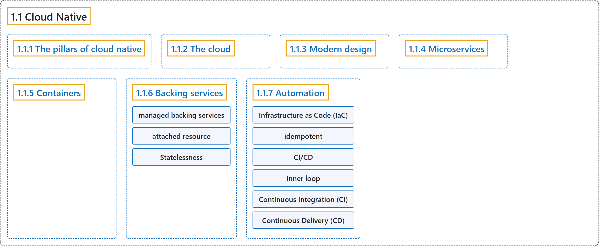

# 1.1 Cloud Native

## Classification

## Glossary

| Term | Definition | 中文翻译 | Source |
|---|---|---|---|
| **1.1 Cloud Native** 云原生 | "**Cloud-native architecture and technologies** are an approach to **designing, constructing, and operating workloads** that are built in the cloud and **take full advantage of the cloud computing model**." | **云原生架构和技术**是一种**设计、构建和运行工作负载**的方法，这些工作负载在云中构建，并**充分利用云计算模型**。 | [Microsoft, 2023, "What is Cloud Native?", para. 3](https://learn.microsoft.com/en-us/dotnet/architecture/cloud-native/definition#:~:text=Cloud%2Dnative%20architecture%20and%20technologies%20are%20an%20approach) |
| **1.1.1 The pillars of cloud native** 云原生的支柱 | "The speed and agility of cloud native derive from **many factors**. Foremost is ***cloud infrastructure***. But there's more: **Five other foundational pillars** shown in Figure 1-3 also provide the bedrock for cloud-native systems." | 云原生的速度和敏捷性来自**许多因素**。首先是***云基础设施***。但还不止这些：图 1-3 中的**另外五根基础支柱**也为云原生系统提供了基石。 | [Microsoft, 2023, "The pillars of cloud native", para. 1](https://learn.microsoft.com/en-us/dotnet/architecture/cloud-native/definition#:~:text=The%20speed%20and%20agility%20of%20cloud%20native%20derive) |
| **1.1.2 The cloud** 云 | (Definition pending) | （定义待补） | [Microsoft, 2023, "The cloud"](https://learn.microsoft.com/en-us/dotnet/architecture/cloud-native/definition#the-cloud) |
| **1.1.3 Modern design** 现代设计 | (Definition pending) | （定义待补） | [Microsoft, 2023, "Modern design"](https://learn.microsoft.com/en-us/dotnet/architecture/cloud-native/definition#modern-design) |
| **1.1.4 Microservices** 微服务 | (Definition pending) | （定义待补） | [Microsoft, 2023, "Microservices"](https://learn.microsoft.com/en-us/dotnet/architecture/cloud-native/definition#microservices) |
| **1.1.5 Containers** 容器 | (Definition pending) | （定义待补） | [Microsoft, 2023, "Containers"](https://learn.microsoft.com/en-us/dotnet/architecture/cloud-native/definition#containers) |
| **1.1.6 Backing services** 支撑服务 | "**Cloud-native systems depend upon many different ancillary resources**, such as data stores, message brokers, monitoring, and identity services. These services are known as **backing services**." | **云原生系统依赖许多不同的辅助资源**，例如数据存储、消息代理、监控和身份服务。这些服务被称为**支撑服务**。 | [Microsoft, 2023, "Backing services", para. 1](https://learn.microsoft.com/en-us/dotnet/architecture/cloud-native/definition#:~:text=Cloud%2Dnative%20systems%20depend%20upon%20many%20different) |
| **managed backing services** 托管支撑服务 | "**Cloud providers** offer a rich assortment of ***managed backing services.*** Instead of **owning the service**, you simply **consume it**." | **云提供商**提供丰富多样的***托管支撑服务***。你不必**拥有这项服务**，只需**使用它**。 | [Microsoft, 2023, "Backing services", para. 4](https://learn.microsoft.com/en-us/dotnet/architecture/cloud-native/definition#:~:text=Cloud%20providers%20offer%20a%20rich%20assortment%20of) |
| **attached resource** 附加资源 | "A best practice is to treat **a backing service** as an **attached resource**, dynamically bound to a microservice with **configuration information** (a URL and credentials) stored in an external configuration." | 最佳做法是把**支撑服务**当作**附加资源**，通过存放在外部配置中的**配置信息**（URL 和凭据）动态绑定到微服务。 | [Microsoft, 2023, "Backing services", para. 6](https://learn.microsoft.com/en-us/dotnet/architecture/cloud-native/definition#:~:text=A%20best%20practice%20is%20to%20treat%20a) |
| **Statelessness** 无状态 | (context) "On a final thought, **backing services** also promote **the Statelessness principle** from the Twelve-Factor Application, discussed earlier in the chapter." | （语境）最后，**支撑服务**还促进了十二要素应用中的**无状态原则**，本章前面已经讨论过。 | [Microsoft, 2023, "Backing services", para. 10](https://learn.microsoft.com/en-us/dotnet/architecture/cloud-native/definition#:~:text=On%20a%20final%20thought%2C%20backing%20services%20also) |
| **1.1.7 Automation** 自动化 | "As you've seen, cloud-native systems embrace microservices, containers, and modern system design to achieve speed and agility. But, that's only part of the story. How do you **provision the cloud environments** upon which these systems run? How do you **rapidly deploy app features and updates**? How do you round out the full picture?" | 正如你所见，云原生系统采用微服务、容器和现代系统设计来实现速度和敏捷性。但这只是故事的一部分。如何**置备云环境**，让这些系统在上面运行？如何**快速部署应用功能和更新**？又如何把整幅图景补全？ | [Microsoft, 2023, "Automation", para. 1](https://learn.microsoft.com/en-us/dotnet/architecture/cloud-native/definition#:~:text=As%20you%27ve%20seen%2C%20cloud%2Dnative%20systems%20embrace) |
| **Infrastructure as Code (IaC)** 基础设施即代码 | "Enter the widely accepted practice of **Infrastructure as Code**, or IaC. With IaC, you **automate platform provisioning and application deployment**." | 这就引出了被广泛接受的**基础设施即代码**实践，简称 IaC。有了 IaC，你可以**自动完成平台置备和应用部署**。 | [Microsoft, 2023, "Automation", paras. 2–3](https://learn.microsoft.com/en-us/dotnet/architecture/cloud-native/definition#:~:text=Enter%20the%20widely%20accepted%20practice%20of) |
| **idempotent** 幂等 | "Under the hood, **IaC is idempotent**, meaning that you can **run the same script over and over without side effects**." | 在底层，**IaC 是幂等的**，意思是你可以**反复运行同一个脚本而没有副作用**。 | [Microsoft, 2023, "Automating infrastructure", para. 2](https://learn.microsoft.com/en-us/dotnet/architecture/cloud-native/definition#:~:text=Under%20the%20hood%2C%20IaC%20is%20idempotent) |
| **CI/CD** continuous integration/continuous delivery 持续集成/持续交付 | "Modern **CI/CD systems** help fulfill this principle. They provide **separate build and delivery steps** that help ensure consistent and quality code that's readily available to users." | 现代 **CI/CD 系统**有助于落实这一原则。它们提供**彼此分开的构建和交付步骤**，帮助确保代码一致、质量可靠，并随时可供用户使用。 | [Microsoft, 2023, "Automating deployments", para. 3](https://learn.microsoft.com/en-us/dotnet/architecture/cloud-native/definition#:~:text=Modern%20CI%2FCD%20systems%20help%20fulfill%20this%20principle) |
| **inner loop** 内循环 | "The developer constructs a feature in their development environment, iterating through what is called the "**inner loop**" of **code, run, and debug**." | 开发者在自己的开发环境中构建功能，反复经历被称为**内循环**的过程，即**编码、运行和调试**。 | [Microsoft, 2023, "Automating deployments", para. 5, item 1](https://learn.microsoft.com/en-us/dotnet/architecture/cloud-native/definition#:~:text=The%20developer%20constructs%20a%20feature%20in%20their%20development) |
| **Continuous Integration (CI)** 持续集成 | "The push triggers **a build stage** that transforms the code into a binary artifact. The work is implemented with a Continuous Integration (CI) pipeline. It **automatically builds, tests, and packages** the application." | 推送会触发**一个构建阶段**，把代码转换成二进制制品。这项工作由持续集成（CI）流水线完成。它**自动构建、测试并打包**应用。 | [Microsoft, 2023, "Automating deployments", para. 5, item 3](https://learn.microsoft.com/en-us/dotnet/architecture/cloud-native/definition#:~:text=The%20push%20triggers%20a%20build%20stage) |
| **Continuous Delivery (CD)** 持续交付 | "The release stage picks up the binary artifact, applies external application and environment configuration information, and produces **an immutable release**. The release is deployed to **a specified environment**. The work is implemented with a Continuous Delivery (CD) pipeline." | 发布阶段取得二进制制品，应用外部的应用配置和环境配置信息，生成**一个不可变的发布版本**。该版本被部署到**指定的环境**。这项工作由持续交付（CD）流水线完成。 | [Microsoft, 2023, "Automating deployments", para. 5, item 4](https://learn.microsoft.com/en-us/dotnet/architecture/cloud-native/definition#:~:text=The%20release%20stage%20picks%20up%20the%20binary%20artifact) |

## References

Microsoft. (2023, December 14). *What is Cloud Native?* Microsoft Learn. Retrieved November 11, 2026, from <https://learn.microsoft.com/en-us/dotnet/architecture/cloud-native/definition>
