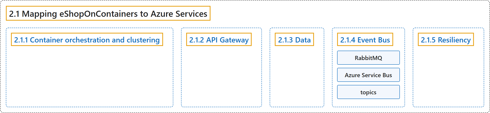

# 2.1 Mapping eShopOnContainers to Azure Services

## Classification

## Glossary

| Term | Definition | 中文翻译 | Source |
|---|---|---|---|
| **2.1 Mapping eShopOnContainers to Azure Services** 将 eShopOnContainers 映射到 Azure 服务 | "The **server-side components** of this architecture all **map easily to Azure services**." | 这一架构的**服务器端组件**都能**轻松映射到 Azure 服务**。 | [Microsoft, 2022, "Mapping eShopOnContainers to Azure Services", para. 3](https://learn.microsoft.com/en-us/dotnet/architecture/cloud-native/map-eshoponcontainers-azure-services#:~:text=The%20server%2Dside%20components%20of%20this%20architecture) |
| **2.1.1 Container orchestration and clustering** 容器编排与集群 | (Definition pending) | （定义待补） | [Microsoft, 2022, "Container orchestration and clustering"](https://learn.microsoft.com/en-us/dotnet/architecture/cloud-native/map-eshoponcontainers-azure-services#container-orchestration-and-clustering) |
| **2.1.2 API Gateway** API 网关 | (Definition pending) | （定义待补） | [Microsoft, 2022, "API Gateway"](https://learn.microsoft.com/en-us/dotnet/architecture/cloud-native/map-eshoponcontainers-azure-services#api-gateway) |
| **2.1.3 Data** 数据 | (Definition pending) | （定义待补） | [Microsoft, 2022, "Data"](https://learn.microsoft.com/en-us/dotnet/architecture/cloud-native/map-eshoponcontainers-azure-services#data) |
| **2.1.4 Event Bus** 事件总线 | "The application uses **events** to **communicate changes between different services**." | 该应用使用**事件**在**不同服务之间传递变更**。 | [Microsoft, 2022, "Event Bus", para. 1](https://learn.microsoft.com/en-us/dotnet/architecture/cloud-native/map-eshoponcontainers-azure-services#:~:text=The%20application%20uses%20events%20to%20communicate%20changes) |
| **RabbitMQ** RabbitMQ | (context) "This functionality can be implemented with **various implementations**, and locally the eShopOnContainers application uses **RabbitMQ**." | （语境）这一功能可以用**多种实现**来完成，eShopOnContainers 应用在本地使用 **RabbitMQ**。 | [Microsoft, 2022, "Event Bus", para. 1](https://learn.microsoft.com/en-us/dotnet/architecture/cloud-native/map-eshoponcontainers-azure-services#:~:text=This%20functionality%20can%20be%20implemented%20with%20various) |
| **Azure Service Bus** Azure 服务总线 | (context) "When hosted in Azure, the application would leverage **Azure Service Bus** for **its messaging**." | （语境）托管在 Azure 上时，该应用会使用 **Azure Service Bus** 来处理**它的消息传递**。 | [Microsoft, 2022, "Event Bus", para. 1](https://learn.microsoft.com/en-us/dotnet/architecture/cloud-native/map-eshoponcontainers-azure-services#:~:text=When%20hosted%20in%20Azure%2C%20the%20application%20would) |
| **topics** 主题 | (context) "Azure Service Bus supports **individual queues** as well as separate ***topics*** to support **publisher-subscriber scenarios**." | （语境）Azure Service Bus 既支持**单独的队列**，也支持独立的***主题***，用于**发布者-订阅者场景**。 | [Microsoft, 2022, "Event Bus", para. 1](https://learn.microsoft.com/en-us/dotnet/architecture/cloud-native/map-eshoponcontainers-azure-services#:~:text=Azure%20Service%20Bus%20supports%20individual%20queues) |
| **2.1.5 Resiliency** 弹性 | (Definition pending) | （定义待补） | [Microsoft, 2022, "Resiliency"](https://learn.microsoft.com/en-us/dotnet/architecture/cloud-native/map-eshoponcontainers-azure-services#resiliency) |

## References

Microsoft. (2022, April 6). *Mapping eShopOnContainers to Azure Services*. Microsoft Learn. Retrieved November 11, 2026, from <https://learn.microsoft.com/en-us/dotnet/architecture/cloud-native/map-eshoponcontainers-azure-services>
