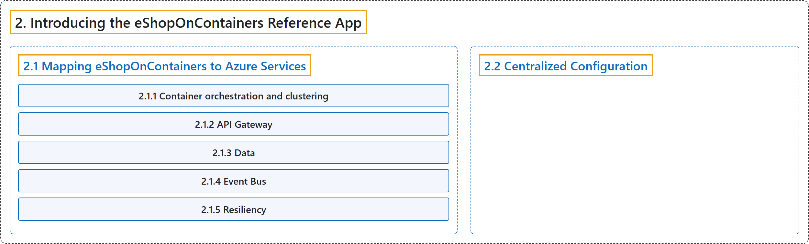

# 2. Introducing the eShopOnContainers Reference App

## Classification

## Glossary

| Term | Definition | 中文翻译 | Source |
|---|---|---|---|
| **2. Introducing the eShopOnContainers Reference App** eShopOnContainers 参考应用简介 | "Microsoft, in partnership with leading community experts, has produced **a full-featured cloud-native microservices reference application**, **eShopOnContainers**." | 微软与社区领先专家合作，制作了**一个功能完整的云原生微服务参考应用**，即 **eShopOnContainers**。 | [Microsoft, 2022, "Introducing eShopOnContainers reference app", para. 1](https://learn.microsoft.com/en-us/dotnet/architecture/cloud-native/introduce-eshoponcontainers-reference-app#:~:text=Microsoft%2C%20in%20partnership%20with%20leading%20community%20experts) |
| **[2.1 Mapping eShopOnContainers to Azure Services](2-1-mapping-eshoponcontainers-to-azure-services.md)** 将 eShopOnContainers 映射到 Azure 服务 | "The **server-side components** of this architecture all **map easily to Azure services**." | 这一架构的**服务器端组件**都能**轻松映射到 Azure 服务**。 | [Microsoft, 2022, "Mapping eShopOnContainers to Azure Services", para. 3](https://learn.microsoft.com/en-us/dotnet/architecture/cloud-native/map-eshoponcontainers-azure-services#:~:text=The%20server%2Dside%20components%20of%20this%20architecture) |
| **[2.2 Centralized Configuration](2-2-centralized-configuration.md)** 集中式配置 | (Definition pending) | （定义待补） | [Microsoft, 2022, "Centralized configuration"](https://learn.microsoft.com/en-us/dotnet/architecture/cloud-native/centralized-configuration) |

## References

Microsoft. (2022, April 6). *Centralized configuration*. Microsoft Learn. Retrieved November 11, 2026, from <https://learn.microsoft.com/en-us/dotnet/architecture/cloud-native/centralized-configuration>

Microsoft. (2022, April 6). *Introducing eShopOnContainers reference app*. Microsoft Learn. Retrieved November 11, 2026, from <https://learn.microsoft.com/en-us/dotnet/architecture/cloud-native/introduce-eshoponcontainers-reference-app>

Microsoft. (2022, April 6). *Mapping eShopOnContainers to Azure Services*. Microsoft Learn. Retrieved November 11, 2026, from <https://learn.microsoft.com/en-us/dotnet/architecture/cloud-native/map-eshoponcontainers-azure-services>
