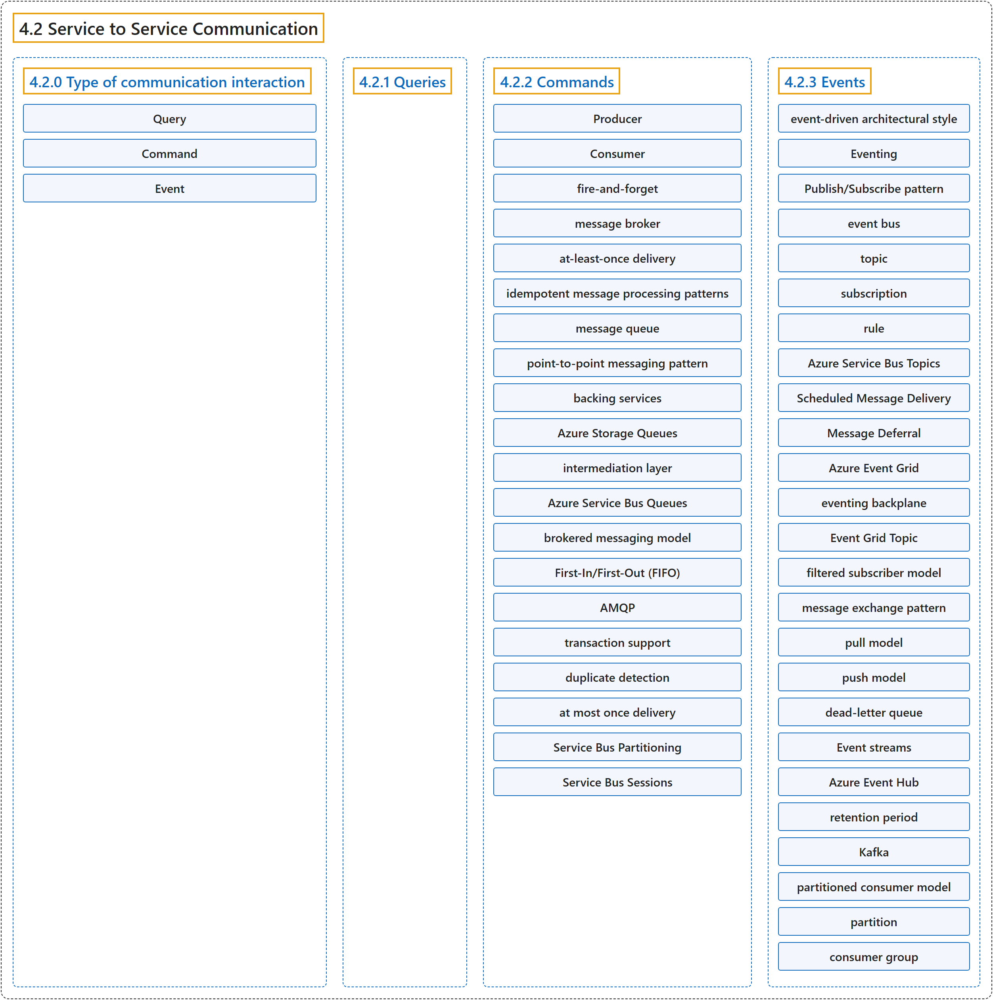

# 4.2 Service to Service Communication

## Classification

## Glossary

| Term | Definition | 中文翻译 | Source |
|---|---|---|---|
| **4.2 Service to Service Communication** 服务间通信 | "When constructing **a cloud-native application**, you'll want to be sensitive to **how back-end services communicate with each other**." | 构建**云原生应用**时，你需要留意**后端服务之间如何通信**。 | [Microsoft, 2022, "Service-to-service communication", para. 2](https://learn.microsoft.com/en-us/dotnet/architecture/cloud-native/service-to-service-communication#:~:text=When%20constructing%20a%20cloud%2Dnative%20application%2C%20you%27ll) |
| **4.2.0 Type of communication interaction** 通信交互类型 | "There are **several widely accepted approaches** to implementing cross-service communication. The ***type of communication interaction*** will often determine the best approach." | 实现跨服务通信有**几种被广泛接受的方法**。***通信交互类型***往往决定了最佳方法。 | [Microsoft, 2022, "Service-to-service communication", para. 3](https://learn.microsoft.com/en-us/dotnet/architecture/cloud-native/service-to-service-communication#:~:text=There%20are%20several%20widely%20accepted%20approaches) |
| **Query** 查询 | "***Query*** – when **a calling microservice requires a response** from a called microservice, such as, "Hey, give me the buyer information for a given customer Id."" | ***查询***：**调用方微服务需要被调用的微服务返回响应**时，例如“嘿，把某个客户 Id 的买家信息给我。” | [Microsoft, 2022, "Service-to-service communication", para. 4, item 1](https://learn.microsoft.com/en-us/dotnet/architecture/cloud-native/service-to-service-communication#:~:text=when%20a%20calling%20microservice%20requires%20a%20response) |
| **Command** 命令 | "***Command*** – when the calling microservice needs **another microservice to execute an action** but **doesn't require a response**, such as, "Hey, just ship this order."" | ***命令***：调用方微服务需要**另一个微服务执行某个操作**，但**不需要响应**时，例如“嘿，把这个订单发货就行。” | [Microsoft, 2022, "Service-to-service communication", para. 4, item 2](https://learn.microsoft.com/en-us/dotnet/architecture/cloud-native/service-to-service-communication#:~:text=when%20the%20calling%20microservice%20needs%20another%20microservice) |
| **Event** 事件 | "***Event*** – when a microservice, called **the publisher**, raises an event that state has changed or an action has occurred. Other microservices, called **subscribers**, who are interested, can react to the event appropriately. The publisher and the subscribers **aren't aware of each other**." | ***事件***：一个微服务，即**发布者**，发出事件，表明状态已改变或某个操作已发生。其他感兴趣的微服务，即**订阅者**，可以对该事件做出相应反应。发布者和订阅者**彼此并不知道对方**。 | [Microsoft, 2022, "Service-to-service communication", para. 4, item 3](https://learn.microsoft.com/en-us/dotnet/architecture/cloud-native/service-to-service-communication#:~:text=when%20a%20microservice%2C%20called%20the%20publisher) |
| **4.2.1 Queries** 查询 | (Definition pending) | （定义待补） | [Microsoft, 2022, "Queries"](https://learn.microsoft.com/en-us/dotnet/architecture/cloud-native/service-to-service-communication#queries) |
| **4.2.2 Commands** 命令 | "Another type of communication interaction is a ***command***. A microservice may need **another microservice to perform an action**." | 另一种通信交互类型是***命令***。一个微服务可能需要**另一个微服务执行某个操作**。 | [Microsoft, 2022, "Commands", para. 1](https://learn.microsoft.com/en-us/dotnet/architecture/cloud-native/service-to-service-communication#:~:text=Another%20type%20of%20communication%20interaction%20is%20a) |
| **Producer** 生产者 | "In Figure 4-12, one microservice, called a **Producer**, sends a message to another microservice, the Consumer, **commanding it to do something**." | 在图 4-12 中，一个微服务，即**生产者**，向另一个微服务（消费者）发送消息，**命令它做某件事**。 | [Microsoft, 2022, "Commands", para. 1](https://learn.microsoft.com/en-us/dotnet/architecture/cloud-native/service-to-service-communication#:~:text=one%20microservice%2C%20called%20a%20Producer) |
| **Consumer** 消费者 | "In Figure 4-12, one microservice, called a Producer, **sends a message** to another microservice, **the Consumer**, commanding it to do something." | 在图 4-12 中，一个微服务（生产者）**发送一条消息**给另一个微服务，即**消费者**，命令它做某件事。 | [Microsoft, 2022, "Commands", para. 1](https://learn.microsoft.com/en-us/dotnet/architecture/cloud-native/service-to-service-communication#:~:text=one%20microservice%2C%20called%20a%20Producer) |
| **fire-and-forget** 发后即忘 | "Most often, the Producer **doesn't require a response** and can ***fire-and-forget*** the message." | 大多数情况下，生产者**不需要响应**，可以对消息***发后即忘***。 | [Microsoft, 2022, "Commands", para. 2](https://learn.microsoft.com/en-us/dotnet/architecture/cloud-native/service-to-service-communication#:~:text=Most%20often%2C%20the%20Producer%20doesn%27t) |
| **message broker** 消息代理 | "A command message is best sent **asynchronously with a message queue**. supported by **a lightweight message broker**." | 命令消息最好**通过消息队列异步发送**，由**轻量级消息代理**提供支持。 | [Microsoft, 2022, "Commands", para. 2](https://learn.microsoft.com/en-us/dotnet/architecture/cloud-native/service-to-service-communication#:~:text=A%20command%20message%20is%20best%20sent) |
| **at-least-once delivery** 至少一次投递 | "As many message queues may dispatch **the same message more than once**, known as **at-least-once delivery**, the consumer must be able to identify and handle these scenarios correctly using the relevant idempotent message processing patterns." | 由于许多消息队列可能把**同一条消息分发不止一次**，这被称为**至少一次投递**，消费者必须能够使用相应的幂等消息处理模式，正确识别并处理这些情况。 | [Microsoft, 2022, "Commands", para. 3](https://learn.microsoft.com/en-us/dotnet/architecture/cloud-native/service-to-service-communication#:~:text=As%20many%20message%20queues%20may%20dispatch) |
| **idempotent message processing patterns** 幂等消息处理模式 | "As many message queues may dispatch the same message more than once, known as at-least-once delivery, **the consumer must be able to identify and handle these scenarios** correctly using the relevant **idempotent message processing patterns**." | 由于许多消息队列可能把同一条消息分发不止一次，这被称为至少一次投递，**消费者必须能够识别并正确处理这些情况**，方法是使用相应的**幂等消息处理模式**。 | [Microsoft, 2022, "Commands", para. 3](https://learn.microsoft.com/en-us/dotnet/architecture/cloud-native/service-to-service-communication#:~:text=As%20many%20message%20queues%20may%20dispatch) |
| **message queue** 消息队列 | "A **message queue** is **an intermediary construct** through which a producer and consumer pass a message." | **消息队列**是**一种中间结构**，生产者和消费者通过它传递消息。 | [Microsoft, 2022, "Commands", para. 4](https://learn.microsoft.com/en-us/dotnet/architecture/cloud-native/service-to-service-communication#:~:text=A%20message%20queue%20is%20an%20intermediary) |
| **point-to-point messaging pattern** 点对点消息传递模式 | "Queues implement an asynchronous, **point-to-point messaging pattern**. The Producer knows where a command needs to be sent and routes appropriately. The queue guarantees that **a message is processed by exactly one of the consumer instances** that are reading from the channel." | 队列实现一种异步的**点对点消息传递模式**。生产者知道命令需要发到哪里，并相应地路由。队列保证**一条消息只被正在读取该通道的消费者实例中的一个处理**。 | [Microsoft, 2022, "Commands", para. 4](https://learn.microsoft.com/en-us/dotnet/architecture/cloud-native/service-to-service-communication#:~:text=Queues%20implement%20an%20asynchronous%2C%20point%2Dto%2Dpoint) |
| **backing services** 支撑服务 | (context) "Backing services are ancillary resources upon which cloud-native systems depend. **Message queues** are **backing services**." | （语境）支撑服务是云原生系统所依赖的辅助资源。**消息队列**是**支撑服务**。 | [Microsoft, 2022, "Commands", para. 5](https://learn.microsoft.com/en-us/dotnet/architecture/cloud-native/service-to-service-communication#:~:text=Backing%20services%20are%20ancillary%20resources) |
| **Azure Storage Queues** Azure 存储队列 | "Azure storage queues offer **a simple queueing infrastructure** that is fast, affordable, and **backed by Azure storage accounts**." | Azure 存储队列提供**一种简单的排队基础设施**，快速、实惠，并且**以 Azure 存储账户为后盾**。 | [Microsoft, 2022, "Azure Storage Queues", para. 1](https://learn.microsoft.com/en-us/dotnet/architecture/cloud-native/service-to-service-communication#:~:text=Azure%20storage%20queues%20offer%20a%20simple) |
| **intermediation layer** 中间层 | "Introduce **an intermediation layer**, or intermediate API, that **exposes generic operations** and encapsulates the concrete library." | 引入**一个中间层**，即中间 API，它**公开通用操作**并封装具体的库。 | [Microsoft, 2022, "Azure Storage Queues", para. 7](https://learn.microsoft.com/en-us/dotnet/architecture/cloud-native/service-to-service-communication#:~:text=Introduce%20an%20intermediation%20layer) |
| **Azure Service Bus Queues** Azure 服务总线队列 | (context) "For **more complex messaging requirements**, consider **Azure Service Bus queues**." | （语境）对于**更复杂的消息传递需求**，可以考虑 **Azure Service Bus 队列**。 | [Microsoft, 2022, "Azure Service Bus Queues", para. 1](https://learn.microsoft.com/en-us/dotnet/architecture/cloud-native/service-to-service-communication#:~:text=For%20more%20complex%20messaging%20requirements) |
| **brokered messaging model** 代理消息传递模型 | "Sitting atop a robust message infrastructure, Azure Service Bus supports a ***brokered messaging model***. Messages are **reliably stored in a broker** (the queue) until received by the consumer." | Azure Service Bus 建立在强大的消息基础设施之上，支持***代理消息传递模型***。消息被**可靠地存储在代理中**，也就是队列中，直到被消费者接收。 | [Microsoft, 2022, "Azure Service Bus Queues", para. 2](https://learn.microsoft.com/en-us/dotnet/architecture/cloud-native/service-to-service-communication#:~:text=Sitting%20atop%20a%20robust%20message%20infrastructure) |
| **First-In/First-Out (FIFO)** 先进先出 | "The queue guarantees **First-In/First-Out (FIFO) message delivery**, respecting **the order in which messages were added** to the queue." | 队列保证**先进先出（FIFO）的消息投递**，遵循**消息加入队列的顺序**。 | [Microsoft, 2022, "Azure Service Bus Queues", para. 2](https://learn.microsoft.com/en-us/dotnet/architecture/cloud-native/service-to-service-communication#:~:text=The%20queue%20guarantees%20First%2DIn%2FFirst%2DOut) |
| **AMQP** Advanced Message Queuing Protocol 高级消息队列协议 | "**AMQP** is an open-standard across vendors that supports **a binary protocol** and higher degrees of reliability." | **AMQP** 是一个跨厂商的开放标准，支持**二进制协议**和更高的可靠性。 | [Microsoft, 2022, "Azure Service Bus Queues", para. 3](https://learn.microsoft.com/en-us/dotnet/architecture/cloud-native/service-to-service-communication#:~:text=AMQP%20is%20an%20open%2Dstandard%20across%20vendors) |
| **transaction support** 事务支持 | "Service Bus provides **a rich set of features**, including **transaction support** and a duplicate detection feature." | Service Bus 提供**一组丰富的功能**，包括**事务支持**和重复检测功能。 | [Microsoft, 2022, "Azure Service Bus Queues", para. 4](https://learn.microsoft.com/en-us/dotnet/architecture/cloud-native/service-to-service-communication#:~:text=Service%20Bus%20provides%20a%20rich%20set) |
| **duplicate detection** 重复检测 | "Service Bus provides **a rich set of features**, including transaction support and **a duplicate detection feature**." | Service Bus 提供**一组丰富的功能**，包括事务支持和**重复检测功能**。 | [Microsoft, 2022, "Azure Service Bus Queues", para. 4](https://learn.microsoft.com/en-us/dotnet/architecture/cloud-native/service-to-service-communication#:~:text=Service%20Bus%20provides%20a%20rich%20set) |
| **at most once delivery** 至多一次投递 | "The queue guarantees **"at most once delivery"** per message. It automatically discards **a message that has already been sent**." | 队列对每条消息保证**至多一次投递**。它会自动丢弃**已经发送过的消息**。 | [Microsoft, 2022, "Azure Service Bus Queues", para. 4](https://learn.microsoft.com/en-us/dotnet/architecture/cloud-native/service-to-service-communication#:~:text=The%20queue%20guarantees%20%22at%20most%20once) |
| **Service Bus Partitioning** Service Bus 分区 | "But, **Service Bus Partitioning** spreads the queue across **multiple message brokers and message stores**." | 但是，**Service Bus 分区**会把队列分散到**多个消息代理和消息存储**上。 | [Microsoft, 2022, "Azure Service Bus Queues", para. 5](https://learn.microsoft.com/en-us/dotnet/architecture/cloud-native/service-to-service-communication#:~:text=But%2C%20Service%20Bus%20Partitioning%20spreads) |
| **Service Bus Sessions** Service Bus 会话 | "**Service Bus Sessions** provide a way to **group-related messages**." | **Service Bus 会话**提供一种**把相关消息分组**的方法。 | [Microsoft, 2022, "Azure Service Bus Queues", para. 6](https://learn.microsoft.com/en-us/dotnet/architecture/cloud-native/service-to-service-communication#:~:text=Service%20Bus%20Sessions%20provide%20a%20way) |
| **4.2.3 Events** 事件 | "To address this scenario, we move to the third type of message interaction, the ***event***. **One microservice announces that an action had occurred**." | 为了解决这种情况，我们转向第三种消息交互类型：***事件***。**一个微服务宣布某个操作已经发生**。 | [Microsoft, 2022, "Events", para. 2](https://learn.microsoft.com/en-us/dotnet/architecture/cloud-native/service-to-service-communication#:~:text=To%20address%20this%20scenario%2C%20we%20move) |
| **event-driven architectural style** 事件驱动架构风格 | "Other microservices, if interested, **react to the action, or event**. This is also known as the **event-driven architectural style**." | 其他微服务如果感兴趣，就会**对该操作或事件做出反应**。这也被称为**事件驱动架构风格**。 | [Microsoft, 2022, "Events", para. 2](https://learn.microsoft.com/en-us/dotnet/architecture/cloud-native/service-to-service-communication#:~:text=Other%20microservices%2C%20if%20interested%2C%20react) |
| **Eventing** 事件机制 | "**Eventing** is a two-step process. For a given state change, a microservice **publishes an event to a message broker**, making it available to any other interested microservice. The interested microservice is notified by **subscribing to the event in the message broker**." | **事件机制**是一个两步过程。对于某个状态变化，一个微服务**把事件发布到消息代理**，使任何其他感兴趣的微服务都能获取它。感兴趣的微服务通过**在消息代理中订阅该事件**来获得通知。 | [Microsoft, 2022, "Events", para. 3](https://learn.microsoft.com/en-us/dotnet/architecture/cloud-native/service-to-service-communication#:~:text=Eventing%20is%20a%20two%2Dstep%20process) |
| **Publish/Subscribe pattern** 发布/订阅模式 | "You use the **Publish/Subscribe pattern** to implement **event-based communication**." | 你使用**发布/订阅模式**来实现**基于事件的通信**。 | [Microsoft, 2022, "Events", para. 3](https://learn.microsoft.com/en-us/dotnet/architecture/cloud-native/service-to-service-communication#:~:text=You%20use%20the%20Publish%2FSubscribe%20pattern) |
| **event bus** 事件总线 | "Note the ***event bus*** component that sits in the middle of the communication channel. It's **a custom class that encapsulates the message broker** and decouples it from the underlying application." | 注意位于通信通道中间的***事件总线***组件。它是**一个封装消息代理的自定义类**，并把消息代理与底层应用解耦。 | [Microsoft, 2022, "Events", para. 5](https://learn.microsoft.com/en-us/dotnet/architecture/cloud-native/service-to-service-communication#:~:text=Note%20the%20event%20bus%20component) |
| **topic** 主题 | "With eventing, we move from queuing technology to ***topics***. A topic is similar to a queue, but supports **a one-to-many messaging pattern**." | 有了事件机制，我们就从排队技术转向***主题***。主题与队列类似，但支持**一对多的消息传递模式**。 | [Microsoft, 2022, "Events", para. 6](https://learn.microsoft.com/en-us/dotnet/architecture/cloud-native/service-to-service-communication#:~:text=With%20eventing%2C%20we%20move%20from) |
| **subscription** 订阅 | "At the end, subscribers receive messages from **subscriptions**. In the middle, **the topic forwards messages to subscriptions** based on a set of rules, shown in dark blue boxes." | 在末端，订阅者从**订阅**接收消息。在中间，**主题根据一组规则把消息转发到各个订阅**，规则显示为深蓝色方框。 | [Microsoft, 2022, "Events", para. 7](https://learn.microsoft.com/en-us/dotnet/architecture/cloud-native/service-to-service-communication#:~:text=At%20the%20end%2C%20subscribers%20receive) |
| **rule** 规则 | "**Rules** act as **a filter that forward specific messages to a subscription**." | **规则**充当**把特定消息转发到某个订阅的过滤器**。 | [Microsoft, 2022, "Events", para. 7](https://learn.microsoft.com/en-us/dotnet/architecture/cloud-native/service-to-service-communication#:~:text=Rules%20act%20as%20a%20filter) |
| **Azure Service Bus Topics** Azure 服务总线主题 | "Sitting on top of the same robust brokered message model of Azure Service Bus queues are **Azure Service Bus Topics**. A topic can receive messages from **multiple independent publishers** and send messages to up to 2,000 subscribers." | 建立在与 Azure Service Bus 队列相同的强大代理消息模型之上的是 **Azure Service Bus 主题**。一个主题可以接收来自**多个独立发布者**的消息，并把消息发送给最多 2,000 个订阅者。 | [Microsoft, 2022, "Azure Service Bus Topics", para. 1](https://learn.microsoft.com/en-us/dotnet/architecture/cloud-native/service-to-service-communication#:~:text=Sitting%20on%20top%20of%20the%20same) |
| **Scheduled Message Delivery** 计划消息投递 | "**Scheduled Message Delivery** tags a message with **a specific time for processing**." | **计划消息投递**为消息标记**一个特定的处理时间**。 | [Microsoft, 2022, "Azure Service Bus Topics", para. 3](https://learn.microsoft.com/en-us/dotnet/architecture/cloud-native/service-to-service-communication#:~:text=Scheduled%20Message%20Delivery%20tags%20a%20message) |
| **Message Deferral** 消息延迟 | "**Message Deferral** enables you to **defer a retrieval of a message** to a later time." | **消息延迟**让你可以把**消息的获取推迟**到以后。 | [Microsoft, 2022, "Azure Service Bus Topics", para. 3](https://learn.microsoft.com/en-us/dotnet/architecture/cloud-native/service-to-service-communication#:~:text=Message%20Deferral%20enables%20you%20to) |
| **Azure Event Grid** Azure 事件网格 | "At first glance, Event Grid may look like just another **topic-based messaging system**. However, it's different in many ways. Focused on **event-driven workloads**, it enables real-time event processing, deep Azure integration, and an open-platform - all on serverless infrastructure." | 乍一看，Event Grid 可能像是又一个**基于主题的消息传递系统**。但它在很多方面都不同。它专注于**事件驱动的工作负载**，在无服务器基础设施上提供实时事件处理、深度 Azure 集成和开放平台。 | [Microsoft, 2022, "Azure Event Grid", para. 2](https://learn.microsoft.com/en-us/dotnet/architecture/cloud-native/service-to-service-communication#:~:text=At%20first%20glance%2C%20Event%20Grid%20may) |
| **eventing backplane** 事件底板 | "As a centralized ***eventing backplane***, or pipe, Event Grid **reacts to events inside Azure resources** and from your own services." | 作为集中式的***事件底板***，也就是管道，Event Grid **对 Azure 资源内部的事件做出反应**，也对你自己服务中的事件做出反应。 | [Microsoft, 2022, "Azure Event Grid", para. 3](https://learn.microsoft.com/en-us/dotnet/architecture/cloud-native/service-to-service-communication#:~:text=As%20a%20centralized%20eventing%20backplane) |
| **Event Grid Topic** Event Grid 主题 | "Event notifications are published to **an Event Grid Topic**, which, in turn, **routes each event to a subscription**." | 事件通知被发布到 **Event Grid 主题**，主题再**把每个事件路由到一个订阅**。 | [Microsoft, 2022, "Azure Event Grid", para. 4](https://learn.microsoft.com/en-us/dotnet/architecture/cloud-native/service-to-service-communication#:~:text=Event%20notifications%20are%20published%20to) |
| **filtered subscriber model** 过滤订阅者模型 | "Like Service Bus, Event Grid supports a ***filtered subscriber model*** where **a subscription sets rule for the events it wishes to receive**." | 与 Service Bus 一样，Event Grid 支持***过滤订阅者模型***，其中**订阅为它希望接收的事件设置规则**。 | [Microsoft, 2022, "Azure Event Grid", para. 4](https://learn.microsoft.com/en-us/dotnet/architecture/cloud-native/service-to-service-communication#:~:text=Like%20Service%20Bus%2C%20Event%20Grid%20supports) |
| **message exchange pattern** 消息交换模式 | "**A major difference** between EventGrid and Service Bus is the underlying ***message exchange pattern***." | EventGrid 与 Service Bus 之间的**一个主要区别**是底层的***消息交换模式***。 | [Microsoft, 2022, "Azure Event Grid", para. 7](https://learn.microsoft.com/en-us/dotnet/architecture/cloud-native/service-to-service-communication#:~:text=A%20major%20difference%20between%20EventGrid) |
| **pull model** 拉取模型 | "Service Bus implements an older style ***pull model*** in which **the downstream subscriber actively polls the topic subscription** for new messages." | Service Bus 实现的是一种较老的***拉取模型***，其中**下游订阅者主动轮询主题订阅**以获取新消息。 | [Microsoft, 2022, "Azure Event Grid", para. 8](https://learn.microsoft.com/en-us/dotnet/architecture/cloud-native/service-to-service-communication#:~:text=Service%20Bus%20implements%20an%20older%20style) |
| **push model** 推送模型 | "It implements a ***push model*** in which **events are sent to the EventHandlers as received**, giving near real-time event delivery." | 它实现的是***推送模型***，其中**事件一收到就被发送给事件处理程序**，实现近乎实时的事件投递。 | [Microsoft, 2022, "Azure Event Grid", para. 9](https://learn.microsoft.com/en-us/dotnet/architecture/cloud-native/service-to-service-communication#:~:text=It%20implements%20a%20push%20model) |
| **dead-letter queue** 死信队列 | "**Undelivered messages** can be moved to **a "dead-letter" queue** for resolution." | **未投递的消息**可以移到**死信队列**中等待处理。 | [Microsoft, 2022, "Azure Event Grid", para. 10](https://learn.microsoft.com/en-us/dotnet/architecture/cloud-native/service-to-service-communication#:~:text=Undelivered%20messages%20can%20be%20moved) |
| **Event streams** 事件流 | "But, what if your cloud-native system needs to process a ***stream of related events***? **Event streams** are more complex. They're typically **time-ordered, interrelated, and must be processed as a group**." | 但是，如果你的云原生系统需要处理***一连串相关事件***呢？**事件流**更复杂。它们通常**按时间排序、彼此关联，并且必须作为一组来处理**。 | [Microsoft, 2022, "Streaming messages in the Azure cloud", para. 1](https://learn.microsoft.com/en-us/dotnet/architecture/cloud-native/service-to-service-communication#:~:text=But%2C%20what%20if%20your%20cloud%2Dnative) |
| **Azure Event Hub** Azure 事件中心 | "**Azure Event Hub** is **a data streaming platform and event ingestion service** that collects, transforms, and stores events." | **Azure Event Hub** 是**一个数据流平台和事件引入服务**，用于收集、转换和存储事件。 | [Microsoft, 2022, "Streaming messages in the Azure cloud", para. 2](https://learn.microsoft.com/en-us/dotnet/architecture/cloud-native/service-to-service-communication#:~:text=Azure%20Event%20Hub%20is%20a%20data) |
| **retention period** 保留期 | "Events stored in event hub are only deleted upon **expiration of the retention period**, which is **one day by default**, but configurable." | 事件中心里存储的事件只有在**保留期到期**时才会被删除，保留期**默认为一天**，但可以配置。 | [Microsoft, 2022, "Streaming messages in the Azure cloud", para. 3](https://learn.microsoft.com/en-us/dotnet/architecture/cloud-native/service-to-service-communication#:~:text=Events%20stored%20in%20event%20hub) |
| **Kafka** Kafka | (context) "It also supports **Kafka 1.0**. Existing Kafka applications can communicate with Event Hub using **the Kafka protocol** providing an alternative to managing large Kafka clusters." | （语境）它还支持 **Kafka 1.0**。现有的 Kafka 应用可以使用 **Kafka 协议**与 Event Hub 通信，从而不必管理大型 Kafka 集群。 | [Microsoft, 2022, "Streaming messages in the Azure cloud", para. 4](https://learn.microsoft.com/en-us/dotnet/architecture/cloud-native/service-to-service-communication#:~:text=It%20also%20supports%20Kafka%201.0) |
| **partitioned consumer model** 分区消费者模型 | "Event Hubs implements message streaming through **a partitioned consumer model** in which **each consumer only reads a specific subset, or partition, of the message stream**." | Event Hubs 通过**分区消费者模型**实现消息流式处理，在这种模型中，**每个消费者只读取消息流的一个特定子集，即一个分区**。 | [Microsoft, 2022, "Streaming messages in the Azure cloud", para. 5](https://learn.microsoft.com/en-us/dotnet/architecture/cloud-native/service-to-service-communication#:~:text=Event%20Hubs%20implements%20message%20streaming) |
| **partition** 分区 | "A **partition** is **an ordered sequence of events** that is held in an event hub." | **分区**是**一个有序的事件序列**，保存在事件中心里。 | [Microsoft, 2022, "Streaming messages in the Azure cloud", para. 5](https://learn.microsoft.com/en-us/dotnet/architecture/cloud-native/service-to-service-communication#:~:text=A%20partition%20is%20an%20ordered) |
| **consumer group** 使用者组 | "Instead of reading from the same resource, **each consumer group** reads across **a subset, or partition, of the message stream**." | 每个**使用者组**不是从同一个资源读取，而是读取**消息流的一个子集，即一个分区**。 | [Microsoft, 2022, "Streaming messages in the Azure cloud", para. 6](https://learn.microsoft.com/en-us/dotnet/architecture/cloud-native/service-to-service-communication#:~:text=Instead%20of%20reading%20from%20the%20same) |

## References

Microsoft. (2022, April 6). *Service-to-service communication*. Microsoft Learn. Retrieved November 11, 2026, from <https://learn.microsoft.com/en-us/dotnet/architecture/cloud-native/service-to-service-communication>
