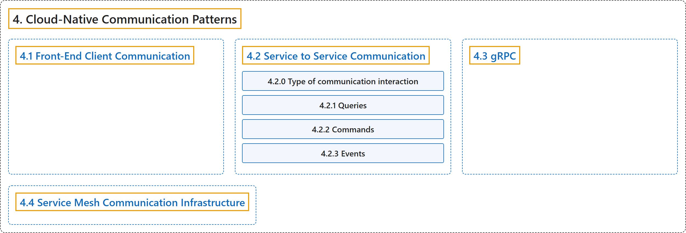

# 4. Cloud-Native Communication Patterns

## Classification

## Glossary

| Term | Definition | 中文翻译 | Source |
|---|---|---|---|
| **4. Cloud-Native Communication Patterns** 云原生通信模式 | "When constructing a cloud-native system, **communication** becomes **a significant design decision**." | 构建云原生系统时，**通信**成为**一项重要的设计决策**。 | [Microsoft, 2022, "Cloud-native communication patterns", para. 1](https://learn.microsoft.com/en-us/dotnet/architecture/cloud-native/communication-patterns#:~:text=When%20constructing%20a%20cloud%2Dnative%20system%2C%20communication) |
| **[4.1 Front-End Client Communication](4-1-front-end-client-communication.md)** 前端客户端通信 | (Definition pending) | （定义待补） | [Microsoft, 2022, "Front-end client communication"](https://learn.microsoft.com/en-us/dotnet/architecture/cloud-native/front-end-communication) |
| **[4.2 Service to Service Communication](4-2-service-to-service-communication.md)** 服务间通信 | "When constructing **a cloud-native application**, you'll want to be sensitive to **how back-end services communicate with each other**." | 构建**云原生应用**时，你需要留意**后端服务之间如何通信**。 | [Microsoft, 2022, "Service-to-service communication", para. 2](https://learn.microsoft.com/en-us/dotnet/architecture/cloud-native/service-to-service-communication#:~:text=When%20constructing%20a%20cloud%2Dnative%20application%2C%20you%27ll) |
| **[4.3 gRPC](4-3-grpc.md)** gRPC | (Definition pending) | （定义待补） | [Microsoft, 2023, "gRPC"](https://learn.microsoft.com/en-us/dotnet/architecture/cloud-native/grpc) |
| **[4.4 Service Mesh Communication Infrastructure](4-4-service-mesh-communication-infrastructure.md)** 服务网格通信基础设施 | (Definition pending) | （定义待补） | [Microsoft, 2023, "Service Mesh communication infrastructure"](https://learn.microsoft.com/en-us/dotnet/architecture/cloud-native/service-mesh-communication-infrastructure) |

## References

Microsoft. (2022, April 6). *Cloud-native communication patterns*. Microsoft Learn. Retrieved November 11, 2026, from <https://learn.microsoft.com/en-us/dotnet/architecture/cloud-native/communication-patterns>

Microsoft. (2022, April 6). *Front-end client communication*. Microsoft Learn. Retrieved November 11, 2026, from <https://learn.microsoft.com/en-us/dotnet/architecture/cloud-native/front-end-communication>

Microsoft. (2023, December 14). *gRPC*. Microsoft Learn. Retrieved November 11, 2026, from <https://learn.microsoft.com/en-us/dotnet/architecture/cloud-native/grpc>

Microsoft. (2023, December 14). *Service Mesh communication infrastructure*. Microsoft Learn. Retrieved November 11, 2026, from <https://learn.microsoft.com/en-us/dotnet/architecture/cloud-native/service-mesh-communication-infrastructure>

Microsoft. (2022, April 6). *Service-to-service communication*. Microsoft Learn. Retrieved November 11, 2026, from <https://learn.microsoft.com/en-us/dotnet/architecture/cloud-native/service-to-service-communication>
