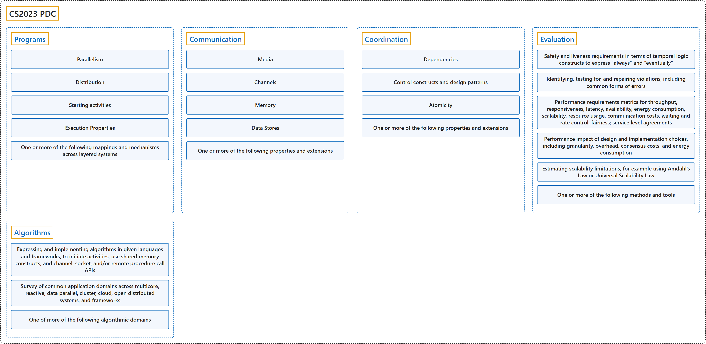

# CS2023 PDC

## Classification

## Glossary

| Term | Definition | 中文翻译 | Source |
|---|---|---|---|
| **CS2023 PDC** CS2023 PDC | "Parallel and distributed programming **arranges, coordinates, and controls multiple computations occurring at the same time across different places**." | 并行与分布式编程**安排、协调并控制在不同地点同时进行的多个计算**。 | [Joint Task Force on Computing Curricula, 2024, PDC "Preamble" section, para. 1](https://csed.acm.org/wp-content/uploads/2024/04/3.1-Body-of-Knowledge-1.pdf#page=155) |
| **[Programs](programs/index.md)** 程序 | (context) "Graphically show (as a **Directed Acyclic Graph (DAG)**) how to **parallelize a compound numerical expression**; for example, a = (b + c) * (d + e)." | （语境）用图形（以**有向无环图**（DAG）的形式）展示如何**并行化一个复合数值表达式**；例如 a = (b + c) * (d + e)。 | [Joint Task Force on Computing Curricula, 2024, PDC-Programs "Illustrative Learning Outcomes", 1](https://csed.acm.org/wp-content/uploads/2024/04/3.1-Body-of-Knowledge-1.pdf#page=158) |
| **[Communication](communication/index.md)** 通信 | (context) "Explain the similarities and differences among: (1) Party A **sends a message on channel X** with contents 1 received by party B (2) A **sets shared variable X to 1**, read by B (3) A sets “X=1’ in a **distributed shared map** accessed by B." | （语境）解释以下三者的异同：（1）A 方**在通道 X 上发送一条消息**，内容为 1，由 B 方接收；（2）A **把共享变量 X 设为 1**，由 B 读取；（3）A 在 B 访问的**分布式共享映射**中设置“X=1”。 | [Joint Task Force on Computing Curricula, 2024, PDC-Communication "Illustrative Learning Outcomes", 1](https://csed.acm.org/wp-content/uploads/2024/04/3.1-Body-of-Knowledge-1.pdf#page=160) |
| **[Coordination](coordination/index.md)** 协调 | (context) "Show how to **avoid or repair a race error** in a given program." | （语境）说明如何在给定程序中**避免或修复竞态错误**。 | [Joint Task Force on Computing Curricula, 2024, PDC-Coordination "Illustrative Learning Outcomes", 1](https://csed.acm.org/wp-content/uploads/2024/04/3.1-Body-of-Knowledge-1.pdf#page=161) |
| **[Evaluation](evaluation/index.md)** 评估 | (context) "Revise a specification to **enable parallelism and distribution** without violating other essential properties or features." | （语境）修改一份规格说明，使其**能够并行和分布式运行**，同时不破坏其他基本性质或特性。 | [Joint Task Force on Computing Curricula, 2024, PDC-Evaluation "Illustrative Learning Outcomes", 1](https://csed.acm.org/wp-content/uploads/2024/04/3.1-Body-of-Knowledge-1.pdf#page=162) |
| **[Algorithms](algorithms/index.md)** 算法 | (context) "Implement a **parallel/distributed component based on a known algorithm**." | （语境）**基于已知算法**实现一个**并行/分布式组件**。 | [Joint Task Force on Computing Curricula, 2024, PDC-Algorithms "Illustrative Learning Outcomes", 1](https://csed.acm.org/wp-content/uploads/2024/04/3.1-Body-of-Knowledge-1.pdf#page=164) |

## References

Joint Task Force on Computing Curricula. (2024). *Computer science curricula 2023*. Association for Computing Machinery. <https://doi.org/10.1145/3664191>
