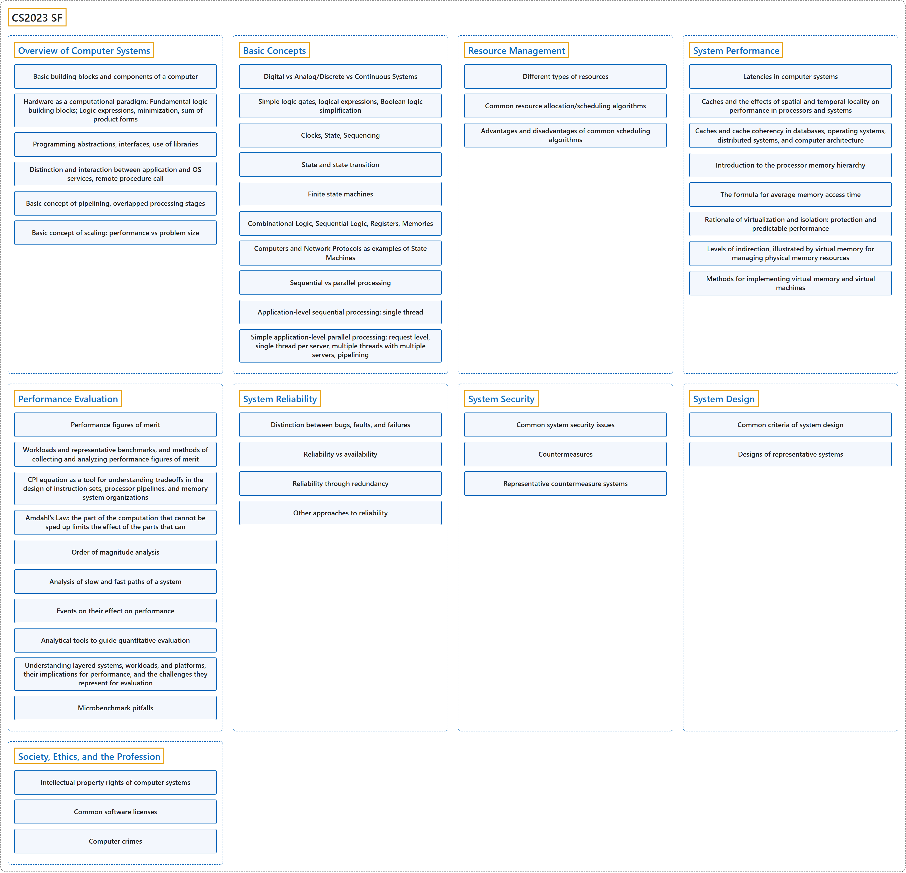

# CS2023 SF

## Classification

## Glossary

| Term | Definition | 中文翻译 | Source |
|---|---|---|---|
| **CS2023 SF** CS2023 SF | "The System Fundamentals knowledge area, as suggested by its name, focuses on the **fundamental concepts and design principles in computer systems** that are shared by these courses within their respective cores." | 顾名思义，系统基础知识领域着重于这些课程在各自核心内容中共有的**计算机系统基本概念和设计原则**。 | [Joint Task Force on Computing Curricula, 2024, SF "Preamble" section, para. 2](https://csed.acm.org/wp-content/uploads/2024/04/3.1-Body-of-Knowledge-1.pdf#page=229) |
| **[Overview of Computer Systems](overview-of-computer-systems/index.md)** 计算机系统概述 | (context) "Describe the **basic building blocks of computers** and their role in the historical development of computer architecture." | （语境）描述**计算机的基本组成部件**及其在计算机体系结构历史发展中的作用。 | [Joint Task Force on Computing Curricula, 2024, SF-Overview "Illustrative Learning Outcomes", 1](https://csed.acm.org/wp-content/uploads/2024/04/3.1-Body-of-Knowledge-1.pdf#page=231) |
| **[Basic Concepts](basic-concepts/index.md)** 基本概念 | (context) "Describe the differences between **digital and analog systems**, and between **discrete and continuous systems**." | （语境）描述**数字系统与模拟系统**之间、**离散系统与连续系统**之间的区别。 | [Joint Task Force on Computing Curricula, 2024, SF-Foundations "Illustrative Learning Outcomes", 1](https://csed.acm.org/wp-content/uploads/2024/04/3.1-Body-of-Knowledge-1.pdf#page=231) |
| **[Resource Management](resource-management/index.md)** 资源管理 | (context) "Define how **finite computer resources** (e.g., processor share, memory, storage, and network bandwidth) are managed by their **careful allocation to existing entities**." | （语境）定义**有限的计算机资源**（例如处理器份额、内存、存储和网络带宽）如何通过**在现有实体之间审慎分配**来加以管理。 | [Joint Task Force on Computing Curricula, 2024, SF-Resource "Illustrative Learning Outcomes", 1](https://csed.acm.org/wp-content/uploads/2024/04/3.1-Body-of-Knowledge-1.pdf#page=232) |
| **[System Performance](system-performance/index.md)** 系统性能 | (context) "Describe the **breakdown of the latency of computer systems** in terms of memory, disk, and network." | （语境）从内存、磁盘和网络的角度描述**计算机系统延迟的构成**。 | [Joint Task Force on Computing Curricula, 2024, SF-Performance "Illustrative Learning Outcomes", 1](https://csed.acm.org/wp-content/uploads/2024/04/3.1-Body-of-Knowledge-1.pdf#page=233) |
| **[Performance Evaluation](performance-evaluation/index.md)** 性能评估 | (context) "Explain how the **components of system architecture contribute to improving its performance**." | （语境）解释**系统体系结构的各个组成部分如何帮助提升其性能**。 | [Joint Task Force on Computing Curricula, 2024, SF-Evaluation "Illustrative Learning Outcomes", 1](https://csed.acm.org/wp-content/uploads/2024/04/3.1-Body-of-Knowledge-1.pdf#page=234) |
| **[System Reliability](system-reliability/index.md)** 系统可靠性 | (context) "Explain the distinction between **program errors, system errors, and hardware faults** (e.g., corrupted memory) and **exceptions** (e.g., attempt to divide by zero)." | （语境）解释**程序错误、系统错误和硬件故障**（例如内存损坏）与**异常**（例如试图除以零）之间的区别。 | [Joint Task Force on Computing Curricula, 2024, SF-Reliability "Illustrative Learning Outcomes", 1](https://csed.acm.org/wp-content/uploads/2024/04/3.1-Body-of-Knowledge-1.pdf#page=234) |
| **[System Security](system-security/index.md)** 系统安全 | (context) "Describe some **common system security issues** and give examples" | （语境）描述一些**常见的系统安全问题**并举例 | [Joint Task Force on Computing Curricula, 2024, SF-Security "Illustrative Learning Outcomes", 1](https://csed.acm.org/wp-content/uploads/2024/04/3.1-Body-of-Knowledge-1.pdf#page=235) |
| **[System Design](system-design/index.md)** 系统设计 | (context) "Describe **common criteria of system design**." | （语境）描述**系统设计的常用准则**。 | [Joint Task Force on Computing Curricula, 2024, SF-Design "Illustrative Learning Outcomes", 1](https://csed.acm.org/wp-content/uploads/2024/04/3.1-Body-of-Knowledge-1.pdf#page=235) |
| **[Society, Ethics, and the Profession](society-ethics-and-the-profession/index.md)** 社会、伦理与职业 | (context) "Describe the **intellectual property rights of computer systems**." | （语境）描述**计算机系统的知识产权**。 | [Joint Task Force on Computing Curricula, 2024, SF-SEP "Illustrative Learning Outcomes", 1](https://csed.acm.org/wp-content/uploads/2024/04/3.1-Body-of-Knowledge-1.pdf#page=236) |

## References

Joint Task Force on Computing Curricula. (2024). *Computer science curricula 2023*. Association for Computing Machinery. <https://doi.org/10.1145/3664191>
