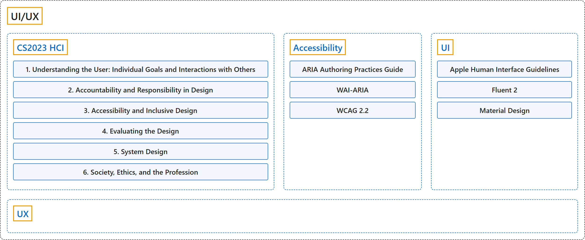

# UI/UX

## Classification

## Glossary

| Term | Definition | 中文翻译 | Source |
|---|---|---|---|
| **UI/UX** 用户界面与用户体验 | (context) "**Human-computer interaction (HCI)** addresses those issues from an **interdisciplinary perspective** that includes computer science, psychology, business strategy, and design principles." | （语境）**人机交互（HCI）**从**跨学科视角**处理这些问题，这一视角包括计算机科学、心理学、商业策略和设计原则。 | [Joint Task Force on Computing Curricula, 2024, p. 111](https://csed.acm.org/wp-content/uploads/2024/04/3.1-Body-of-Knowledge-1.pdf#page=111) |
| **[CS2023 HCI](cs2023/index.md)** CS2023 人机交互 | "Each user is different and, from the perspective of HCI, the **design of every system that interacts with people** should **anticipate and respect that diversity**." | 每个用户都不同；从人机交互的角度看，**每个与人交互的系统的设计**都应当**预见并尊重这种多样性**。 | [Joint Task Force on Computing Curricula, 2024, p. 111](https://csed.acm.org/wp-content/uploads/2024/04/3.1-Body-of-Knowledge-1.pdf#page=111) |
| **Accessibility** 无障碍 | "The domain of **web accessibility** defines how to make **web content usable by persons with disabilities**." | **网络无障碍**领域界定如何让**残障人士能够使用网络内容**。 | [World Wide Web Consortium, 2023](https://www.w3.org/TR/wai-aria-1.2/) |
| **Email clients** 邮件客户端 | (Definition pending) | （定义待补） | [Microsoft, n.d., "Mail in Outlook.com"](https://support.microsoft.com/en-us/outlook/mail-in-outlook-com) |
| **UI** 用户界面 | "the way in which the **information on a computer, phone, etc. and instructions on how to use it** are **arranged on the screen and shown to the user**" | **计算机、手机等设备上的信息及其使用说明**，在**屏幕上排列并展示给用户**的方式 | [Cambridge University Press & Assessment, n.d., "user interface" noun](https://dictionary.cambridge.org/dictionary/english/user-interface) |
| **[UX](ux/index.md)** 用户体验 | Pending | 待写 | Pending |

## References

Cambridge University Press & Assessment. (n.d.). User interface. In *Cambridge Dictionary*. Retrieved November 2, 2026, from <https://dictionary.cambridge.org/dictionary/english/user-interface>

Joint Task Force on Computing Curricula. (2024). *Computer science curricula 2023*. Association for Computing Machinery. <https://doi.org/10.1145/3664191>

Microsoft. (n.d.). *Mail in Outlook.com*. Microsoft Support. Retrieved November 8, 2026, from <https://support.microsoft.com/en-us/outlook/mail-in-outlook-com>

World Wide Web Consortium. (2023, June 6). *Accessible Rich Internet Applications (WAI-ARIA) 1.2* (W3C Recommendation). <https://www.w3.org/TR/wai-aria-1.2/>
