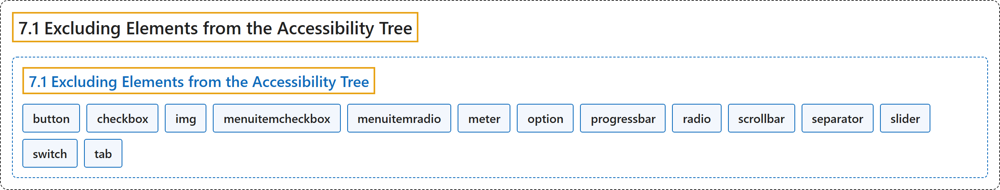

# 7.1 Excluding Elements from the Accessibility Tree

## Classification

## Glossary

| Term | Definition | 中文翻译 | Source |
|---|---|---|---|
| **7.1 Excluding Elements from the Accessibility Tree** 从无障碍树中排除元素 | "The following elements are **not exposed via the accessibility API** and user agents MUST NOT include them in the accessibility tree:" | 下列元素**不通过无障碍 API 公开**，用户代理不得把它们包含在无障碍树中： | [World Wide Web Consortium, 2023, section 7.1](https://www.w3.org/TR/wai-aria-1.2/) |
| **button** 按钮 | "An input that allows for **user-triggered actions** when **clicked or pressed**." | 一种输入，在**点击或按下**时允许**用户触发动作**。 | [World Wide Web Consortium, 2023, section 5.4, button](https://www.w3.org/TR/wai-aria-1.2/#button) |
| **checkbox** 复选框 | "A **checkable input** that has **three possible values: true, false, or mixed**." | 一种**可勾选的输入**，有**三个可能的值：true、false 或 mixed**。 | [World Wide Web Consortium, 2023, section 5.4, checkbox](https://www.w3.org/TR/wai-aria-1.2/#checkbox) |
| **img** 图像 | "A container for a **collection of elements that form an image**." | 一个容器，装着**构成一幅图像的一组元素**。 | [World Wide Web Consortium, 2023, section 5.4, img](https://www.w3.org/TR/wai-aria-1.2/#img) |
| **menuitemcheckbox** 复选菜单项 | "A menuitem with a **checkable state** whose possible values are **true, false, or mixed**." | 带有**可勾选状态**的菜单项，可能的值为 **true、false 或 mixed**。 | [World Wide Web Consortium, 2023, section 5.4, menuitemcheckbox](https://www.w3.org/TR/wai-aria-1.2/#menuitemcheckbox) |
| **menuitemradio** 单选菜单项 | "A **checkable menuitem** in a set of elements with the same role, **only one of which can be checked at a time**." | 同一角色的一组元素中的**可勾选菜单项**，**同一时间只能选中其中一个**。 | [World Wide Web Consortium, 2023, section 5.4, menuitemradio](https://www.w3.org/TR/wai-aria-1.2/#menuitemradio) |
| **meter** 计量器 | "An element that represents a **scalar measurement within a known range**, or a fractional value." | 表示**已知范围内的标量测量值**或分数值的元素。 | [World Wide Web Consortium, 2023, section 5.4, meter](https://www.w3.org/TR/wai-aria-1.2/#meter) |
| **option** 选项 | "A **selectable item in a listbox**." | **列表框中可选择的项目**。 | [World Wide Web Consortium, 2023, section 5.4, option](https://www.w3.org/TR/wai-aria-1.2/#option) |
| **progressbar** 进度条 | "An element that **displays the progress status** for tasks that take a long time." | 为耗时较长的任务**显示进度状态**的元素。 | [World Wide Web Consortium, 2023, section 5.4, progressbar](https://www.w3.org/TR/wai-aria-1.2/#progressbar) |
| **radio** 单选按钮 | "A **checkable input** in a group of elements with the same role, **only one of which can be checked at a time**." | 同一角色的一组元素中的**可勾选输入**，**同一时间只能选中其中一个**。 | [World Wide Web Consortium, 2023, section 5.4, radio](https://www.w3.org/TR/wai-aria-1.2/#radio) |
| **scrollbar** 滚动条 | "A graphical object that **controls the scrolling of content within a viewing area**, regardless of whether the content is fully displayed within the viewing area." | **控制内容在可视区域内滚动**的图形对象，无论内容是否完整显示在可视区域内。 | [World Wide Web Consortium, 2023, section 5.4, scrollbar](https://www.w3.org/TR/wai-aria-1.2/#scrollbar) |
| **separator** 分隔符 | "A divider that **separates and distinguishes sections of content or groups of menuitems**." | 一种分隔线，**分开并区分内容的各节或菜单项的各组**。 | [World Wide Web Consortium, 2023, section 5.4, separator](https://www.w3.org/TR/wai-aria-1.2/#separator) |
| **slider** 滑块 | "An input where the user **selects a value from within a given range**." | 一种输入，用户**从给定范围内选择一个值**。 | [World Wide Web Consortium, 2023, section 5.4, slider](https://www.w3.org/TR/wai-aria-1.2/#slider) |
| **switch** 开关 | "A type of checkbox that represents **on/off values**, as opposed to checked/unchecked values." | 一种复选框，表示**开/关值**，而不是选中/未选中值。 | [World Wide Web Consortium, 2023, section 5.4, switch](https://www.w3.org/TR/wai-aria-1.2/#switch) |
| **tab** 标签页 | "A **grouping label** providing a mechanism for **selecting the tab content** that is to be rendered to the user." | 一种**分组标签**，提供**选择标签页内容**的机制，所选内容将呈现给用户。 | [World Wide Web Consortium, 2023, section 5.4, tab](https://www.w3.org/TR/wai-aria-1.2/#tab) |

## References

World Wide Web Consortium. (2023, June 6). *Accessible Rich Internet Applications (WAI-ARIA) 1.2* (W3C Recommendation). <https://www.w3.org/TR/wai-aria-1.2/>
