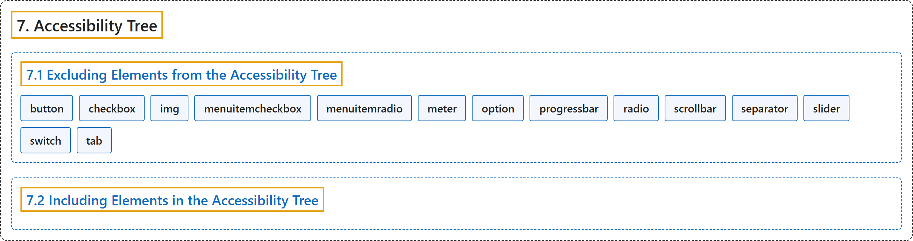

# 7. Accessibility Tree

## Classification

## Glossary

| Term | Definition | 中文翻译 | Source |
|---|---|---|---|
| **7. Accessibility Tree** 无障碍树 | "The **accessibility tree** and the **DOM tree** are **parallel structures**." | **无障碍树**和 **DOM 树**是**平行的结构**。 | [World Wide Web Consortium, 2023, section 7](https://www.w3.org/TR/wai-aria-1.2/) |
| **[7.1 Excluding Elements from the Accessibility Tree](excluding-elements-from-the-accessibility-tree.md)** 从无障碍树中排除元素 | "The following elements are **not exposed via the accessibility API** and user agents MUST NOT include them in the accessibility tree:" | 下列元素**不通过无障碍 API 公开**，用户代理不得把它们包含在无障碍树中： | [World Wide Web Consortium, 2023, section 7.1](https://www.w3.org/TR/wai-aria-1.2/) |
| **[7.2 Including Elements in the Accessibility Tree](including-elements-in-the-accessibility-tree.md)** 将元素纳入无障碍树 | (context) "If not excluded from or marked as hidden in the accessibility tree per the rules above in Excluding Elements in the Accessibility Tree, user agents MUST **provide an accessible object in the accessibility tree** for DOM elements that meet any of the following criteria:" | （语境）如果没有按上文“从无障碍树中排除元素”的规则被排除或标记为隐藏，用户代理必须为满足下列任一条件的 DOM 元素**在无障碍树中提供可访问对象**： | [World Wide Web Consortium, 2023, section 7.2](https://www.w3.org/TR/wai-aria-1.2/) |

## References

World Wide Web Consortium. (2023, June 6). *Accessible Rich Internet Applications (WAI-ARIA) 1.2* (W3C Recommendation). <https://www.w3.org/TR/wai-aria-1.2/>
