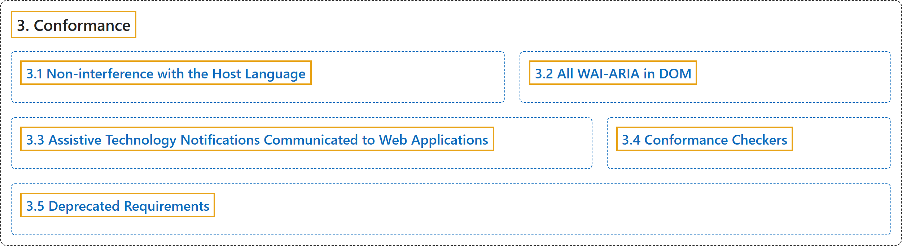

# 3. Conformance

## Classification

## Glossary

| Term | Definition | 中文翻译 | Source |
|---|---|---|---|
| **3. Conformance** 一致性 | (context) "The main content of Accessible Rich Internet Applications is **normative** and defines **requirements that impact conformance claims**." | （语境）Accessible Rich Internet Applications 的主要内容是**规范性的**，并规定**影响一致性声明的要求**。 | [World Wide Web Consortium, 2023, section 3](https://www.w3.org/TR/wai-aria-1.2/) |
| **[3.1 Non-interference with the Host Language](non-interference-with-the-host-language.md)** 不干扰宿主语言 | "WAI-ARIA processing by the user agent MUST NOT **interfere with the normal operation of the built-in features of the host language**." | 用户代理对 WAI-ARIA 的处理不得**干扰宿主语言内置特性的正常运作**。 | [World Wide Web Consortium, 2023, section 3.1](https://www.w3.org/TR/wai-aria-1.2/) |
| **[3.2 All WAI-ARIA in DOM](all-wai-aria-in-dom.md)** DOM 中的所有 WAI-ARIA | "A conforming user agent which implements a document object model that does not conform to the W3C DOM specification MUST **include the content attribute for role and its WAI-ARIA role values, as well as the WAI-ARIA States and Properties in the DOM** as specified by the author, even though processing may affect how the elements are exposed to accessibility APIs." | 实现了不符合 W3C DOM 规范的文档对象模型的符合规范的用户代理，必须按作者的指定**把 role 内容属性及其 WAI-ARIA 角色值，以及 WAI-ARIA 状态和属性包含在 DOM 中**，即使处理可能影响元素向无障碍 API 公开的方式。 | [World Wide Web Consortium, 2023, section 3.2](https://www.w3.org/TR/wai-aria-1.2/) |
| **[3.3 Assistive Technology Notifications Communicated to Web Applications](assistive-technology-notifications-communicated-to-web-applications.md)** 传达给 Web 应用的辅助技术通知 | "Assistive technologies, such as speech recognition systems and alternate input devices for users with mobility impairments, require the ability to **control a web application in a device-independent way**." | 辅助技术（例如语音识别系统和供行动障碍用户使用的替代输入设备）需要能够**以与设备无关的方式控制 Web 应用**。 | [World Wide Web Consortium, 2023, section 3.3](https://www.w3.org/TR/wai-aria-1.2/) |
| **[3.4 Conformance Checkers](conformance-checkers.md)** 一致性检查器 | "Any application or script verifying document conformance or validity SHOULD **include a test for all of the normative author requirements** in this specification." | 任何验证文档一致性或有效性的应用或脚本，都应**包含对本规范中所有规范性作者要求的测试**。 | [World Wide Web Consortium, 2023, section 3.4](https://www.w3.org/TR/wai-aria-1.2/) |
| **[3.5 Deprecated Requirements](deprecated-requirements.md)** 已弃用的要求 | "In this case, the older feature is **marked as** "**deprecated**"." | 在这种情况下，较旧的特性被**标记为**“**已弃用**”。 | [World Wide Web Consortium, 2023, section 3.5](https://www.w3.org/TR/wai-aria-1.2/) |

## References

World Wide Web Consortium. (2023, June 6). *Accessible Rich Internet Applications (WAI-ARIA) 1.2* (W3C Recommendation). <https://www.w3.org/TR/wai-aria-1.2/>
