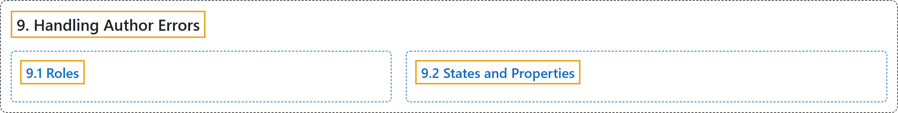

# 9. Handling Author Errors

## Classification

## Glossary

| Term | Definition | 中文翻译 | Source |
|---|---|---|---|
| **9. Handling Author Errors** 处理作者错误 | (context) "User agents are expected to **perform validation** of WAI-ARIA roles." | （语境）用户代理应当对 WAI-ARIA 角色**进行验证**。 | [World Wide Web Consortium, 2023, section 9](https://www.w3.org/TR/wai-aria-1.2/) |
| **[9.1 Roles](roles.md)** 角色 | "If the role attribute contains **no tokens matching the name of a non-abstract WAI-ARIA role**, the user agent MUST **treat the element as if no role had been provided**." | 如果 role 属性**不含与任何非抽象 WAI-ARIA 角色名匹配的令牌**，用户代理必须**把该元素当作没有提供角色来处理**。 | [World Wide Web Consortium, 2023, section 9.1](https://www.w3.org/TR/wai-aria-1.2/) |
| **[9.2 States and Properties](states-and-properties.md)** 状态和属性 | "In general, user agents **do not do much validation of WAI-ARIA properties**." | 一般来说，用户代理**不对 WAI-ARIA 属性做太多验证**。 | [World Wide Web Consortium, 2023, section 9.2](https://www.w3.org/TR/wai-aria-1.2/) |

## References

World Wide Web Consortium. (2023, June 6). *Accessible Rich Internet Applications (WAI-ARIA) 1.2* (W3C Recommendation). <https://www.w3.org/TR/wai-aria-1.2/>
