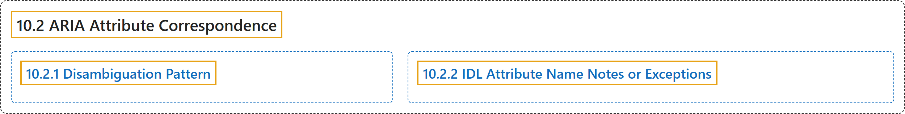

# 10.2 ARIA Attribute Correspondence

## Classification

## Glossary

| Term | Definition | 中文翻译 | Source |
|---|---|---|---|
| **10.2 ARIA Attribute Correspondence** ARIA 属性对应关系 | "The following table provides a **correspondence between IDL attribute names and content attribute names**, for use by ARIAMixin." | 下表提供 **IDL 属性名与内容属性名之间的对应关系**，供 ARIAMixin 使用。 | [World Wide Web Consortium, 2023, section 10.2](https://www.w3.org/TR/wai-aria-1.2/) |
| **[10.2.1 Disambiguation Pattern](disambiguation-pattern.md)** 消歧模式 | "Any attribute name referencing concepts that are combinations of two or more words (such as "described by") becomes a **camel-cased IDL attribute capitalizing each word boundary**." | 任何引用由两个或更多词组合而成的概念（如“described by”）的属性名，都变成**在每个词边界大写的驼峰式 IDL 属性**。 | [World Wide Web Consortium, 2023, section 10.2.1](https://www.w3.org/TR/wai-aria-1.2/) |
| **[10.2.2 IDL Attribute Name Notes or Exceptions](idl-attribute-name-notes-or-exceptions.md)** IDL 属性名说明或例外 | (context) "Any **notes or exceptions for specific attribute names** will be listed here." | （语境）任何**针对特定属性名的说明或例外**都会列在这里。 | [World Wide Web Consortium, 2023, section 10.2.2](https://www.w3.org/TR/wai-aria-1.2/) |

## References

World Wide Web Consortium. (2023, June 6). *Accessible Rich Internet Applications (WAI-ARIA) 1.2* (W3C Recommendation). <https://www.w3.org/TR/wai-aria-1.2/>
