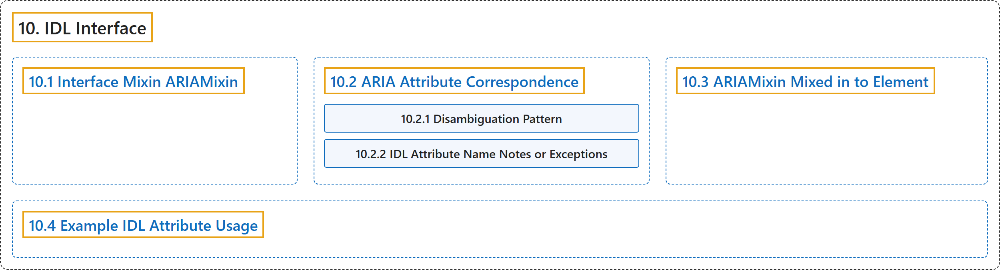

# 10. IDL Interface

## Classification

## Glossary

| Term | Definition | 中文翻译 | Source |
|---|---|---|---|
| **10. IDL Interface** IDL 接口 | (context) "Conforming user agents MUST **implement the following IDL interface**." | （语境）符合规范的用户代理必须**实现下列 IDL 接口**。 | [World Wide Web Consortium, 2023, section 10](https://www.w3.org/TR/wai-aria-1.2/) |
| **[10.1 Interface Mixin ARIAMixin](interface-mixin-ariamixin.md)** 接口混入 ARIAMixin | (context) "**ARIAMixin getter steps**, which take the host interface instance, IDL attribute name, and content attribute name, and must **return a string value**; and" | （语境）**ARIAMixin 取值步骤**，接收宿主接口实例、IDL 属性名和内容属性名，并且必须**返回一个字符串值**；以及 | [World Wide Web Consortium, 2023, section 10.1](https://www.w3.org/TR/wai-aria-1.2/) |
| **[10.2 ARIA Attribute Correspondence](aria-attribute-correspondence/index.md)** ARIA 属性对应关系 | "The following table provides a **correspondence between IDL attribute names and content attribute names**, for use by ARIAMixin." | 下表提供 **IDL 属性名与内容属性名之间的对应关系**，供 ARIAMixin 使用。 | [World Wide Web Consortium, 2023, section 10.2](https://www.w3.org/TR/wai-aria-1.2/) |
| **[10.3 ARIAMixin Mixed in to Element](ariamixin-mixed-in-to-element.md)** 混入 Element 的 ARIAMixin | (context) "User agents MUST **include ARIAMixin on Element**:" | （语境）用户代理必须**在 Element 上包含 ARIAMixin**： | [World Wide Web Consortium, 2023, section 10.3](https://www.w3.org/TR/wai-aria-1.2/) |
| **[10.4 Example IDL Attribute Usage](example-idl-attribute-usage.md)** IDL 属性用法示例 | "The primary purpose of ARIA IDL attribute reflection is to **ease JavaScript-based manipulation of values**." | ARIA IDL 属性反射的主要目的是**简化基于 JavaScript 的值操作**。 | [World Wide Web Consortium, 2023, section 10.4](https://www.w3.org/TR/wai-aria-1.2/) |

## References

World Wide Web Consortium. (2023, June 6). *Accessible Rich Internet Applications (WAI-ARIA) 1.2* (W3C Recommendation). <https://www.w3.org/TR/wai-aria-1.2/>
