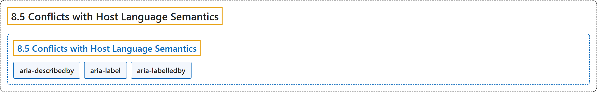

# 8.5 Conflicts with Host Language Semantics

## Classification

## Glossary

| Term | Definition | 中文翻译 | Source |
|---|---|---|---|
| **8.5 Conflicts with Host Language Semantics** 与宿主语言语义的冲突 | "WAI-ARIA roles, states, and properties are intended to **add semantic information when native host language elements with these semantics are not available**, and are generally used on elements that have no native semantics of their own." | WAI-ARIA 角色、状态和属性旨在**当没有具备这些语义的原生宿主语言元素时添加语义信息**，通常用在本身没有原生语义的元素上。 | [World Wide Web Consortium, 2023, section 8.5](https://www.w3.org/TR/wai-aria-1.2/) |
| **aria-describedby** 描述来源 | "Identifies the element (or elements) that **describes the object**." | 标识**描述该对象**的元素。 | [World Wide Web Consortium, 2023, section 6.7, aria-describedby](https://www.w3.org/TR/wai-aria-1.2/#aria-describedby) |
| **aria-label** 标签 | "Defines a **string value that labels the current element**." | 定义**标注当前元素的字符串值**。 | [World Wide Web Consortium, 2023, section 6.7, aria-label](https://www.w3.org/TR/wai-aria-1.2/#aria-label) |
| **aria-labelledby** 标签来源 | "Identifies the element (or elements) that **labels the current element**." | 标识**标注当前元素**的元素。 | [World Wide Web Consortium, 2023, section 6.7, aria-labelledby](https://www.w3.org/TR/wai-aria-1.2/#aria-labelledby) |

## References

World Wide Web Consortium. (2023, June 6). *Accessible Rich Internet Applications (WAI-ARIA) 1.2* (W3C Recommendation). <https://www.w3.org/TR/wai-aria-1.2/>
