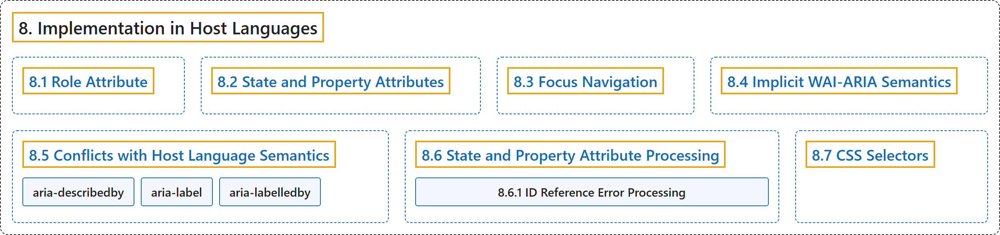

# 8. Implementation in Host Languages

## Classification

## Glossary

| Term | Definition | 中文翻译 | Source |
|---|---|---|---|
| **8. Implementation in Host Languages** 在宿主语言中的实现 | (context) "This section discusses **how host languages are to implement WAI-ARIA**, to ensure that the markup specified here will **integrate smoothly and effectively** with the host language markup." | （语境）本节讨论**宿主语言应如何实现 WAI-ARIA**，以确保这里规定的标记能与宿主语言的标记**顺畅而有效地集成**。 | [World Wide Web Consortium, 2023, section 8](https://www.w3.org/TR/wai-aria-1.2/) |
| **[8.1 Role Attribute](role-attribute.md)** role 属性 | (context) "The attribute name MUST be **role**; The attribute value MUST allow a **token list** as the value;" | （语境）属性名必须是 **role**；属性值必须允许**令牌列表**作为值； | [World Wide Web Consortium, 2023, section 8.1](https://www.w3.org/TR/wai-aria-1.2/) |
| **[8.2 State and Property Attributes](state-and-property-attributes.md)** 状态和属性的 attribute | (context) "The attribute name is the **name of any state or property** identified in the Supported States and Properties section, such as aria-busy, aria-selected, aria-activedescendant, aria-valuetext;" | （语境）属性名是“支持的状态和属性”一节中标识的**任何状态或属性的名称**，例如 aria-busy、aria-selected、aria-activedescendant、aria-valuetext； | [World Wide Web Consortium, 2023, section 8.2](https://www.w3.org/TR/wai-aria-1.2/) |
| **[8.3 Focus Navigation](focus-navigation.md)** 焦点导航 | "An implementing host language MUST provide support for the author to **make all interactive elements focusable**, that is, any renderable or event-receiving elements." | 实现方宿主语言必须支持作者**使所有交互元素可聚焦**，即任何可呈现或接收事件的元素。 | [World Wide Web Consortium, 2023, section 8.3](https://www.w3.org/TR/wai-aria-1.2/) |
| **[8.4 Implicit WAI-ARIA Semantics](implicit-wai-aria-semantics.md)** 隐式 WAI-ARIA 语义 | "These host language features can be viewed as having "**implicit WAI-ARIA semantics**"." | 这些宿主语言特性可以视为具有“**隐式 WAI-ARIA 语义**”。 | [World Wide Web Consortium, 2023, section 8.4](https://www.w3.org/TR/wai-aria-1.2/) |
| **[8.5 Conflicts with Host Language Semantics](conflicts-with-host-language-semantics.md)** 与宿主语言语义的冲突 | "WAI-ARIA roles, states, and properties are intended to **add semantic information when native host language elements with these semantics are not available**, and are generally used on elements that have no native semantics of their own." | WAI-ARIA 角色、状态和属性旨在**当没有具备这些语义的原生宿主语言元素时添加语义信息**，通常用在本身没有原生语义的元素上。 | [World Wide Web Consortium, 2023, section 8.5](https://www.w3.org/TR/wai-aria-1.2/) |
| **[8.6 State and Property Attribute Processing](state-and-property-attribute-processing/index.md)** 状态和属性的处理 | "State and property attributes are included in host languages, and therefore **syntax for representation of their value types is governed by the host language**." | 状态和属性的 attribute 包含在宿主语言中，因此**其值类型的表示语法由宿主语言决定**。 | [World Wide Web Consortium, 2023, section 8.6](https://www.w3.org/TR/wai-aria-1.2/) |
| **[8.7 CSS Selectors](css-selectors.md)** CSS 选择器 | "Support for attribute selectors MUST **include WAI-ARIA attributes**." | 对属性选择器的支持必须**包括 WAI-ARIA 属性**。 | [World Wide Web Consortium, 2023, section 8.7](https://www.w3.org/TR/wai-aria-1.2/) |

## References

World Wide Web Consortium. (2023, June 6). *Accessible Rich Internet Applications (WAI-ARIA) 1.2* (W3C Recommendation). <https://www.w3.org/TR/wai-aria-1.2/>
