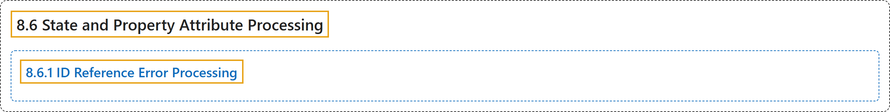

# 8.6 State and Property Attribute Processing

## Classification

## Glossary

| Term | Definition | 中文翻译 | Source |
|---|---|---|---|
| **8.6 State and Property Attribute Processing** 状态和属性的处理 | "State and property attributes are included in host languages, and therefore **syntax for representation of their value types is governed by the host language**." | 状态和属性的 attribute 包含在宿主语言中，因此**其值类型的表示语法由宿主语言决定**。 | [World Wide Web Consortium, 2023, section 8.6](https://www.w3.org/TR/wai-aria-1.2/) |
| **[8.6.1 ID Reference Error Processing](id-reference-error-processing.md)** ID 引用错误处理 | "User agents SHOULD **ignore ID references that do not match the ID of another element** in the same document." | 用户代理应**忽略与同一文档中其他元素的 ID 不匹配的 ID 引用**。 | [World Wide Web Consortium, 2023, section 8.6.1](https://www.w3.org/TR/wai-aria-1.2/) |

## References

World Wide Web Consortium. (2023, June 6). *Accessible Rich Internet Applications (WAI-ARIA) 1.2* (W3C Recommendation). <https://www.w3.org/TR/wai-aria-1.2/>
