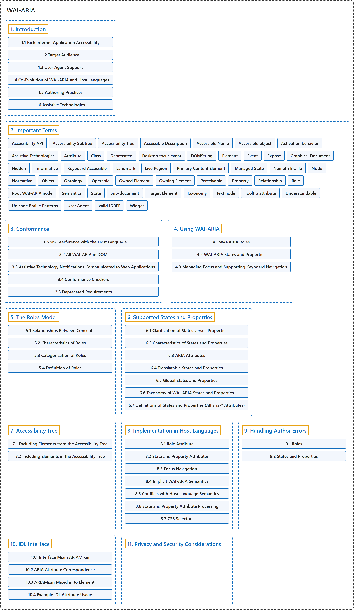

# WAI-ARIA

## Classification

## Glossary

| Term | Definition | 中文翻译 | Source |
|---|---|---|---|
| **Accessible Rich Internet Applications (WAI-ARIA)** 无障碍富互联网应用 | "This specification provides an **ontology of roles, states, and properties** that **define accessible user interface elements** and can be used to improve the accessibility and interoperability of web content and applications." | 本规范提供一套**角色、状态和属性的本体**，它们**定义无障碍的用户界面元素**，并可用于提升网络内容和应用的无障碍性与互操作性。 | [World Wide Web Consortium, 2023, Abstract](https://www.w3.org/TR/wai-aria-1.2/) |
| **Web Accessibility Initiative (WAI)** 网络无障碍倡议 | "WAI develops **strategies, standards, and resources** to **make the web accessible**" | WAI 制定**策略、标准和资源**，以**让网络变得无障碍**。 | [W3C Web Accessibility Initiative, n.d., "W3C WAI"](https://www.w3.org/WAI/about/#:~:text=WAI%20develops%20strategies) |
| **[1. Introduction](introduction/index.md)** 引言 | "WAI-ARIA is a **technical specification** that provides a **framework to improve the accessibility and interoperability** of web content and applications." | WAI-ARIA 是一份**技术规范**，它提供一个**提升无障碍性和互操作性的框架**，面向网络内容和应用。 | [World Wide Web Consortium, 2023, section 1](https://www.w3.org/TR/wai-aria-1.2/) |
| **[2. Important Terms](important-terms.md)** 重要术语 | (context) "While some terms are defined in place, the following **definitions** are **used throughout this document**." | （语境）虽然有些术语就地定义，但下列**定义**，**在整份文档中通用**。 | [World Wide Web Consortium, 2023, section 2](https://www.w3.org/TR/wai-aria-1.2/) |
| **[3. Conformance](conformance/index.md)** 一致性 | (context) "The main content of Accessible Rich Internet Applications is **normative** and defines **requirements that impact conformance claims**." | （语境）Accessible Rich Internet Applications 的主要内容是**规范性的**，并规定**影响一致性声明的要求**。 | [World Wide Web Consortium, 2023, section 3](https://www.w3.org/TR/wai-aria-1.2/) |
| **[4. Using WAI-ARIA](using-wai-aria/index.md)** 使用 WAI-ARIA | "WAI-ARIA divides the semantics into **roles** (the type defining a user interface element) and **states and properties** supported by the roles." | WAI-ARIA 把语义分为**角色**（定义用户界面元素的类型），以及角色所支持的**状态和属性**。 | [World Wide Web Consortium, 2023, section 4](https://www.w3.org/TR/wai-aria-1.2/) |
| **[5. The Roles Model](the-roles-model/index.md)** 角色模型 | "This section **defines WAI-ARIA roles** and describes their **characteristics and properties**." | 本节**定义 WAI-ARIA 角色**，并描述它们的**特征和属性**。 | [World Wide Web Consortium, 2023, section 5](https://www.w3.org/TR/wai-aria-1.2/) |
| **[6. Supported States and Properties](supported-states-and-properties/index.md)** 支持的状态和属性 | "Both provide **specific information about an object**, and both form part of the **definition of the nature of roles**." | 两者都提供**关于对象的具体信息**，也都是**角色性质定义**的一部分。 | [World Wide Web Consortium, 2023, section 6](https://www.w3.org/TR/wai-aria-1.2/) |
| **[7. Accessibility Tree](accessibility-tree/index.md)** 无障碍树 | "The **accessibility tree** and the **DOM tree** are **parallel structures**." | **无障碍树**和 **DOM 树**是**平行的结构**。 | [World Wide Web Consortium, 2023, section 7](https://www.w3.org/TR/wai-aria-1.2/) |
| **[8. Implementation in Host Languages](implementation-in-host-languages/index.md)** 在宿主语言中的实现 | (context) "This section discusses **how host languages are to implement WAI-ARIA**, to ensure that the markup specified here will **integrate smoothly and effectively** with the host language markup." | （语境）本节讨论**宿主语言应如何实现 WAI-ARIA**，以确保这里规定的标记能与宿主语言的标记**顺畅而有效地集成**。 | [World Wide Web Consortium, 2023, section 8](https://www.w3.org/TR/wai-aria-1.2/) |
| **[9. Handling Author Errors](handling-author-errors/index.md)** 处理作者错误 | (context) "User agents are expected to **perform validation** of WAI-ARIA roles." | （语境）用户代理应当对 WAI-ARIA 角色**进行验证**。 | [World Wide Web Consortium, 2023, section 9](https://www.w3.org/TR/wai-aria-1.2/) |
| **[10. IDL Interface](idl-interface/index.md)** IDL 接口 | (context) "Conforming user agents MUST **implement the following IDL interface**." | （语境）符合规范的用户代理必须**实现下列 IDL 接口**。 | [World Wide Web Consortium, 2023, section 10](https://www.w3.org/TR/wai-aria-1.2/) |
| **[11. Privacy and Security Considerations](privacy-and-security-considerations.md)** 隐私与安全考虑 | (context) "This specification introduces **no new security considerations**." | （语境）本规范**没有引入新的安全考虑**。 | [World Wide Web Consortium, 2023, section 11](https://www.w3.org/TR/wai-aria-1.2/) |

## References

W3C Web Accessibility Initiative. (n.d.). *About W3C WAI*. Retrieved November 9, 2026, from <https://www.w3.org/WAI/about/>

World Wide Web Consortium. (2023, June 6). *Accessible Rich Internet Applications (WAI-ARIA) 1.2* (W3C Recommendation). <https://www.w3.org/TR/wai-aria-1.2/>
