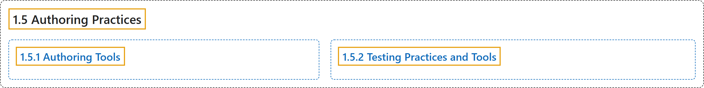

# 1.5 Authoring Practices

## Classification

## Glossary

| Term | Definition | 中文翻译 | Source |
|---|---|---|---|
| **1.5 Authoring Practices** 编写实践 | (context) "Many of the requirements in the definitions of WAI-ARIA roles, states, and properties can be **checked automatically during the development process**, similar to other quality control processes used for validating code." | （语境）WAI-ARIA 角色、状态和属性定义中的许多要求可以**在开发过程中自动检查**，类似于用于验证代码的其他质量控制过程。 | [World Wide Web Consortium, 2023, section 1.5](https://www.w3.org/TR/wai-aria-1.2/) |
| **[1.5.1 Authoring Tools](authoring-tools.md)** 编写工具 | "To assist authors who are creating custom widgets, **authoring tools may compare widget roles, states, and properties** to those supported in WAI-ARIA as well as those supported in related and cross-referenced roles, states, and properties." | 为了帮助创建自定义控件的作者，**编写工具可以把控件的角色、状态和属性**与 WAI-ARIA 支持的，以及相关和交叉引用的角色、状态和属性所支持的进行比较。 | [World Wide Web Consortium, 2023, section 1.5.1](https://www.w3.org/TR/wai-aria-1.2/) |
| **[1.5.2 Testing Practices and Tools](testing-practices-and-tools.md)** 测试实践与工具 | "The accessibility of interactive content **cannot be confirmed by static checks alone**." | 交互内容的无障碍性**不能仅靠静态检查来确认**。 | [World Wide Web Consortium, 2023, section 1.5.2](https://www.w3.org/TR/wai-aria-1.2/) |

## References

World Wide Web Consortium. (2023, June 6). *Accessible Rich Internet Applications (WAI-ARIA) 1.2* (W3C Recommendation). <https://www.w3.org/TR/wai-aria-1.2/>
