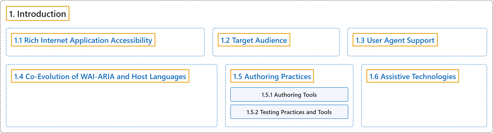

# 1. Introduction

## Classification

## Glossary

| Term | Definition | 中文翻译 | Source |
|---|---|---|---|
| **1. Introduction** 引言 | "WAI-ARIA is a **technical specification** that provides a **framework to improve the accessibility and interoperability** of web content and applications." | WAI-ARIA 是一份**技术规范**，它提供一个**提升无障碍性和互操作性的框架**，面向网络内容和应用。 | [World Wide Web Consortium, 2023, section 1](https://www.w3.org/TR/wai-aria-1.2/) |
| **[1.1 Rich Internet Application Accessibility](rich-internet-application-accessibility.md)** 富互联网应用无障碍 | "The incorporation of WAI-ARIA is a way for an author to **provide proper semantics for custom widgets** to make these widgets **accessible, usable, and interoperable with assistive technologies**." | 引入 WAI-ARIA 是作者**为自定义控件提供恰当语义**的一种方式，使这些控件**无障碍、可用，并能与辅助技术互操作**。 | [World Wide Web Consortium, 2023, section 1.1](https://www.w3.org/TR/wai-aria-1.2/) |
| **[1.2 Target Audience](target-audience.md)** 目标读者 | "This specification defines the **basic model for WAI-ARIA**, including **roles, states, properties, and values**." | 本规范定义 **WAI-ARIA 的基本模型**，包括**角色、状态、属性和值**。 | [World Wide Web Consortium, 2023, section 1.2](https://www.w3.org/TR/wai-aria-1.2/) |
| **[1.3 User Agent Support](user-agent-support.md)** 用户代理支持 | "Mainstream user agents use WAI-ARIA to **alter how host language features are exposed to accessibility APIs** in order to improve accessibility." | 主流用户代理用 WAI-ARIA 来**改变宿主语言特性向无障碍 API 公开的方式**，以提升无障碍性。 | [World Wide Web Consortium, 2023, section 1.3](https://www.w3.org/TR/wai-aria-1.2/) |
| **[1.4 Co-Evolution of WAI-ARIA and Host Languages](co-evolution-of-wai-aria-and-host-languages.md)** WAI-ARIA 与宿主语言的共同演进 | "WAI-ARIA is intended to **augment semantics in supporting languages** like [HTML] and [SVG2], or to be used as an **accessibility enhancement technology** in other markup-based languages that do not explicitly include support for ARIA." | WAI-ARIA 旨在**增强 [HTML] 和 [SVG2] 等支持语言中的语义**，或在其他未明确支持 ARIA 的标记语言中用作**无障碍增强技术**。 | [World Wide Web Consortium, 2023, section 1.4](https://www.w3.org/TR/wai-aria-1.2/) |
| **[1.5 Authoring Practices](authoring-practices/index.md)** 编写实践 | (context) "Many of the requirements in the definitions of WAI-ARIA roles, states, and properties can be **checked automatically during the development process**, similar to other quality control processes used for validating code." | （语境）WAI-ARIA 角色、状态和属性定义中的许多要求可以**在开发过程中自动检查**，类似于用于验证代码的其他质量控制过程。 | [World Wide Web Consortium, 2023, section 1.5](https://www.w3.org/TR/wai-aria-1.2/) |
| **[1.6 Assistive Technologies](assistive-technologies.md)** 辅助技术 | "**Programmatic access to accessibility semantics** is **essential for assistive technologies**." | **对无障碍语义的程序化访问**对**辅助技术至关重要**。 | [World Wide Web Consortium, 2023, section 1.6](https://www.w3.org/TR/wai-aria-1.2/) |

## References

World Wide Web Consortium. (2023, June 6). *Accessible Rich Internet Applications (WAI-ARIA) 1.2* (W3C Recommendation). <https://www.w3.org/TR/wai-aria-1.2/>
