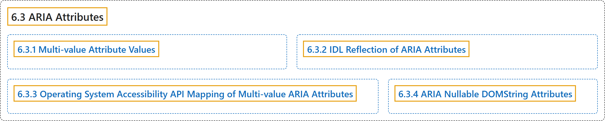

# 6.3 ARIA Attributes

## Classification

## Glossary

| Term | Definition | 中文翻译 | Source |
|---|---|---|---|
| **6.3 ARIA Attributes** ARIA 属性 | (context) "When the ARIA attribute definition includes a table listing the attribute's allowed values, that attribute is a **multi-value nullable attribute**." | （语境）当 ARIA 属性的定义包含列出该属性允许值的表格时，该属性就是**多值可空属性**。 | [World Wide Web Consortium, 2023, section 6.3](https://www.w3.org/TR/wai-aria-1.2/) |
| **[6.3.1 Multi-value Attribute Values](multi-value-attribute-values.md)** 多值属性的值 | "Each value in the table is a **keyword for the attribute**, mapping to a **state of the same name**." | 表中的每个值都是**该属性的关键字**，映射到**同名的状态**。 | [World Wide Web Consortium, 2023, section 6.3.1](https://www.w3.org/TR/wai-aria-1.2/) |
| **[6.3.2 IDL Reflection of ARIA Attributes](idl-reflection-of-aria-attributes.md)** ARIA 属性的 IDL 反射 | "All ARIA attributes **reflect in IDL as nullable DOMString attributes**." | 所有 ARIA 属性**在 IDL 中都反射为可空的 DOMString 属性**。 | [World Wide Web Consortium, 2023, section 6.3.2](https://www.w3.org/TR/wai-aria-1.2/) |
| **[6.3.3 Operating System Accessibility API Mapping of Multi-value ARIA Attributes](operating-system-accessibility-api-mapping-of-multi-value-aria-attributes.md)** 多值 ARIA 属性的操作系统无障碍 API 映射 | "Unlike IDL reflection, operating system accessibility API mappings of ARIA attributes **can have defaults**." | 与 IDL 反射不同，ARIA 属性的操作系统无障碍 API 映射**可以有默认值**。 | [World Wide Web Consortium, 2023, section 6.3.3](https://www.w3.org/TR/wai-aria-1.2/) |
| **[6.3.4 ARIA Nullable DOMString Attributes](aria-nullable-domstring-attributes.md)** ARIA 可为空的 DOMString 属性 | "As noted in A. Mapping WAI-ARIA Value types to languages, attributes are included in host languages, and the **syntax for representation of WAI-ARIA types is governed by the host language**." | 如附录 A 所述，属性包含在宿主语言中，**WAI-ARIA 类型的表示语法由宿主语言决定**。 | [World Wide Web Consortium, 2023, section 6.3.4](https://www.w3.org/TR/wai-aria-1.2/) |

## References

World Wide Web Consortium. (2023, June 6). *Accessible Rich Internet Applications (WAI-ARIA) 1.2* (W3C Recommendation). <https://www.w3.org/TR/wai-aria-1.2/>
