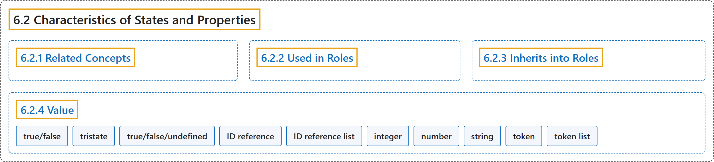

# 6.2 Characteristics of States and Properties

## Classification

## Glossary

| Term | Definition | 中文翻译 | Source |
|---|---|---|---|
| **6.2 Characteristics of States and Properties** 状态和属性的特征 | (context) "States and properties have the **characteristics described in the following sections**." | （语境）状态和属性具有**下列各节所描述的特征**。 | [World Wide Web Consortium, 2023, section 6.2](https://www.w3.org/TR/wai-aria-1.2/) |
| **[6.2.1 Related Concepts](related-concepts.md)** 相关概念 | "Advisory information about **features from this or other languages that correspond to this state or property**." | 关于**本语言或其他语言中与此状态或属性对应的特性**的建议性信息。 | [World Wide Web Consortium, 2023, section 6.2.1](https://www.w3.org/TR/wai-aria-1.2/) |
| **[6.2.2 Used in Roles](used-in-roles.md)** 用于角色 | "Advisory information about **roles that use this state or property**." | 关于**使用此状态或属性的角色**的建议性信息。 | [World Wide Web Consortium, 2023, section 6.2.2](https://www.w3.org/TR/wai-aria-1.2/) |
| **[6.2.3 Inherits into Roles](inherits-into-roles.md)** 继承到角色 | "Advisory information about **roles that inherit the state or property from an ancestor role**." | 关于**从祖先角色继承此状态或属性的角色**的建议性信息。 | [World Wide Web Consortium, 2023, section 6.2.3](https://www.w3.org/TR/wai-aria-1.2/) |
| **[6.2.4 Value](value.md)** 值 | "**Value type** of the state or property." | 状态或属性的**值类型**。 | [World Wide Web Consortium, 2023, section 6.2.4](https://www.w3.org/TR/wai-aria-1.2/) |

## References

World Wide Web Consortium. (2023, June 6). *Accessible Rich Internet Applications (WAI-ARIA) 1.2* (W3C Recommendation). <https://www.w3.org/TR/wai-aria-1.2/>
