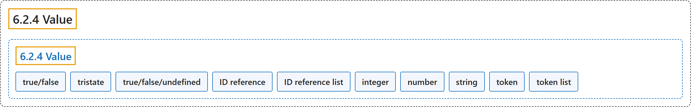

# 6.2.4 Value

## Classification

## Glossary

| Term | Definition | 中文翻译 | Source |
|---|---|---|---|
| **6.2.4 Value** 值 | "**Value type** of the state or property." | 状态或属性的**值类型**。 | [World Wide Web Consortium, 2023, section 6.2.4](https://www.w3.org/TR/wai-aria-1.2/) |
| **true/false** 真/假 | "Value representing **either true or false**." | 表示**真或假**的值。 | [World Wide Web Consortium, 2023, section 6.2.4](https://www.w3.org/TR/wai-aria-1.2/) |
| **tristate** 三态 | "Value representing **true, false, mixed, or undefined** values." | 表示 **true、false、mixed 或 undefined** 的值。 | [World Wide Web Consortium, 2023, section 6.2.4](https://www.w3.org/TR/wai-aria-1.2/) |
| **true/false/undefined** 真/假/未定义 | "Value representing **true, false, or undefined** (not applicable)." | 表示 **true、false 或 undefined**（不适用）的值。 | [World Wide Web Consortium, 2023, section 6.2.4](https://www.w3.org/TR/wai-aria-1.2/) |
| **ID reference** ID 引用 | "**Reference to the ID of another element** in the same document" | **对同一文档中另一元素 ID 的引用** | [World Wide Web Consortium, 2023, section 6.2.4](https://www.w3.org/TR/wai-aria-1.2/) |
| **ID reference list** ID 引用列表 | "A **list of one or more ID references**." | **一个或多个 ID 引用的列表**。 | [World Wide Web Consortium, 2023, section 6.2.4](https://www.w3.org/TR/wai-aria-1.2/) |
| **integer** 整数 | "A numerical value **without a fractional component**." | **没有小数部分**的数值。 | [World Wide Web Consortium, 2023, section 6.2.4](https://www.w3.org/TR/wai-aria-1.2/) |
| **number** 数 | "**Any real numerical value**." | **任何实数值**。 | [World Wide Web Consortium, 2023, section 6.2.4](https://www.w3.org/TR/wai-aria-1.2/) |
| **string** 字符串 | "**Unconstrained value type**." | **不受约束的值类型**。 | [World Wide Web Consortium, 2023, section 6.2.4](https://www.w3.org/TR/wai-aria-1.2/) |
| **token** 令牌 | "**One of a limited set of allowed values**." | **有限的一组允许值之一**。 | [World Wide Web Consortium, 2023, section 6.2.4](https://www.w3.org/TR/wai-aria-1.2/) |
| **token list** 令牌列表 | "A **list of one or more tokens**." | **一个或多个令牌的列表**。 | [World Wide Web Consortium, 2023, section 6.2.4](https://www.w3.org/TR/wai-aria-1.2/) |

## References

World Wide Web Consortium. (2023, June 6). *Accessible Rich Internet Applications (WAI-ARIA) 1.2* (W3C Recommendation). <https://www.w3.org/TR/wai-aria-1.2/>
